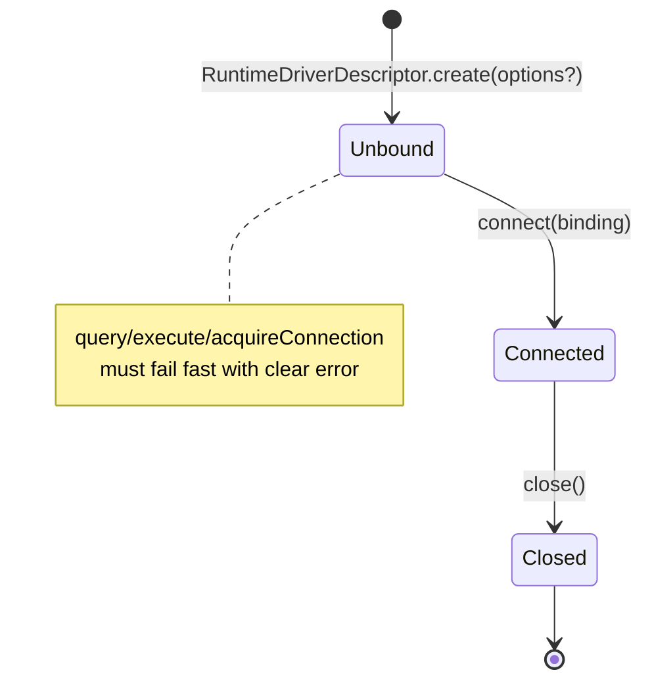
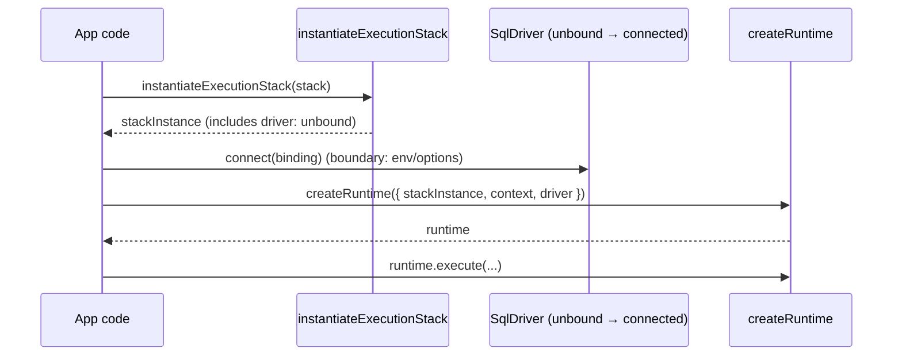

# ADR 159 — Runtime Driver Lifecycle (Instantiation vs Binding vs Connection)

**Status:** Implemented  
**Date:** 2026-02-15  
**Domain:** Runtime, Drivers  

## TL;DR

- A runtime driver instance has two relevant states:
  - **Unbound**: created, configured, but not wired to any transport yet
  - **Connected**: bound to a driver-determined “binding” (pool/client/url/http/etc), and now executable
- `RuntimeDriverDescriptor.create(options?)` **creates the driver instance** (no env access; no connection/binding)
- `SqlDriver.connect(binding)` **binds the driver instance** to its transport configuration
- After `connect(...)`, call sites can use `query/execute/acquireConnection`.
- Before `connect(...)`, use fails fast with a clear error.
- `acquireConnection()` returns a connection handle. **`connect()` does not “return a connection.”**

## Context

Runtime drivers previously required connection-ish configuration at instantiation time. `RuntimeDriverDescriptor.create(options)` accepted connection data (e.g. Postgres pool/client), which made stack instantiation environment-bound and prevented `instantiateExecutionStack()` from producing a “complete” stack instance.

We need a clear lifecycle that:

- keeps **stack instantiation deterministic and env-free**, and
- pushes **environment/runtime configuration** (e.g. `DATABASE_URL`) to the boundary where it exists.

## Problem

The term “driver” was overloaded and the lifecycle was unclear:

- People assumed a driver instance implied an underlying connected library instance (e.g. `pg`).
- Call sites had to construct drivers “late”, outside the execution stack, which diverged from the descriptor/instance pattern used for targets/adapters/extensions.
- The API shape conflated “create a driver object” with “bind it to a transport”.

## Definitions (non-negotiable vocabulary)

- **Driver**: A Prisma Next runtime interface that implements execution behavior (e.g. `SqlDriver`). It is **not** the underlying library object (e.g. `pg.Pool`).
- **Binding**: Driver-determined data that wires a driver to a transport/configuration. Examples:
  - Postgres: `{ kind: 'url' | 'pgPool' | 'pgClient', ... }`
  - Future: `{ kind: 'http', endpoint, headers }`, `{ kind: 'memory' }`
- **Connect**: A method on the driver instance (`connect(binding)`) that transitions the driver from **unbound → connected** by storing/initializing whatever it needs to execute.
- **Connection**: A handle returned by `acquireConnection()` for operations that require a dedicated connection (e.g. transactions). This is separate from “binding”.

## Decision

### Responsibilities and boundary

| Step | Owner | Input | Output | Env allowed? |
|------|-------|-------|--------|--------------|
| Instantiate stack | `instantiateExecutionStack(stack)` | descriptors | instances incl. **unbound driver** | No |
| Bind/Connect | boundary (e.g. `postgres().runtime()`) | binding derived from options/env | driver becomes **connected** | Yes |
| Create runtime | `createRuntime(...)` | connected driver + stack instance + context | runtime object | Yes |
| Execute | runtime + driver | plans/queries | results | Yes |

### Lifecycle state model



### Sequencing (happy path)



### Interface changes (what to memorize)

- `RuntimeDriverDescriptor.create(options?: TCreateOptions)`:
  - options are **driver-specific** and must be **non-connection**
  - returns an **unbound** driver instance
- `SqlDriver.connect(binding: TBinding)`:
  - binding is **driver-determined**
  - after connect, driver is executable (and may lazily allocate resources as needed)
- `RuntimeDriverDescriptor.create(options?, sessionSettings?)`:
  - `sessionSettings` come from the stack's target; the driver ensures them on every connection it hands out
- `ExecutionStackInstance.driver`:
  - stack instantiation includes the driver instance so the stack is “complete” and deterministic

### A target's session settings

A target may need every database session to have certain settings. PostgreSQL's date and time codecs read ISO 8601 text, so they need `DateStyle=ISO`, and its `money` codec reads the text PostgreSQL prints under the `C` locale, so it needs `lc_monetary=C`. The target states this as data, `sessionSettings` on its descriptor:

```ts
sessionSettings: { DateStyle: 'ISO', lc_monetary: 'C' }
```

The stack hands the settings to the driver. `createExecutionStack` calls `RuntimeDriverDescriptor.create(options, sessionSettings)`, and `createControlStack` passes them in the control driver's connect options. The driver ensures every connection it hands to the runtime has them, whatever its binding. How it does so is the driver's choice. The PostgreSQL driver sends them as startup options on connections it opens. On a pool or client the user supplies, it applies them with a statement before first use, and again after an exclusively held connection is released, because the holder may have reset the session.

A codec never sets a session setting. If a connection does not have the setting, for example because a pooler dropped it, the codec refuses the value it cannot read and names the setting.

### How to pass driver create options when stack instantiation calls `create()` with no args

Because `instantiateExecutionStack(...)` calls `descriptor.create()` with no driver options, the supported pattern is to **curry options into the descriptor** (i.e. wrap `create()`). The wrapper passes on the session settings the stack hands it:

```ts
const driverWithCursor = {
  ...postgresDriverDescriptor,
  create(_options, sessionSettings) {
    return postgresDriverDescriptor.create({ cursor }, sessionSettings);
  },
};
```

This preserves the invariant that stack instantiation is env-free while still allowing driver-specific configuration at create time.

**DX note:** This descriptor-wrapping pattern is intentionally treated as a **temporary compromise**. It solves the immediate goal of TML-1837 (decoupling instantiation from binding), but it is not ideal ergonomics for callers. We intend to introduce a more explicit, first-class way to provide driver create options (while keeping stack instantiation deterministic and env-free) in a follow-up effort, and are deferring that improvement for now.

## Consequences

- ✅ Stack instantiation is deterministic and env-free (descriptors → instances, including driver).
- ✅ Binding is explicitly a boundary concern (env/options live there).
- ✅ “Driver” terminology is unambiguous: interface object ≠ underlying library object.
- ⚠️ Create-time driver options must be passed by descriptor wrapping (or via a future helper API); this needs to be documented wherever drivers are configured.

## Worked example (Postgres lazy client)

At the boundary (e.g. `postgres().runtime()`), we:

1. instantiate the execution stack (includes unbound driver),
2. resolve binding from options/env,
3. call `driver.connect(binding)`,
4. call `createRuntime(...)`.

## References

- [ADR 152 — Execution Plane Descriptors and Instances](./ADR%20152%20-%20Execution%20Plane%20Descriptors%20and%20Instances.md)
- TML-1837 spec: `agent-os/specs/2026-02-15-runtime-dx-decouple-runtime-driver-instantiation-from-connection-binding/spec.md`
- [Runtime & Middleware Framework](../subsystems/4.%20Runtime%20&%20Middleware%20Framework.md)
