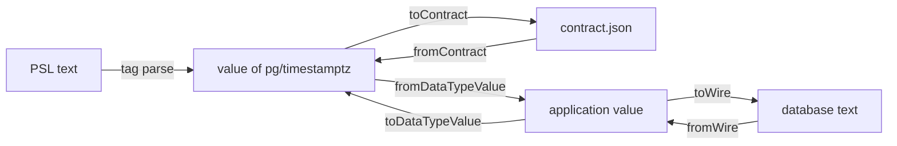

# ADR 254 — Data types and casts

Status: **Accepted.** Implemented for the Postgres, SQLite and MongoDB targets and their extensions. Amended 2026-10-20: a type-constructor argument that is a value names a data type and is admitted by the cast rule (see "Columns and type constructors"). Amended 2026-10-22: MongoDB values are written and cast as SQL values are, and enum members and discriminator values are read by one framework function in both families (see "Enum members and discriminator values"). Amended by [ADR 279](ADR%20279%20-%20Convenience%20types%20choose%20an%20explicit%20type%20from%20their%20arguments.md) on 2026-10-22: a type constructor still names one codec, and a second kind of type declaration, a type choice, resolves to a type constructor from its arguments, so a column always stores the codec and parameters of a type constructor. Amended 2026-10-27: the Postgres target sets `lc_monetary=C` so `money` reads exactly (see "Money").

## At a glance

A Postgres model with two defaults:

```prisma
model Event {
  id        Int      @id
  attendees BigInt   @default(42)
  startsAt  DateTime @default(timestamptz`2024-01-01T01:00:00+01:00`)
}
```

Follow the `startsAt` default from the schema to the database:

| Where | The value | Who owns this form |
| --- | --- | --- |
| PSL | `` timestamptz`2024-01-01T01:00:00+01:00` `` | the data type `pg/timestamptz`, through its tag |
| In the framework | `{ type: 'pg/timestamptz', params: {}, value: '2024-01-01T00:00:00Z' }` | the data type |
| `contract.json` | `"2024-01-01T00:00:00Z"` | the data type |
| In the application | a `Temporal.Instant` with codec `pg/timestamptz-temporal@1`, a `Date` with `pg/timestamptz-date@1` | the column's codec |
| On the wire and in the `DEFAULT` clause | `2024-01-01T00:00:00Z` from the `Temporal` codec, `2024-01-01T00:00:00.000Z` from the `Date` codec; PostgreSQL prints it back as `2024-01-01 00:00:00+00` | the column's codec |



The data type owns the value: it reads it from PSL, decides its one stored form, and is the only thing that constructs it. The codec converts that value into what the application holds and into what the database exchanges. Three codecs of `pg/timestamptz` give three different application values from one stored value, so choosing a codec never changes the contract.

The `attendees` default shows the other half of the decision. The written `42` is a value of `pg/int2`, the narrowest Postgres integer type that holds it. The column's type is `pg/int8`, which declares that it takes `pg/int2` values, and its cast turns the number `42` into the digit text `"42"` that `pg/int8` stores. `pg/int4` declares no cast from `pg/int8`, so `100000000000000099` on an `Int` column is refused before any codec sees it, with a message that says what to write instead.

## Decision

1. **A data type is the type of a value Prisma stores or passes to the database.** Most are database types made first-class: `pg/int8`, `pg/jsonb`, `sqlite/integer`, `postgis/geometry`. The target or extension that owns the database type registers it. A data type owns its name in DDL, its parameters, its values and its casts.
2. **A data type owns its values.** It reads them from PSL, defines the one form `contract.json` stores, and is the only thing that constructs one. Nothing else reads or normalises a stored value.
3. **A codec converts a value of one data type** to and from the value an application holds, and that value to and from the wire. Several codecs may represent one type, and they differ only in the value the application holds. A codec defines no value of its own.
4. **A written value is admitted where its type is the receiving type, or where the receiving type casts from it.** A cast is declared by the type that receives the value.

## Why

Each of these problems comes from a value that has no type of its own, or from a fact about a type that lives somewhere other than the type.

- A written number read through a JavaScript number is rounded before anything can check it: `100000000000000099` becomes `100000000000000100`, and `1.50` loses its trailing zero.
- A JSON default written as a quoted string, `Jsonb @default("{}")`, is a string, not a document, and `contract infer` cannot print one back.
- The `8` in `@default(8)` and the `8` in a database function's argument, such as `gen_random_bytes(8)` in a `sql` default, are the same thing: a written value handed to a position that expects a particular type. Without types they are checked by unrelated code. So is the `8` in `nanoid(8)`, which sizes a generator that runs in the client: it is a value of the target's integer type, read by the same rule, and the function then checks its own limit.
- When a codec stands in for the database type, the facts about that type, such as its DDL name, its parameters and how `numeric(10,2)` is written, are spread across codecs and rendering hooks. Two codecs of one database type, `pg/int8@1` and `pg/int8number@1`, cannot say they are the same type, and each can store the same value in a different form.
- When both a codec and its type can define how a value is stored, one value gets two texts. On SQLite a datetime default would be `2024-01-01T00:00:00Z` in the contract and `2024-01-01T00:00:00.000Z` in every row, and every tool that compares them needs code to make them equal.

One entity, the data type, owning its values and declaring what it takes, answers all of these.

## Values

A value of a data type is a `DataTypeValue`, `{ type, params, value }`. `value` is the JSON form `contract.json` stores:

| Data type | Stored form |
| --- | --- |
| `pg/int4` | a JSON number |
| `pg/int8`, `pg/numeric` | digit text, so no digit is lost |
| `pg/jsonb`, `pg/json` | the document |
| `pg/timestamptz` | ISO text in UTC |
| `pg/bytea` | base64 |
| `pgvector/vector` | an array of numbers |

A type declares two functions for its values. `read(json, params)` accepts every spelling of a value the type holds and refuses anything else: a value of another kind, and a value the parameters exclude (`numeric(10,2)` refuses `"1.234"`, `vector(3)` refuses four numbers, `pg/int4` refuses an integer outside its range, and `pg/char` with no length refuses a second character, because a bare `character` is `character(1)`). `spell(json, params)` gives an accepted value its one spelling. A type whose values have only one spelling declares no `spell`, and its `read` refuses any other spelling.

A value has one spelling. Where the database normalises how a value is written, the stored spelling is the database's: `pg/uuid` stores lower case, `pg/int8` and `pg/numeric` store digit text without leading zeros or a minus sign on zero, `pg/inet` stores an address as PostgreSQL prints it, `pg/char` stores its text without the padding PostgreSQL adds, and a `numeric(10,2)` value stores two fraction digits, `"1.50"`. Every date and time type stores ISO 8601 text as "Date and time types" describes; `pg/bytea` and `sqlite/blob` store base64 with zero padding bits, PostGIS geometry stores upper-case little-endian hex, and a Mongo ObjectId stores lower-case hex.

Only the type constructs a value, in two ways. `fromContract(json, params)` reads a stored value: it reads and spells `json`, and refuses it unless it is already in the stored spelling, naming that spelling. `valueFrom(json, params)` builds every other value, from a codec, a written default or a cast: it reads and spells `json` under the parameters, so a type with a `spell` rewrites any spelling it accepts, and `1.5` on a `numeric(10,2)` column becomes `"1.50"` and `1.234` is refused rather than rounded. `toContract(value)` gives the JSON to store. Two values are equal when their types are equal, their parameters are equal, and their JSON is equal as canonical JSON. A codec, including one from outside the repository, therefore cannot store a value differently from the other codecs of its type: whatever spelling it hands over, the type writes the one it stores.

Every path into a value goes through its type. A tag's `parse` reads PSL text, the number classifier reads digits, and a cast turns a value of one type into a value of another; each result is built by its type through `valueFrom`, under the parameters of the position that receives it. A value that does not hold exactly in the receiving type is refused, never rounded: a `pgvector/vector` element must be a number PostgreSQL's `real` holds exactly, so `0.123456789` is refused with the value PostgreSQL would store.


## Codecs

A codec's descriptor names the data type it represents and nothing about the database type itself:

```ts
export class PgInt8NumberDescriptor extends PostgresCodecDescriptor<void> {
  override readonly dataType = pgInt8.id;
  override readonly codecId = PG_INT8_NUMBER_CODEC_ID;
  // traits, the JSON projection and the factory follow
}
```

A codec has four methods:

| Method | From | To | Used when | Runs |
| --- | --- | --- | --- | --- |
| `fromDataTypeValue` | value | application value | building a contract, planning, verifying | synchronously |
| `toDataTypeValue` | application value | value | the same | synchronously |
| `fromWire` | wire value | application value | reading a row, or a default the database reports | asynchronously |
| `toWire` | application value | wire value | writing a parameter, or a default into DDL | asynchronously |

A codec is built with its descriptor, its data type and the column's parameters of that type, and `toDataTypeValue` ends with `dataTypeValueOf(json)`, which calls `DataType.valueFrom` with those parameters. A Mongo codec is the same: its `toDataTypeValue` returns a `DataTypeValue`. The wire value is what the driver exchanges with the database, and it is not always text: a Postgres `bytea` codec writes a `Uint8Array`, a SQLite integer codec reads a number, a Mongo codec writes a BSON value. `fromWire` and `toWire` take the per-call context of [ADR 207](ADR%20207%20-%20Codec%20call%20context%20per-query%20AbortSignal%20and%20column%20metadata.md) and are asynchronous as [ADR 204](ADR%20204%20-%20Single-Path%20Async%20Codec%20Runtime.md) describes. A codec never reads `contract.json` and never sees PSL text.

Codecs of one type differ only in the application value. `pg/int8@1` holds a `bigint` and `pg/int8number@1` a `number`; `pg/timestamptz-date@1`, `pg/timestamptz-temporal@1` and `pg/timestamptz-string@1` hold a `Date`, a `Temporal.Instant` and text. A codec refuses in `fromDataTypeValue` a value its application value cannot hold exactly: `pg/int8number@1` refuses digit text past 2^53, and the `Temporal` and `Date` codecs refuse `infinity`, which only the text codecs hold. The `Date` codecs also refuse digits below a millisecond, which the text and `Temporal` codecs hold. A limit one target's storage has belongs to that target's codec: SQLite cannot store `NaN`, so `sqlite/real@1`, and `sql/float@1` as SQLite adapts it, refuse it in `toWire` and in both value methods, and the SQLite driver refuses a `NaN` parameter no codec encoded, such as one in raw SQL.

A limit of the type itself is the type's, as "Values" describes. A codec checks only parameters it keeps for itself: `arktype/json@1` validates the document against its schema in `fromDataTypeValue` and `fromWire`.

An enum compares values with its members: `db.enums` holds each member as `fromDataTypeValue` gives it, which equals what a query returns for it. So every enum authoring surface, in TypeScript and PSL and in both families, refuses a codec whose descriptor does not declare the `equality` trait. A codec that declares it but whose values cannot be compared as members sets `enumRefusal` on its descriptor, naming the reason and what to use instead. On Postgres these are `pg/bytea@1`, whose base64 stored form PostgreSQL reads as the bytes of that text; `pg/jsonb@1` and `arktype/json@1`, because a CHECK lists a string member as text PostgreSQL reads as JSON and a number member as a number it cannot compare with `jsonb`; `pg/enum@1`, which types a native enum's column, so the reason says to declare a native enum; `pg/vector@1`, whose members are arrays no CHECK can list; and `pg/geometry@1`, which is refused until a test can prove a shape reads back as its member. A codec without the trait may set `enumRefusal` to replace the generic reason with a specific one: `pg/json@1` says its type has no equality operator and to use a text enum, and `pg/tsquery@1` says PostgreSQL normalises query text. `pg/tsquery@1` declares no `equality` although PostgreSQL has `tsquery = tsquery`, because comparing queries means nothing to an application and no contract can write a `tsquery` column. Every surface reads both rules through `enumRefusalOf`. Every surface checks `enumRefusalOf` first, so a codec's own reason wins. Two more checks then refuse an enum that `enumRefusalOf` accepts, because the family's storage check cannot enforce its members: the SQL family's CHECK builder refuses a member whose stored form is neither a string nor a finite number, such as a `pg/bool@1` or `pg/text-array@1` member, and on MongoDB, both TypeScript and PSL refuse an enum on a managed collection whose codec stores a BSON type that a collection validator cannot list, such as `long`, `date` or `objectId`. A test per target puts every registered codec in exactly one of these groups or proves that its member reads back.

An enum member written in PSL is a written value, read by the cast rule as a default is: its syntax gives it a data type, the enum codec's data type takes it directly or through a cast, and the codec checks it. A quoted member is text, so a member of a type with no cast from text is written in that type's own syntax: `Half = 0.5` on `pg/numeric@1`, `` Launch = date`2024-01-01` `` on `pg/date-temporal@1`, and `Nan = NaN` on a float codec. A bare member is its name, as text. A member written as a list, such as `Up = [0, 1]` on a vector codec, is read through the list cast of the codec's data type. Both families read members this way, as "Enum members and discriminator values" describes, so the same member gets the same code and wording on SQL and on MongoDB. A member written in TypeScript is an application value, which the codec writes as any value it is given.

A value is a member when the enum data type's equality holds it equal to one. Most types have one stored form for each value, so equal values have equal stored forms. A type whose equal values have more than one stored form declares `equalityKey`, a key two stored forms share exactly when they are equal: `pg/numeric` and `mongo/decimal128` keep the scale a value was written with, so `0.50` and `0.5` are one value, and `db.enums` finds `0.50` as the member `0.5`; `pg/interval` keys a value by its total microseconds, counting a month as 30 days and a day as 24 hours, as PostgreSQL compares intervals, so `P1D` and `PT24H` are one value. The CHECK lists each member's stored form as an untyped literal, which PostgreSQL reads as the column's type, so it compares by the same equality. Two members with one key are refused as duplicates. A codec whose application value keeps the form a value was written in, so a read can return a form that no member's literal names, declares `keepsWrittenForm: true` on its descriptor; `pg/numeric@1`, `pg/interval@1` and `mongo/decimal128@1` do. Such a codec renders no member literal, and its codec type map entry carries the same flag. Both type paths read that one declaration: the emitted `contract.d.ts` types the enum's members as the codec's output type because the codec renders no literal, and a `defineContract` contract does so because `EnumMemberValueType` reads the flag from the codec type map. So a column typed by the enum keeps the codec's type and `db.enums.<Enum>.has()` does not narrow a read to one member. For every other codec, members are typed as their literals and the column as their union. A test per target checks that only a codec whose data type declares `equalityKey` sets the flag, and that every flagged codec renders no literal.

The codec conformance test kits assert, for every codec and every case, that `toDataTypeValue(fromDataTypeValue(v))` equals `v`; and, against a real database, that `fromWire` of the row `toWire` wrote equals the case's application value, and that `fromWire` of the column's JSON projection equals `fromWire` of the row.

## Casts

For each other type whose values a type takes, it declares a cast: a pure function from a value of that type to a value of this one.

- A cast may convert. `pg/int2` to `pg/int8` turns a number into digit text; `pg/numeric` to `pg/float8` turns decimal text into a number, and keeps the words `NaN`, `Infinity` and `-Infinity` as the text the floating-point types store.
- A cast may return the value unchanged. `pg/json` to `pg/jsonb` does, because `jsonb` takes what `json` takes. The declaration is the point: this type takes those values.
- A cast may refuse. The cast into the floating-point types refuses a magnitude no double holds rather than rounding it to `Infinity`, because the database refuses it too and a stored `Infinity` would make a written number look like a written `Infinity`.
- On MongoDB, `mongo/int64` takes `mongo/int32`; `mongo/decimal128` takes `mongo/int32` and `mongo/int64`; `mongo/double` takes all three, keeping `NaN` and the infinities as text and refusing a magnitude no double holds; `mongo/objectid` takes `mongo/string` when the text is 24 hexadecimal digits; and `mongo/vector` takes a list of `mongo/int32`, `mongo/int64`, `mongo/decimal128` and `mongo/double` values, refusing an element that is not finite.
- A cast never parses text into a value of another kind. A date, a time, an interval, bytes and a JSON document each have their own grammar, so each is written with its type's tag, and a quoted string on such a column is refused with a message that shows the tag. Types whose values are text, such as `pg/varchar`, `pg/char`, `pg/inet`, `pg/uuid` and `mongo/objectid` (24 hexadecimal digits), cast from the text type.

Casts are declared by the type that receives, never by the source, so there is at most one cast for any pair, and the owner of a type is the only one who decides what it takes. That ownership rule is PostgreSQL's for its own cast table, and the rule is all that is borrowed: these casts are between data types, applied in the framework before a value is stored or sent, and they say nothing about what the database can convert. Nothing central computes convertibility, because only a type's owner knows what its database or extension takes.

There is no list data type. A written list is several values, each cast on its own, and a list column is a column of one type with `many` set, checked element by element. A type whose single value holds several elements, such as a vector, declares a cast whose source is a list of other types, and each element is checked against that set.

## How PSL writes a value

The component that registers a data type contributes its PSL support, keyed by the type's id:

```ts
authoring: {
  dataTypes: {
    [pgJson.id]: {
      written: { kind: 'tag', tag: 'json', parse: parseJsonText },
      print: printJsonText,
      documentation: 'Reads the text as a JSON document and stores it as the default value.',
    },
    [pgText.id]: {
      written: { kind: 'plain', syntax: 'string', parse: (text) => text },
      print: (value) => String(value),
      documentation: 'Text.',
    },
    [pgNumeric.id]: {
      written: {
        kind: 'plain',
        syntax: 'number',
        types: [pgInt2.id, pgInt4.id, pgInt8.id, pgNumeric.id],
        classify: classifyPostgresNumber,
      },
      print: printNumber,
      documentation: 'A number, whose type comes from its own size and precision.',
    },
  },
}
```

`parse` turns the written text into a value of the type and refuses text it cannot read; `print` writes a value back. A value is written in one of two ways.

**With a tag**, for a value whose text has its own grammar: a JSON document, a date or time, an interval, bytes. A tag is a qualified name followed by a string in any of PSL's quote styles; the body between the quotes is canonicalised into text as [ADR 129](ADR%20129%20-%20Template-Tagged%20Literals%20for%20Extensions.md) describes. A tag is unprefixed when its data type is owned by the family or a target, and every other owner prefixes its tags with its own namespace:

| Tag | Data type | Registered by |
| --- | --- | --- |
| `sql` | `sql/expression` | the SQL family |
| `json` | `pg/json`; `sqlite/json` | each SQL target |
| `date`, `time`, `timetz`, `timestamp`, `timestamptz`, `interval` | the Postgres type of the same name | the Postgres target |
| `bytea` | `pg/bytea`; the body is the hex text PostgreSQL prints, `` bytea`\x68656c6c6f` `` | the Postgres target |
| `datetime` | `sqlite/datetime` | the SQLite target |
| `blob` | `sqlite/blob`; the body is hex, `` blob`68656c6c6f` `` | the SQLite target |
| `json` | `mongo/json` | the MongoDB target |
| `date` | `mongo/date`; the body is ISO 8601 with a UTC offset, stored as the text `Date.toISOString()` writes | the MongoDB target |
| `binary` | `mongo/binary`; the body is base64, as MongoDB prints bytes, `` binary`aGVsbG8=` `` | the MongoDB target |

**Plainly**, for the three pieces of syntax the interpreter reads without a tag: a quoted string, `true` or `false`, and a number. Each target says which of its types they are. A number is the one plain kind that yields several types, so the target's number entry carries a **classifier** in place of `parse`: it picks the type from the digits and returns a value of that type. Beside it, `types` lists every type the classifier can return, which is how assembly knows those types can be written.

- **Postgres:** a whole number takes the narrowest of `pg/int2`, `pg/int4` and `pg/int8` that holds it; anything else, a larger whole number, a number with a fraction, or `NaN`, `Infinity` or `-Infinity`, is `pg/numeric`. PostgreSQL itself types a whole literal as `integer`, never `smallint`; starting narrower costs nothing here, because a column takes a value only through a cast its type declares, and every wider integer type casts from `pg/int2`.
- **SQLite:** a whole number of up to 64 bits is `sqlite/integer`, stored as digit text; a number with a fraction is `sqlite/real`, stored as a JSON number; anything else has no SQLite type and is refused. `sqlite/real` casts from `sqlite/integer`, so a `Float` column takes `42`.
- **MongoDB:** a whole number in 32 bits, `-0` included, is `mongo/int32`; one in 64 bits is `mongo/int64`, stored as digit text; any other number, `NaN`, `Infinity` and `-Infinity` included, is `mongo/decimal128` when a Decimal128 holds it exactly, and `mongo/double` otherwise. "Holds exactly" is a round trip: the text Decimal128 writes back is the same number, digit for digit and with its sign, so a number with more than 34 significant digits is a double. Zeros after the decimal point count, so `1.` followed by 36 zeros is a double; zeros at the end of a whole number do not, because they go into the exponent, so `1` followed by 41 zeros is a Decimal128. A quoted string is `mongo/string` and `true` or `false` is `mongo/bool`. `mongo/bson` has no entry and no type casts from it, on purpose: no position takes a BSON value written in PSL.

Digit text has no leading zeros and no negative zero, and keeps trailing zeros: `007` is `7`, `-007.50` is `-7.50`. `mongo/decimal128` spells its values as MongoDB does: it drops leading zeros and keeps negative zero, and its reader refuses a value that does not survive a Decimal128 round trip instead of letting it round. A type may be writable both ways; a target that registered an `int2` tag would make `` int2`8` `` and `8` the same value.

`sql` yields a value of `sql/expression`, whose `parse` returns the text unchanged, because nothing in the framework reads SQL. `sql/expression` declares no casts and no type casts from it, so a `sql` literal is admitted only where the position asks for that type. `@default` is the one position that takes it beside the column's own type, and stores it in the contract's expression form on any column.

The language server takes tag completion and documentation from the same entries, and offers at a value position only the tags whose type the receiving type is or casts from. `contract infer` prints from them. The reader for an earlier Prisma version's schema language ([ADR 252](ADR%20252%20-%20An%20earlier%20Prisma%20version's%20schema%20is%20a%20contract%20source.md)) maps that language's quoted defaults onto the same entries: a JSON document through the `json` tag's `parse`, a date through its date tag's `parse` after applying the earlier language's meaning (a `DateTime` default on a `date` column keeps only the date), and bytes, written there in base64, converted to hex and read through the `bytea` tag's `parse`. A default written in that language and the same default written in Prisma 8's store the same value.

## Reading a written default

PSL has three kinds of expression, and each has one rule.

- **A literal** is written plainly or with a tag. The interpreter finds its entry, calls `parse`, and has a value of a known type.
- **A reference** is an identifier that resolves through the symbol table to a declaration. An enum member resolves to the member declared in its `enum` block, and the only check is that it belongs to this column's enum. No parsing and no cast: the member's value was read by the cast rule when its `enum` block was, as "Codecs" describes.
- **A call** names a registered function. Every parameter of a built-in function names a data type, so its argument is admitted by the same rule as a default; an extension's function may still declare a plain signature with shape combinators. That includes the client generators of [ADR 275](ADR%20275%20-%20Client%20generators%20are%20field%20attributes%2C%20and%20a%20type%20alias%20is%20expanded%20into%20each%20column.md): `uuid`'s and `cuid`'s version and `nanoid`'s size are values of the target's integer type (`pg/int4`, `sqlite/integer`), and each function then checks its own limit (`uuid: version must be 4 or 7, got 5`), reported as `PSL_INVALID_GENERATOR_ARGUMENT` at the argument. Each target declares those signatures with its integer type, and the Prisma 7 schema reader checks its client functions' arguments the same way. On SQLite a generator argument is a `sqlite/integer`, whose stored form is digit text, because the function converts the value it receives into a number itself; a type-constructor size is a `sqlite/real` instead, because it becomes a type parameter, which is a JSON number (see "Columns and type constructors"). Both refuse a number with a fraction, with different messages. Which columns a generator applies to, and whether what it writes fits the column's length, is decided by its codec binding (ADR 275).

Reading a default is then:

1. The parser yields a literal, a reference or a call, with source spans.
2. A reference resolves and a call dispatches. A literal is parsed to a value of a known type; a value of `sql/expression` is stored as the column's default expression.
3. If the value's type is not the column's, the column's type is looked up for a cast from it. Having none is `PSL_VALUE_TYPE_INCOMPATIBLE`, reported at the value: `Field "Account.count": Expected a number that pg/int4 can hold; got pg/int8`.
4. The column's type builds the value under the column's parameters through `valueFrom`, then the column's codec's `fromDataTypeValue` checks it against the codec's own limits. A refusal is `PSL_INVALID_DEFAULT_LITERAL`, with the type's or the codec's message.
5. The value's `toContract` is stored.

Text an entry cannot parse is `PSL_INVALID_LITERAL`, and a tag no component registered is `PSL_UNKNOWN_LITERAL_TAG`. A single value on a list column is `PSL_DEFAULT_LIST_EXPECTED`. The two default-only codes are reported at the `@default` attribute and the others at the written value, or at the element of a written list they are about.

A value position whose receiving type is fixed, such as a function's parameter, is typed in its attribute specification with the combinator `dataTypeValue`, which runs the same rule for one written value ([ADR 231](ADR%20231%20-%20Declarative%20attribute%20specifications.md)). `@default` runs the rule in lowering instead, because its receiving type comes from the column.

The TypeScript builder is not a text surface: `.default(value)` hands the column's codec an application value that TypeScript has typed, and `toDataTypeValue` gives the value to store. A PSL schema and a TypeScript contract that write the same default store the same value, whichever codec the column uses. `sql/expression` has no codec, so it has a TypeScript value of its own: `SqlExpression`, made by the `sql` template tag, whose `text` is the stored value. `.default()` stores it as the column's default expression, and every builder field that takes raw SQL takes only that value ([ADR 129](ADR%20129%20-%20Template-Tagged%20Literals%20for%20Extensions.md)).

## Enum members and discriminator values

An enum member and a `@@base` value are each a value written for a codec, not for a column, so they have their own reader in the framework, `readWrittenValueIntoCodec`. It takes a codec reference (a codec id and type parameters) and reads the written value as a default is read: the entry for its syntax reads it, the codec's data type takes it directly or through a cast, the data type builds it under the type parameters, and the codec checks it. A written list is read element by element into the element types of the data type's list cast, then through the list cast. It returns the value as the data type stores it, or a refusal worded after the subject its caller names, such as `enum "Ratio" member "Half"`:

- syntax no entry reads, or a cast that refuses, is `PSL_INVALID_LITERAL`, and a tag no component registered is `PSL_UNKNOWN_LITERAL_TAG`;
- a value of a type the receiving type neither is nor casts from is `PSL_VALUE_TYPE_INCOMPATIBLE`, with the literal to write when there is an exact one;
- a value the data type, under the type parameters, or the codec refuses is `PSL_VALUE_REFUSED`.

The literal to write is offered only when it stores what the quoted text says: `"0.5"` on `mongo/double@1` says to write `0.5`, but `"-0"` on `mongo/decimal128@1` gets no rewrite, because `-0` is an int32 zero and would store zero without its sign. The families' default readers keep their own default-only codes; reading a default through this function is not decided here.

A discriminator is decided by one rule in the framework, which both families' PSL apply through `applyDiscriminatorRule`. The field must be required, hold one value, and have one of the stack's text data types; each target names its text types (`mongo/string` on MongoDB), and an extension may add to them. So a discriminator is accepted by its data type, not by the name of its type: a type alias of `String` is a discriminator. When an enum types the field, each `@@base` value, read into the field's codec with `readWrittenValueIntoCodec`, must be one of the enum's members by the data type's equality. `applyDiscriminatorRule` applies the rule to one discriminator and its variants: it reads each variant's value, and returns, as data, the field's refusals, each refused value, and the values it accepts, so every source decides the same way. A field with no scalar codec, such as a relation, is not text. The PSL interpreters word the refusals with `describeDiscriminatorRefusal`, whose wording is PSL's: an optional, list or non-text field at its `@@discriminator`, a value that is not a member at its `@@base`, each as `PSL_INVALID_ATTRIBUTE_ARGUMENT`. A TypeScript source words them in its own terms.

## Reading and writing a stored value

Every consumer of a stored default reads it through the column's data type and codec, and none normalises text of its own.

- **Loading a contract.** When the CLI loads a contract, the SQL family's `deserializeContract` reads every literal default through its column's type and refuses a value the type does not hold, with `CONTRACT.VALIDATION_FAILED` naming the column. No later step meets an invalid stored value.
- **Writing a default into DDL.** The planner hands the column's value to its codec, `fromDataTypeValue` then `toWire`, and the adapter writes the wire value as a SQL literal of the column's type. The `DEFAULT` clause therefore holds the text the codec writes for every row: on SQLite a default and a row the application wrote for the same instant are one text, and on Postgres a year before 1 is written with ` BC`. The codec's methods are asynchronous, so this runs where DDL is lowered, which is asynchronous too.
- **Reading a default the database reports.** Postgres reports a default as a literal with a cast, `'2024-01-01 00:00:00+00'::timestamp with time zone`; SQLite reports the literal its `DEFAULT` clause holds. The target takes the literal's body out of that text, which is what its driver would hand `fromWire` for a row of the column, and introspection reads it with the column's codec, `fromWire` then `toDataTypeValue`. Introspection is asynchronous and receives the contract, so this runs there, and the tree it builds holds the value ([ADR 235](ADR%20235%20-%20The%20schema%20differ%20walks%20two%20derived%20schema%20IRs.md): each side of a diff is built in the form it is compared in). A default the database holds as an expression, such as `now()`, is compared as expression text. A contract default written as a `sql` expression that holds only a literal, such as `'hello'::bytea`, has its literal read the same way, so the two sides compare as values; text is compared only where no codec can read a literal, and then case and spaces inside quotes count. A literal the codec cannot read, such as a value written outside Prisma that the application value cannot hold, is reported as a difference naming the column and the codec's message.
- **Comparing defaults.** `db verify` and the planner compare two values of the column's type for equality. A `Date` default is a value of its column's type like any other: the database's default is read through the column's codec, and the comparison never goes through `toISOString()`. On a column whose codec reads a `Date`, both sides are read as the application reads them, so a difference below a millisecond is not reported. When no database is in reach, both sides come from contracts and no codec is needed.
- **Rows the database returns as JSON.** An `include` or an aggregated child row set comes back as JSON. Each column enters it through its codec's JSON projection ([codec authoring guide](../../reference/codec-authoring-guide.md#rows-the-database-returns-as-json)), and the runtime reads it with `fromWire`, the same method that reads an ordinary row. A projection puts into the JSON a value `fromWire` reads exactly, giving the same application value as an ordinary row. On Postgres a type whose value would enter the JSON in another form than its row's text is cast to text, `CAST(x AS text)`, including `json`, `jsonb` and vectors: a document embedded as JSON would come back already parsed, so `fromWire` would parse the string document `"42"` a second time, and a vector widened to double precision would read `0.10000000149011612` where a row reads `0.1`. A type whose JSON value `fromWire` already reads, such as a number, a boolean, or text like a uuid or an enum label, enters as the column itself, and its `fromWire` reads both forms; `pg/char` enters with its padding removed. The runtime has one way to read what the database returns, and the stored form never has to match the database's spelling.
- **Inferring a contract.** `contract infer` has no contract, so it reads a reported default with the codec of the type constructor it prints for the column, `fromWire` of the literal's body then `toDataTypeValue`, and an enum column's through `pg/text@1`. It prints a reported literal only when the codec holds it exactly, and otherwise prints the raw expression. Where the column's data type reads the body's text, infer asks the codec's `fromDataTypeValue`, as `contract emit` asks of a written default, so a `Date` codec's refusal of digits below a millisecond reaches infer from the codec. A JSON number keeps its own check, because the JSON codec parses the document's text into JavaScript numbers when it reads the body, so a number such as `12345678901234567890` is rounded before any value reaches `fromDataTypeValue`. It prints the value as "Printing" describes.

## How a data type names its database type

A SQL data type is declared with `sqlDataType` from `@internal/sql-contract/data-type`. Two of the Postgres target's:

```ts
import { sqlDataType } from '@internal/sql-contract/data-type';
import { type as arktype } from 'arktype';

export const pgInt8 = sqlDataType('pg/int8', {
  texts: [
    { text: 'int8', written: true },
    { text: 'bigint', catalog: true },
  ],
  read: (json) => {
    readJsonIntegerText('pg/int8', json, INT64_RANGE);
    return json;
  },
  casts: { [pgInt2.id]: asNumeralText, [pgInt4.id]: asNumeralText },
});

export const pgNumericParams = arktype({
  'precision?': 'number.integer >= 1 & number.integer <= 1000',
  'scale?': 'number.integer >= -1000 & number.integer <= 1000',
}).narrow(
  (params, ctx) =>
    params.scale === undefined ||
    params.precision !== undefined ||
    ctx.reject({ path: ['scale'], message: 'scale requires a precision' }),
);

export const pgNumeric = sqlDataType('pg/numeric', {
  params: pgNumericParams,
  texts: [
    { text: 'numeric', written: true, catalog: true },
    { text: 'numeric({precision})', written: true },
    { text: 'numeric({precision},{scale})', written: true, catalog: true },
    { text: 'decimal' },
    { text: 'decimal({precision})' },
    { text: 'decimal({precision},{scale})' },
  ],
  read: readNumeric,
  spell: spellNumeric,
  normalize: (params) =>
    params.precision !== undefined && params.scale === undefined ? { ...params, scale: 0 } : params,
  casts: { [pgInt2.id]: asNumeralText, [pgInt4.id]: asNumeralText, [pgInt8.id]: castUnchanged },
});
```

- **Id.** `owner/name`, with no version: `pg/int8`, `sqlite/integer`, `postgis/geometry`. A type's identity does not change; what changes over time is a representation of it, which is a codec, and codecs are versioned (`pg/int8@1`). The two forms look different so that one string never names both.
- **Texts.** Every name the database has for the type, in lower case, with `{name}` standing for the parameter `name`. The text marked `written` is the one a migration writes, the text marked `catalog` is the one the database catalog prints, and a text with neither mark is another name the database accepts, such as `decimal`. Among texts with the same placeholders, at most one is written and at most one is catalog. `display` gives the exact characters when they differ in letter case only: PostGIS writes `geometry(Geometry,{srid})`. A type the catalog reports by kind rather than by name, a Postgres enum, declares `claimsKind: 'enum'` with `render` and `fromReported` in place of texts.
- **Values.** `read(json, params)` reads a stored value: it returns the JSON when the type holds it under the parameters and refuses anything else. It is required. `spell(json, params)`, where present, gives the one stored spelling: lower case for `pg/uuid`, ISO 8601 text for the date and time types, and the spelling the parameters require, such as two fraction digits on `numeric(10,2)`.
- **Parameters.** `params` is an arktype object schema and the only place a parameter's bound is written; a codec's `paramsSchema` is its type's `params`, extended by any keys the codec keeps for itself. `normalize` gives the normal form, so `numeric(10)` and `numeric(10,0)` have equal parameters. Parameters do not make a new type: `numeric(10,2)` holds values of `pg/numeric` under a constraint.
- **Writing the name.** The written text whose placeholders are exactly the column's parameters is filled in: `numeric(10,2)`, `vector(1536)`, `timestamptz(3)`. A parameter outside its bound, or a set of parameters no written text takes, is `CONTRACT.TYPE_PARAMS_INVALID`. The runtime's parameter casts use the name without parameters (`$1::numeric`), because a cast to `varchar(n)` truncates and a cast to `numeric(p,s)` rounds.
- **Stored as.** The database type a value is stored in, with the same parameters. A type is stored as itself unless it says otherwise. A type is stored as a type that is stored as itself; there are no chains. A type stored as another declares no texts of its own: its DDL name is its storage type's, so no two types claim one reported name. Introspection resolves the type the database reports to the data type that claims it, which is always a storage type because a type stored as another claims nothing, and `db verify` and the planner compare the contract column's stored-as type with it.

`json` and `jsonb` are two database types, and so two data types. No database type spans targets: the framework (`@internal/framework-components`) exports implementations the targets of every family share, such as the number classifier, the JSON parse and print, and the cast helpers, and each target declares its own types with them.

A family registers only a data type that is the same on every target and that nothing casts from. `sql/expression` is the only one: a SQL expression in the target database's language, whose value is its text. It has no codec and no DDL name, no column has it, it declares no casts, and no type casts from it. The SQL family registers it and its tag itself, so no target has to, and refuses a stack in which a type casts from it, with `CONTRACT.DATA_TYPE_CASTS_FROM_SQL_EXPRESSION`.

### SQLite's types

SQLite stores text, integers, reals and blobs, so its target declares `sqlite/text`, `sqlite/integer`, `sqlite/real` and `sqlite/blob`, and the two types a column may be declared with, `sqlite/character` and `sqlite/character-varying`. It also declares `sqlite/datetime` and `sqlite/json`, both stored as `sqlite/text`. Their values are an instant and a document, read by their tags and stored in forms of their own, and `sqlite/text` casts from neither: a `String` column refuses a `json` literal, and a `Json` column refuses a quoted string. The `json` value is the document's JSON text with sorted keys and no added whitespace, so the same document written with its keys in another order is the same value.

`sqlite/datetime@1` represents `sqlite/datetime` and `sqlite/json@1` represents `sqlite/json`. `sqlite/integer@1`, `sqlite/bigint@1`, `sqlite/bigintnumber@1` and `sql/int@1` all represent `sqlite/integer`: SQLite enforces no narrower integer range, so whether the application holds a `bigint` or a `number` is a codec's choice.

A type is stored as its own database type only when the database can record it. Declaring a SQLite column `DATETIME` or `JSON` would let introspection tell the types apart, but `JSON` gives the column numeric affinity, and SQLite would then store the document `"42"` as the integer 42.

**Comparing column types.** Two columns have the same type when they are stored as the same data type, with equal parameters in its normal form, and are both lists or both not. The rule is the same whether one column comes from the database or both come from contracts, as when the migration planner compares two contracts or the contract validator checks a many-to-many join table; without the stack's data types, the validator compares parameters as written. The database side's type is the one that claims what the database reports: by its texts, or for an enum by the kind of the type, read from the catalog with its schema and name, so the result does not depend on the search path. A column whose reported type no data type in the stack claims never equals another, and its mismatch names the reported type: `The database column is "point", which no data type in the configured stack declares.`, or for a SQLite column declared with no type, `The database column has no declared type.` After `ALTER COLUMN TYPE`, the Postgres planner checks the new type the same way: a type with texts by comparing `format_type` with its catalog text for the type as written (a bare `timestamptz` is `timestamp with time zone`, though its normal form counts the omitted precision as 6), an enum by identity, `atttypid = to_regtype(...)`, or the element type's `typarray` for a list. A column in the unbound namespace whose enum type lives outside `public` does not compare equal; this is a known limit.

## Columns and type constructors

A column stores the codec that represents its value, the data type that codec represents, and the type's parameters. `contract.json` stores no type name:

```json
"createdAt": {
  "codecId": "pg/timestamp-temporal@1",
  "dataType": "pg/timestamp",
  "nullable": false,
  "typeParams": { "precision": 3 }
}
```

The column's DDL name is written from `dataType` and the parameters the type declares (`timestamp(3)`); keys a codec keeps for itself, such as the `expression` of `arktype/json@1`, never reach the name. A `storage.types` entry stores the same three fields under `kind: "codec-instance"`, and a column that names it with `typeRef` is written as a column of that entry's type and parameters. (Amended by [ADR 275](ADR%20275%20-%20Client%20generators%20are%20field%20attributes%2C%20and%20a%20type%20alias%20is%20expanded%20into%20each%20column.md) on 2026-10-21: a column has no `typeRef`, and `storage.types` holds only the database types a contract space registers, such as pgvector's `vector`; every column stores its own type and parameters.) A Postgres enum column stores `dataType: "pg/enum"` with the enum's name in `typeParams.typeName`. A value-object column uses the codec of the type constructor the adapter names in `valueObjectStorageType`: `Jsonb` (`pg/jsonb@1`) on Postgres, `Json` (`sqlite/json@1`) on SQLite.

The contract stores `dataType`, although the stack could derive it from the codec, for two reasons. For a type stored as another, such as `sqlite/datetime`, it is the type the codec represents, and DDL and verify use the type it is stored as. The storage hash then covers the type the database stores. And code with no stack can read the type: the contract validator, which checks that a many-to-many join table's columns have the type of the columns they join, and `ContractView` ([ADR 233](ADR%20233%20-%20ContractView%20is%20a%20typed%20by-name%20accessor%20over%20a%20contract.md)).

`dataType` is written by the contract build from the codec, never by the author. When the CLI loads a contract, `deserializeContract` checks every column and `storage.types` entry against the stack: a codec the stack knows must represent the stored `dataType` (`<path>: codec pg/int4@1 represents pg/int4, not pg/text`), and a value-object column must use the codec of the stack's `valueObjectStorageType`.

A **type constructor** is how PSL names a column's type: `Int`, `Numeric(10, 2)`, `pgvector.Vector(1536)`, `pg.enum(Status)`. It names the codec and maps its arguments onto parameters; the data type follows from the codec. `BigInt` is `pg/int8` with `pg/int8@1`, and a number-valued variant is the same type with `pg/int8number@1`. A `types { X = ... }` alias is a type constructor call given a name.

Every argument of a type constructor is a value argument: it names its data type, `{ kind: 'value', dataType: 'pg/int4' }`, and is read as an attribute argument is. Assembly refuses a type-constructor argument of any other kind with `CONTRACT.PACK_CONTRIBUTION_INVALID`. (Amended 2026-10-22: field presets, the last users of the other argument kinds, were removed by [ADR 275](ADR%20275%20-%20Client%20generators%20are%20field%20attributes%2C%20and%20a%20type%20alias%20is%20expanded%20into%20each%20column.md), so `value` is the only argument kind.) A value argument is read this way: the written literal is read through the authoring entry for its syntax and admitted when it is a value of that type or of a type it casts from. `VarChar(255)` reads `255` as a `pg/int2` and casts it to `pg/int4`, so the parameter is `255` as before; `VarChar(3000000000)` is refused with `Expected a number that pg/int4 can hold; got pg/int8`, and `VarChar("255")` with `Expected a number; write 255`. Every Postgres length, precision, scale and SRID is a `pg/int4`, the type of a typmod. `Raw`'s argument is a `sql/expression`, written `` Raw(sql`ltree`) ``. A constructor every SQL target contributes, such as `sql.String`, is built by `sqlTargetTypeConstructors({ sizeType })` and takes the target's size type, the data type of a length or a precision: `pg/int4` on Postgres and `sqlite/real` on SQLite, because a size becomes a type parameter, which is a JSON number, and `sqlite/integer` stores its value as digit text. A client generator's argument is different: it is a `sqlite/integer`, because the generator converts the value itself (see "Reading a written default"). A SQLite length is at most 2147483647, so the cast from `sqlite/integer` to `sqlite/real` is exact for every length the schema accepts. The argument carries no bounds; the parameter's schema checks the value it gives. The TypeScript builder reads its arguments through the same read and cast, with data types assembled from its packs by the same function the control stack uses (`assembleDataTypeSupport`), and builds its entity helpers, its codec registry and the contract with that lookup. So both sources give the same parameters, and both refuse a pack that registers a data type or an entry twice, names an unregistered data type in a codec, an entry or a cast, claims a written form another entry claims, casts from a type nothing writes, takes a value argument of an unregistered or unwritten data type, or gives a type constructor an argument that is not a value argument. The checks on type constructors that read the stack's codecs (a registered codec, parameters the codec or data type declares, one inferred constructor per data type) run in the control stack only. A pack declares the TypeScript type of an argument of each data type it registers as `__dataTypeArguments`, `{ argument, parameter }`: the value an author passes, and the parameter the data type's reader gives for it. `contract print` writes each argument as a literal of its type. Raw SQL in `Raw`'s argument is one of the places [ADR 268](ADR%20268%20-%20Raw%20SQL%20is%20a%20value%20of%20the%20data%20type%20sql-expression.md) lists (amendment 2026-10-20). (Amended 2026-10-22: the `number`, `option` and `object` argument kinds were removed with field presets, so no argument is read from its text.)

## Date and time types

Each date and time type has a tag named after it, listed under "How PSL writes a value". `` timestamptz`2024-01-01T00:00:00Z` ``, `` timestamptz`2024-01-01T00:00:00.000Z` `` and `` timestamptz`2024-01-01T01:00:00+01:00` `` are one instant, stored once as `2024-01-01T00:00:00Z`.

| Data type | Stored value | Earliest | Latest |
|---|---|---|---|
| `pg/timestamptz` | the instant in UTC: `2024-01-01T00:00:00Z` | `-004713-11-24T00:00:00Z` | `+275760-09-13T00:00:00Z` |
| `pg/timestamp` | `2024-01-01T12:34:56` | `-004713-11-24T00:00:00` | `+275760-09-13T23:59:59.999999` |
| `pg/date` | `2024-01-01` | `-004713-11-24` | `+275760-09-13` |
| `pg/time` | `12:34:56` | | |
| `pg/timetz` | the time and its offset, `12:34:56+02:00`; `Z` for a zero offset | | |
| `pg/interval` | an ISO 8601 duration: `P1Y2M3DT4H5M6.5S` | | |
| `sqlite/datetime` | the instant in UTC with three fraction digits: `2024-01-01T00:00:00.000Z` | `-271821-04-20T00:00:00.000Z` | `+275760-09-13T00:00:00.000Z` |

- Seconds are always written. On the Postgres types a fraction of a second has no trailing zeros and at most six digits, because those types hold microseconds. On `sqlite/datetime` the fraction always has three digits, because that is what `toISOString()` writes for every row, and SQLite compares the text byte by byte.
- `sqlite/datetime` reads text without an offset as UTC, as SQLite's own date functions do, so reading a value never depends on the machine's time zone.
- A year from 0000 to 9999 has four digits. Any other year is a sign and six digits: `-000043-03-15`, `+012026-01-02`. Years count as ISO 8601 counts them, with year 0000 as 1 BC.
- An offset is `+HH:MM`, or `+HH:MM:SS` when it has seconds. `pg/timetz` holds offsets up to 15:59 either way.
- `infinity` and `-infinity` are values of `pg/date`, `pg/timestamp` and `pg/timestamptz`.
- An interval balances months into years and minutes and seconds into hours, and keeps days as days: `P14MT90M` is `P1Y2MT1H30M`. It leaves out a part that is zero, and a zero interval is `PT0S`. Years, months and days each carry their own sign; hours, minutes and seconds carry the sign of the time as a whole: `-1 days -04:05:00` is `P-1DT-4H-5M`.

The earliest value of each Postgres type is the earliest PostgreSQL holds, 4714-11-24 BC, which is year `-004713` because PostgreSQL has no year 0: its 1 BC is ISO year 0000. The latest value of every type, and the earliest of `sqlite/datetime`, is the limit of the `Temporal` and `Date` values the type's codecs produce. A type refuses a value outside its range rather than store one some codec of the type cannot read.

Each tag reads ISO 8601 with a four-digit or signed six-digit year and a `T` or a space between date and time. A Postgres tag also reads the text PostgreSQL prints: a ` BC` suffix, a year of five or six digits, `infinity` and `-infinity`, and for `interval` the text PostgreSQL prints under `IntervalStyle = postgres`. `parse` uses no `Temporal` and no JavaScript `Date`, so a default reads the same on every runtime. It refuses an offset on a type that holds none, a missing offset on a type that needs one, a date on a time type, a time on `pg/date`, more fraction digits than the type holds, a date or time that does not exist, and a value outside the type's range, and each refusal names what is wrong and shows text the type takes.

PostgreSQL reads no signed year, so the Postgres codecs' `toWire` writes a year after 9999 without its sign and leading zeros (`10000-01-01`) and a year at or before 0000 with a ` BC` suffix (`0044-03-15 BC`). The `Temporal` and `Date` codecs' `fromWire` reads both into their value. One pair of functions in the Postgres target, `isoYearText` and `postgresYearText`, reads and writes PostgreSQL's year text, and the codecs and the tags share it.

A text codec's application value is the stored form of its data type, the same on every server: `pg/timestamptz-string@1` reads `2024-01-01T00:00:00Z` whether the session prints `2024-01-01 00:00:00+00` or `2024-01-01 01:00:00+01`. Its `fromWire` reads PostgreSQL's text into the stored form, converting a ` BC` or long year to the ISO year and any offset of an instant to UTC, so the session's `TimeZone` never reaches the application, and it reads a row and a JSON row alike. A value PostgreSQL holds beyond the stored form's range reads in the same ISO shape rather than being refused, because the text codecs exist to carry the values the other codecs cannot: `24:00:00` for `time` and `timetz`, a year after +275760 in six digits, and a date's seven-digit year with all its digits, as in `+5874897-12-31`. Its `toDataTypeValue` takes only the stored form, so a default or an enum member is written as a query reads it back, and its `toWire` sends the value in PostgreSQL's year text, which PostgreSQL reads in any form ISO 8601 allows.

PostgreSQL prints dates and timestamps in the session's `DateStyle`, and only `ISO` prints text these codecs read. The PostgreSQL target declares `DateStyle=ISO` as a session setting on its descriptor (`sessionSettings`), and the stack passes it to every driver it creates. The PostgreSQL driver ensures it on every connection it uses; how is the driver's own detail. It starts each connection it opens with `options=-c DateStyle=ISO`, after any options the URL or `PGOPTIONS` gives; a startup option sets the session's default, so a `RESET ALL`, which the Supabase client runs when it releases a role scope, keeps it. On a `pg.Pool` or `pg.Client` the application supplies, it sets `DateStyle=ISO` with a statement on each connection before first use, and again after a connection held for exclusive use is released, since its holder may have reset the session. Every date and time codec that reads a date or timestamp, the text, `Temporal` and `Date` codecs alike, refuses one printed in another style with `RUNTIME.DATE_STYLE_NOT_ISO`, which says the driver could not ensure the setting, rather than read it wrong. `time` and `timetz` print the same text in every style. No `TimeZone` setting is needed.

## Money

`money` is printed in the session's `lc_monetary` locale, whose currency symbol, separators and sign vary. The target declares `lc_monetary=C` beside `DateStyle=ISO`, and the driver ensures both the same way, so PostgreSQL prints `$1,234.56` and `-$1,234.56`. `pg/money` stores digit text with two fraction digits, `"-1234.56"`, and `pg/money@1` reads the `C` form into it exactly. It also reads a plain numeral such as `12.50`, which is how PostgreSQL reports a default written as a number, and refuses any other form with `RUNTIME.LC_MONETARY_NOT_C`. PostgreSQL also reads `money` input by `lc_monetary`, so under a German locale `12.50` would be stored as 1250.00. The PostgreSQL adapter therefore sends a `money` parameter as `numeric` and casts it, `$1::numeric::money`, which reads no separators; the cast is adapter policy, like every parameter cast. The conversion still scales the value by the number of fraction digits `lc_monetary` gives, so a write is exact under `C` and under every locale with two fraction digits, but not under one such as `ja_JP`, which has none. PostgreSQL has no conversion to `money` that ignores the setting, so `lc_monetary=C` stays a requirement for writes too. The setting also changes how `money` prints in an application's own raw SQL.

## Assembly

The control stack assembles every pack's data types, codec descriptors, type constructors and authoring entries and checks them against each other. It fails with a structured error naming the contributor and the dangling id when:

1. a codec names a data type that is not registered;
2. an authoring entry, a type in a number entry's `types`, or the source of some type's cast names a data type that is not registered;
3. two entries claim one tag or one plain kind; for the same reason, two components register one type id, or two entries sit under one key;
4. a type that is the source of some cast cannot be written, because a cast from a type nobody can write can never be exercised; a type can be written when it has an authoring entry of its own or a number entry's `types` names it;

It refuses, as an `InternalError` naming the contributor and the id, declarations no user input can produce, because each is a bug in a pack:

5. a type constructor names a codec no component registers (amended 2026-10-22: field presets were removed by [ADR 275](ADR%20275%20-%20Client%20generators%20are%20field%20attributes%2C%20and%20a%20type%20alias%20is%20expanded%20into%20each%20column.md));
6. a type constructor maps an argument onto a parameter that neither its codec's data type nor the codec declares;
7. two type constructors of one data type are both marked `inferred`.

It refuses, with a structured error, a value argument of a type constructor whose data type no component registers (`CONTRACT.DATA_TYPE_UNREGISTERED`), or that no contract source can write, itself or through a type it casts from (`CONTRACT.DATA_TYPE_NOT_WRITABLE`).

The reverse of item 4 is not required: a type may be reachable only through casts. These checks run at assembly because they span packs: `pgvector/vector` taking `pg/numeric` values is valid only when the Postgres target that owns `pg/numeric` is in the stack. Within a pack, types are referred to by constant, so a misspelt id fails to compile and an unregistered one fails assembly.

A family may add checks for its own data types. The SQL family runs four when it creates its control instance, so the CLI reports them and the language server does not:

8. two SQL data types would both recognise one reported type: their claiming texts collide, or they claim the same kind. Two texts collide when either text's pattern matches the other with each placeholder replaced by `1`. This is an `InternalError`;
9. a type casts from `sql/expression` (`CONTRACT.DATA_TYPE_CASTS_FROM_SQL_EXPRESSION`);
10. a codec represents a data type that is not a `SqlDataType`, because a codec represents a column's type and `sql/expression` is the one data type no column has. This is an `InternalError`;
11. a type is stored as a data type that is not registered (`CONTRACT.DATA_TYPE_UNREGISTERED`); a type stored as a type that is itself stored as another is an `InternalError`.

## Printing

`contract infer` inverts the mapping. For an introspected column, it resolves the reported type through the stack's data types as verify does, and prints the constructor that type marks `inferred`, with the fewest arguments that give the same parameters in normal form. A column whose type no data type claims, or whose type marks no constructor, fails the whole command with `CONTRACT.INFER_COLUMN_TYPE_UNCLAIMED`, which lists every such column. A stored value is printed with the entry of its own type when the type has one: a date with its date tag, bytes with `bytea`, a document with `json`. A value of a type with no entry of its own is classified by the rules a written value uses, digit text or a number through the target's classifier, text as the text type, a boolean, an array element by element, and the printer confirms the column's type is that type or casts from it. Either way it prints with the entry's `print`, then runs the text back through `parse` and the cast to prove it returns the stored value. Anything that fails is printed as a `sql` expression, so infer never prints a schema that emit cannot read.

## Adding a type

A pack that owns a database type registers it once: the data type, with its names, parameters and casts; the codecs that represent it; the type constructor that names it in PSL; and, if its values are written in PSL, the authoring entry with its tag, `parse`, `print` and documentation. For a SQL target's types, the target and its adapter are the owner together: the target registers the data types and the authoring entries, contributes the type constructors that are also TypeScript `type.*` helpers (`BigIntNumber`, `UnboundedInt`, `pg.enum`) and defines its PSL-only constructors; the adapter registers the codecs and contributes the PSL-only constructors, so they do not become `type.*` helpers of the TypeScript builder ([ADR 241](ADR%20241%20-%20Scalar%20types%20use%20the%20authoring%20type-constructor%20channel.md)). Nothing in the interpreter, the planner, the printer, the language server or the readers changes. A tag for geometry written as WKT is the model case. The postgis extension does not register one today; this is how it would be written:

```prisma
model Place {
  id       Int      @id
  location Geometry @default(postgis.geometry`POINT(1 2)`)
}
```

## Consequences

- Each value has one owner. The data type defines it, reads it from PSL and stores it; a codec converts it; nothing else normalises it. A SQLite datetime default is one text in the contract, in its `DEFAULT` clause and in every row.
- Choosing a codec never changes a contract: every codec of a type, including one from outside the repository, reads and writes the same stored value.
- A written value is never rounded before its receiving type sees it, and a value the receiving type cannot hold is refused rather than rounded into one it can.
- A JSON document, a date, a time, an interval and bytes are each written with a tag and printed with one. A quoted string on such a column is refused with a message that shows the tag.
- Defaults and function arguments are admitted by one rule.
- The facts about a database type live in one declaration, and a column's DDL name is written from it rather than stored.
- `db verify`, the planner and the runtime read a default or a row the database reports through the column's codec, the same way they read a row.
- Column types are compared as data types and parameters in normal form, so any spelling the database uses for a type verifies clean, and a type no configured pack declares is reported by the name the database gives it.
- Registering a codec or a type constructor without a data type, or a type that values are cast from without PSL support for it, is an assembly error, not a runtime surprise.

## Alternatives considered

- **Keeping `nativeType` in `contract.json` as a copy derived from the data type.** Two fields would state one fact for as long as the format lasts. Prisma 8 had not shipped, so this was the last change to the format that needed no major version.
- **Databases signed with old hashes keep working through a map from old hashes to new ones, or a one-time command that rewrites them.** A map is code that every hash comparison must consult forever, and a rewrite command is a migration of Prisma's own tables that only exists for this change. Re-signing with `db sign` uses a command that already exists. Its cost is that the migration ledger keeps the old hashes, so `migration status` no longer marks earlier migrations as applied.
- **The codec defines the stored form.** Several codecs represent one type, so the form would depend on the codec an application chose, and moving from `Date` to `Temporal` would change the contract.
- **A canonical-form function per type that codecs and verification call, separate from the type's reader.** It is a second definition of a value beside the tag's `parse`. The type's `spell` does this job inside the type, after its `read`, so the value keeps one owner. Where two kinds of value share one type, as a date and a document would share `sqlite/text`, it has to live on the codec, which gives the value two owners and a helper that chooses between them.
- **Codec methods that receive PSL text** (`encodePsl` and `decodePsl`, sketched in [ADR 184](ADR%20184%20-%20Codec-owned%20value%20serialization.md)). Every codec becomes coupled to PSL's tokenizer and escaping, and nothing checks a value before a codec fails on it.
- **Conversion inside the codec**, each codec listing the types it takes and converting them itself. Two codecs of one type repeat the same fact and the same conversion, and each ends up accepting shapes it never writes.
- **Dates as quoted strings, read through a cast from the text type.** A cast from text that parses is a parser in a cast's clothing: it exists for no other reason, and it makes every date column take any string until the cast refuses it. A tag says what the value is.
- **A data type that reads the database's text for defaults.** A data type would then parse SQL value literals. The database's text is wire text, and the codec already reads it for every row.
- **Reading rows the database returns as JSON with `fromDataTypeValue`.** Every projection would have to produce the stored form in SQL, which for a date means formatting UTC text in every query, and the runtime would read database values through a method meant for stored ones.
- **`sqlite/datetime` and `sqlite/json` stored as their own database types.** Introspection could tell them apart, but a column declared `JSON` has numeric affinity and corrupts documents such as `"42"`, and every existing column would need its table rebuilt.
- **A central rule for which types convert into which.** Databases and extensions define their own types and conversions, which the framework cannot know. A type's own casts are the only honest declaration.
- **Casts declared by the source type, or by both sides.** Two declarations for one pair, and no rule for which wins.
- **A family-level vocabulary of written types** (`sql/i8`, `sql/json`, …) that every target's types cast from. It invents types no database has, and most of its casts would return the value unchanged. `sql/expression` is not such a type: no column has it and nothing casts from it.
- **A data type as the set of values a group of codecs share**, so that `json` and `jsonb` are one type. It invents a layer the database does not have, and a cast that returns the document unchanged says the same thing without it.
- **Separate `json` and `jsonb` tags.** An author would have to know a column's storage to pick a tag for the same text, and infer would print a different tag per column.
- **One `number` type converted per receiver.** Big numbers round, and every numeric receiver carries the same conversion.
- **The column decides a written number's type.** One piece of syntax would not name one type, and a size error would surface inside a codec instead of as a missing cast.
- **A closed set of types in the framework.** An extension could not add one, and the framework would own a vocabulary that belongs to targets.
- **A list data type.** A list is several values of one type; its shape belongs to the column or to the receiving type's cast.
- **Enum member names in a default as string values.** A member name is a reference to a declaration, resolved in scope like a field name.
- **A vector type casting from the JSON type.** It matches on storage shape; a vector is several numbers.
- **A role name for the argument of a constructor every SQL target contributes**, such as `sql.String`'s length declared `dataType: 'wholeNumber'` and resolved by each target at assembly. It is a small vocabulary of family types, which this ADR rejects above. The family builds the constructor with the target's size type instead (`sqlTargetTypeConstructors({ sizeType })`).
- **Reading `money` through a `::numeric` cast in every query instead of setting `lc_monetary`.** A numeric cast prints the same text in every locale, but each read of a `money` column would need it: in a plain select, in a returned row and in a nested relation's JSON. No codec can add SQL to a read today, so every codec descriptor would gain a hook for one type.
- **A SQLite data type that holds a whole number as a JavaScript number, for type-constructor sizes.** No SQLite column has such a type. `sqlite/real` already holds every size exactly, and a written whole number casts to it.
- **A framework number classifier that knows Decimal128.** The framework cannot depend on `bson`. The MongoDB target wraps the shared classifier with its own round-trip check; a number entry's `classify` is a plain function.
- **A MongoDB number with a fraction is a `mongo/double`, as the MongoDB shell reads it.** A double loses digits before the receiving type sees them. A fraction is a `mongo/decimal128` when a Decimal128 holds it exactly, as Postgres reads it as `pg/numeric`, and `mongo/double` casts from it. A number no Decimal128 holds exactly is a `mongo/double`, so every Double member accepted before stays valid.
- **`-0` is a `mongo/decimal128`, to keep its sign.** Every Int32 and Int64 member written `-0` would then be refused. A negative-zero member is rare; a zero integer member is not.
- **Read enum members with the SQL default reader, moved into the framework.** That reader is about defaults on columns: it admits `sql` expressions and value-object documents and words its refusals for a column. Enum members and `@@base` values need only `readWrittenValueAs` and the codec check, which `readWrittenValueIntoCodec` adds.

## Not decided here

- Whether a codec writes the `sql` representation of a value (the DDL half of ADR 184).
- Mongo validator enums, which use a stored value as a database value without a codec. Every Mongo member can be written, but a collection validator still cannot list the members of an enum whose codec stores `long`, `date`, `decimal`, `binData` or `objectId`, or a `double` member that is `NaN` or infinite, so those enums are refused on a collection the contract manages. An enum CHECK lists stored forms the same way; "Codecs" says which members it can list and how it compares them.
- Whether the families' default readers are built on `readWrittenValueIntoCodec`.

## Related

- [ADR 184 — Codec-owned value serialization](ADR%20184%20-%20Codec-owned%20value%20serialization.md): superseded. A value and its stored form belong to the data type, and a codec converts the value to and from the application and the wire.
- [ADR 129 — Tagged literals](ADR%20129%20-%20Template-Tagged%20Literals%20for%20Extensions.md): the tag syntax and its canonical text; a tag is how PSL writes a value of a data type.
- [ADR 268 — Raw SQL is a value of the data type `sql/expression`](ADR%20268%20-%20Raw%20SQL%20is%20a%20value%20of%20the%20data%20type%20sql-expression.md): every place that holds raw SQL receives `sql/expression` through `dataTypeValue`.
- [ADR 208 — Higher-order codecs for parameterized types](ADR%20208%20-%20Higher-order%20codecs%20for%20parameterized%20types.md): a data type declares and checks its parameters; a codec instance checks only the parameters it keeps for itself.
- [ADR 231 — Declarative attribute specifications](ADR%20231%20-%20Declarative%20attribute%20specifications.md): `dataTypeValue`, and the line between values and grammar.
- [ADR 235 — The schema differ walks two derived schema IRs](ADR%20235%20-%20The%20schema%20differ%20walks%20two%20derived%20schema%20IRs.md): introspection reads a reported default through the column's codec while it builds the database's side of the diff.
- [ADR 252 — An earlier Prisma version's schema is a contract source](ADR%20252%20-%20An%20earlier%20Prisma%20version's%20schema%20is%20a%20contract%20source.md): a second text source mapped onto the same types.
