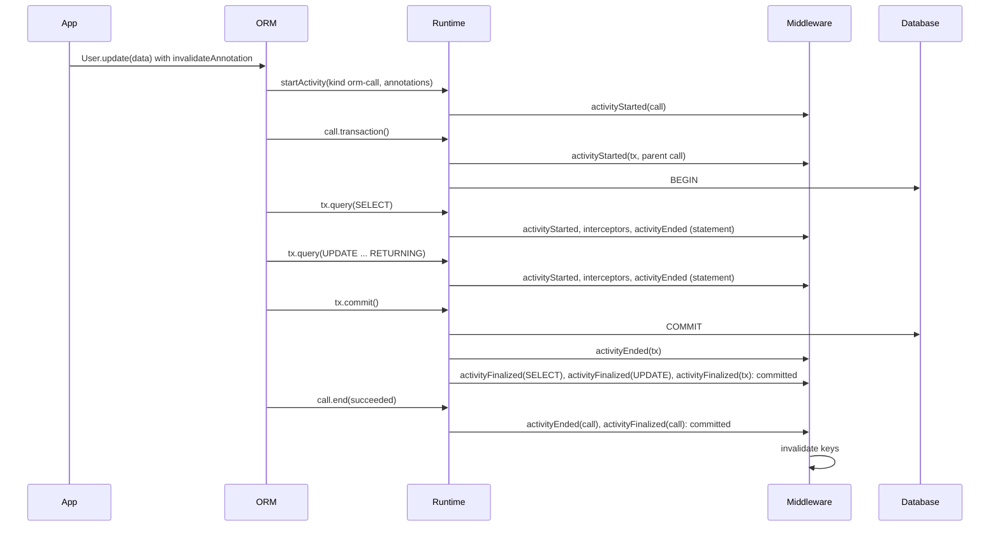

# ADR 271 — The runtime middleware observes a tree of activities, each started, ended and finalized

Status: **Accepted**

## Decision

```ts
import type { CrossFamilyMiddleware } from '@internal/framework-components/runtime';

// A cache that invalidates once the thing the user annotated has committed.
// It does not know whether the activity is an ORM call, a statement or a transaction.
export const cache: CrossFamilyMiddleware = {
  name: 'cache',
  async activityFinalized(activity, result, ctx) {
    const target = invalidateAnnotation.read(activity);
    if (target === undefined || result.outcome === 'rolled-back') return;
    await invalidate(target);
  },
};
```



The runtime's middleware sees a tree. An **activity** is one act by an actor: a statement a client sent, a transaction a client or the user opened, an ORM call the user made. An activity may have a parent, to any depth. The runtime hosts the tree and fires the hooks; it starts no activity on its own.

The runtime defines two kinds of activity:

- **`statement`**: one statement sent to the database. `query()` sends it for its rows and `execute()` sends it for its statistics, such as the number of affected rows; the activity's `returns` field is `'rows'` or `'stats'` accordingly. Both have the same lifecycle. A statement is a leaf.
- **`transaction`**: started by `transaction()`, ended by `commit()` or `rollback()`.

Clients add their own kinds. A client kind contains a hyphen, such as `orm-call`, so it is never `statement` or `transaction`. Kinds the runtime defines, in every family, never contain a hyphen. `Activity` is `StatementActivity | TransactionActivity | ClientActivity` in every program, so a middleware that knows no client kind still receives client activities, and a check such as `activity.kind !== 'statement'` leaves both a transaction and a client activity. A client may register a kind's result type by module augmentation of `ClientActivityRegistry` through the published entry `@prisma/orm-framework/components/runtime`. The registry types the handle side only, `intercepted.result` and `end({ result })`; in middleware hooks a client activity's result is `unknown` even after narrowing on its kind, because the hook types must accept unregistered kinds. The runtime rejects a kind without a hyphen at run time too. The SQL ORM is to start one `orm-call` activity for every terminal method. The framework names no client vocabulary.

Middleware has two kinds of hook: **lifecycle events**, which observe, and **interceptors**, which can change or stop a statement while the runtime executes it.

### Lifecycle events

Every activity has the same three, and each is one hook whatever the activity's kind:

- **`activityStarted(activity, ctx)`**: the act begins. If a middleware's `activityStarted` throws, the activity fails; the middleware after it never saw the activity start, so they receive no later lifecycle event for it.
- **`activityEnded(activity, result, ctx)`**: the act ends, with the outcome as the actor saw it: `succeeded`, `failed`, or `stopped` when the caller stopped reading a row stream early. A statement's result also carries its latency, where its result came from (`source: 'driver' | 'middleware'`), and its row count or statistics, discriminated by `result.returns`. An error thrown from this hook fails the activity: the actor receives it. A latency budget fails a statement this way. Every middleware that saw the activity start still receives its `activityEnded`; when several throw, the actor receives the first error. Finalization follows what the database did, not the hook: a statement that succeeded outside a transaction is finalized `committed` even when a hook failed it. For a transaction whose `COMMIT` or `ROLLBACK` the database has already settled, the hook's error cannot undo that outcome: the database outcome stands, and the transaction is finalized with it. A `commit()` then rejects with the hook's error, and a `rollback()` after a failed callback leaves the caller with the callback's original error; `rollback()` after a commit does nothing.
- **`activityFinalized(activity, result, ctx)`**: the act's effects are final, with `committed`, `rolled-back` or `unknown`. An error thrown from this hook is passed to `ctx.log.error` and swallowed; later middleware still run.

A middleware that only cares about some kinds checks `activity.kind` at the top of the hook, and ignores kinds it does not know.

### When an activity is finalized

A statement with no enclosing transaction is finalized right after it ends: `committed` when it succeeded, `unknown` when it failed or was stopped, because a statement that errors on the response path, or whose caller stopped reading, may already have applied.

A client activity with no enclosing transaction is also finalized right after it ends: `committed` when it succeeded and everything beneath it was finalized `committed`, otherwise `unknown`. A transaction beneath it that rolled back makes it `unknown`, because the client's act did not take effect as it ended. Its children are finalized when they end, each by its own rule.

An activity inside a transaction is finalized when the nearest enclosing transaction ends, with that transaction's outcome:

| What happened | Outcome |
|---|---|
| `commit()` resolves and no statement in the transaction failed | `committed` |
| `commit()` resolves after a statement in the transaction failed | `unknown` |
| `rollback()` settles and no commit was attempted | `rolled-back` |
| `commit()` rejects, whether or not a rollback follows | `unknown` |

`unknown` means the runtime cannot tell whether the writes landed. A rejected `COMMIT` may have landed on the server before the error came back, and the cleanup `ROLLBACK` that follows succeeds either way. A resolved `COMMIT` after a failed statement is answered by Postgres with a silent `ROLLBACK`, while other databases commit. A consumer that must not miss a committed write treats `unknown` like `committed`. Only a failed statement makes a resolved `COMMIT` `unknown`: its failure is passed up through the client activities above it to the transaction, and a client activity that fails with no failed statement beneath it does not change the outcome.

The nearest transaction finalizes its whole subtree when it ends, in post-order: children in start order, depth first, then the parent; the transaction itself comes last. An activity still open when its transaction ends, such as a row stream the caller is still reading, is finalized when it ends, with the outcome the transaction recorded, and keeps its `ctx.state` until then; the transaction does not wait for it. So every activity is started, then ended, then finalized. An activity's own end cannot stand in for its finalization: inside a transaction it ends before the `COMMIT`, and acting then lets a concurrent read store rows the transaction is about to replace.

### Interceptors

The runtime executes statements and nothing else, so three of the four interceptors exist only on statement activities. In the order the runtime runs them:

| Interceptor | When it runs | What it can do |
|---|---|---|
| `beforeCompile` | before the query tree becomes SQL (SQL family only) | return a rewritten query tree, for example to add a soft-delete filter |
| `beforeEncode` | after lowering, before parameter values are encoded by codecs | throw to block the statement; change parameter values through the mutator, for example to encrypt them |
| `intercept` | instead of running the activity | supply the result, so the work never runs |
| `onRow` | for each row the database returns | observe the row, or throw to stop the stream |

`intercept` has one handler per result type, so each handler's return type is fixed and checked by the compiler:

```ts
intercept?: {
  onQuery?(plan, ctx): Promise<{ readonly rows: Iterable<Row> | AsyncIterable<Row> } | undefined>;
  onExecute?(plan, ctx): Promise<{ readonly stats: RuntimeStatementStats } | undefined>;
  onActivity?(activity, ctx): Promise<{ readonly result: unknown } | undefined>;
};
```

The statement interceptors receive the plan at their stage: `beforeEncode(draft, ctx, params)`, `intercept.onQuery(plan, ctx)`, `intercept.onExecute(plan, ctx)` and `onRow(row, plan, ctx)`. `activity.plan` is the plan the caller sent; the interceptors need the lowered or encoded plan, which is what the cache keys on through `ctx.contentHash(plan)`. Interceptors for activities a client started receive the activity.

`onQuery` and `onExecute` run for statements, named after the runtime method that sent them. `onActivity` runs for activities a client started; its result type belongs to the client, so the framework types it `unknown` and the client checks what it receives. A handler checks `activity.kind` to decide whether it handles the activity; the check does not type the result. Middleware run in registration order and the first handler that returns a result wins. A transaction has no handler: it has no result to supply, and its statements are run by its actor, not the runtime.

### Starting activities

`query()` and `execute()` start a statement activity for the call's duration. `transaction()` starts a transaction activity that `commit()` and `rollback()` end. A statement sent on a transaction's connection while the transaction is open is a child of that transaction, because the database runs it inside the transaction's session.

A client is code that calls the runtime on the user's behalf, such as the ORM or an extension. `postgres()`, `sqlite()` and `supabase()` are facades: they build the runtime and the ORM, and start no client activities themselves.

`startActivityOn(queryable, activity)` starts an activity for an act the runtime would not otherwise see. The runtime's queryables carry the member it calls under a symbol, so neither the public runtime types nor the user-facing ones show it. `startActivityOn`, `planContentHashOn` and the `activitySource` symbol are public exports of the SQL runtime, so a third-party client can start activities too:

```ts
startActivityOn<K extends ClientActivityKind>(queryable: RuntimeScope, activity: {
  readonly kind: K;
  readonly contentHash: () => Promise<string>;
  readonly annotations?: Annotations;
}): Promise<ActivityHandle<K>>;

interface ActivityHandle<K> extends RuntimeQueryable, ActivitySource, ActivitySourceTarget {
  readonly activity: ClientActivity<K>;
  readonly intercepted: { readonly result: ClientActivityResult<K> } | undefined;
  readonly transaction?: () => Promise<RuntimeTransaction>;
  end(result: { readonly outcome: 'succeeded' | 'failed' | 'stopped'; readonly result?: ClientActivityResult<K> }): Promise<void>;
}
```

Statements sent through the handle are the activity's children, and `handle.transaction()` starts a transaction activity beneath it. A handle carries the `activitySource` member too, so `startActivityOn(handle, activity)` nests an activity beneath it. A handle opened under a transaction has no `transaction`, so transactions do not nest. `intercepted` is set when an `intercept.onActivity` handler supplied a result; the client then returns it without running anything. `end()` hands the runtime the value the client returns to its caller, which the runtime passes to middleware without reading it.

Ending an activity while one of its children is still open ends it `failed`, finalizes it, and rejects with a runtime error naming how many children are open. A transaction is the exception: the database ends it, so a child still open then is finalized when it ends (see "When an activity is finalized"). Starting a statement or an activity beneath an activity that no longer accepts children is rejected at entry with `RUNTIME.ACTIVITY_NOT_ACCEPTING_CHILDREN`. A client activity stops accepting children when it ends; a transaction, when its `commit()` or `rollback()` is called, before it ends, and with it every client activity inside it.

The SQL ORM's terminal methods follow this shape:

```ts
const call = await startActivityOn(runtime, {
  kind: 'orm-call',
  contentHash: () => ormCallContentHash(runtime, method, plan),
  annotations,
});
if (call.intercepted) {
  await call.end({ outcome: 'succeeded' });
  return call.intercepted.result;
}
const rows = await queryPlanRows(call, plan).toArray();
await call.end({ outcome: 'succeeded', result: rows });
return rows;
```

The user-facing types (`tx`, the facades) and the public `Runtime`, `RuntimeConnection` and `RuntimeTransaction` types omit `startActivity` and `planContentHash`, as `tx` has no `transaction` method today. The ORM reaches activities the same way everything else does, with `startActivityOn` and `planContentHashOn` on the queryable it holds: the runtime's queryables carry the `activitySource` member, the facades give the ORM runtime objects they build the same member, and a terminal method on a queryable without it fails with `ORM.ACTIVITY_SOURCE_MISSING`, so a call's annotations are never dropped silently.

### Annotations

An annotation lives on the activity the user annotated. An annotation on an ORM call lives on the call activity, and the statements the ORM sends beneath it carry none. A SQL builder query the user annotates is itself the statement activity, and carries its annotations as today. A middleware reads an activity's annotations through the annotation's handle, as it reads a plan's today, and acts only on the activity in hand, never on its parent.

### Content hash

A statement and a client activity each have a content hash: an opaque digest of what they do, used to derive a cache key when the annotation names none, and to name spans. A transaction has none. For a statement the runtime computes it from the contract's storage hash, the statement text and its parameters, as `ctx.contentHash` does today. For a client activity, the client supplies a function that computes it, and middleware read it with `activity.contentHash()`. The runtime calls the function on the first `contentHash()` and returns the same promise to every later caller, so a runtime with no middleware that asks never computes it, as a statement's digest is computed only when a middleware calls `ctx.contentHash(exec)`. The SQL runtime's `planContentHashOn(queryable, plan)` gives a client the digest of the statement a plan would send, through the `planContentHash` member of the queryable's activity source: it runs `beforeCompile` and lowers and encodes the plan, without `beforeEncode`, whose lints would fire twice and whose parameter changes need not be deterministic. It equals the digest `ctx.contentHash(exec)` returns for the statement's execution plan only when three things hold: `beforeCompile` gives the same result for the plan in both places, no `beforeEncode` hook changes the parameters, and the codecs encode deterministically. `planContentHash` compiles the plan with the scope and parent of the queryable it is called on and with fresh state (a hash taken on the runtime before the activity starts has no parent), while the statement compiles beneath the handle with the state its `activityStarted` hooks wrote; a `beforeCompile` that reads `ctx.parent` or state, or is not deterministic, gives a different digest, as does a middleware that encrypts parameters with a fresh nonce. A cache keys on the client's content hash and must not rely on the two being equal.

### The middleware context

Each activity has its own `ctx`, and every hook of that activity receives the same one.

- **`ctx.parent`** is the parent activity's context, or `undefined` at the root. A child learns its parent because its opener passed the handle; nothing is propagated through ambient context.
- **`ctx.inTransaction()`** walks up the parents and returns whether any of them is a transaction.
- **`ctx.scope`** stays as today: `'runtime'`, `'connection'` or `'transaction'`, the scope of the queryable the activity was started on.
- **`ctx.state(key)`** returns the state object stored under `key` for this activity, created empty on first use. The key is a string or a symbol, and the runtime places no constraint on it: two middleware that use the same key share the object, and a middleware that wants its state to itself uses a `Symbol()` or an unusual string. The state is dropped when the activity is finalized.

A tracer keeps its span this way and finds its parent's through `ctx.parent`:

```ts
const tracing = Symbol('tracing');

activityStarted(activity, ctx) {
  const parentSpan = ctx.parent?.state(tracing).span;
  ctx.state(tracing).span = tracer.startSpan(activity.kind, { parent: parentSpan });
},
activityFinalized(activity, result, ctx) {
  ctx.state(tracing).span?.end(result.outcome);
},
```

### Caching

The cache middleware applies one rule to every kind of activity: when the activity carries a cache annotation, serve it from the store through `intercept`, and on a miss store the result it ended with, if it succeeded. The key is the annotation's `key`, or else one derived from the activity's content hash: `ctx.contentHash(exec)` for a statement, `activity.contentHash()` for a client activity. An annotated ORM call is cached as a whole: on a hit the ORM sends no statements. The middleware tags each value it stores with what produced it, `statement-rows` or `call-result`, and the store keeps the tag, so a statement's rows and a call's result under the same key never stand in for each other.

The cache neither serves nor stores an activity for which `ctx.inTransaction()` is true, because a transaction must read its own uncommitted writes and the cache cannot know what the transaction changed until it commits. It also skips an activity whose `ctx.scope` is `'connection'`, because a held connection can carry session state, such as a database role, that changes which rows a statement returns.

## Context

The middleware lifecycle is defined per statement. Each need to reason about something other than the statement was answered by hand: ADR 160 decided a `groupingKey` on each plan of an ORM call (never built); ADR 220 added `planExecutionId` per execution; ADR 260 added `afterTransaction`, where the runtime walks from each statement to its transaction on the statement's behalf; transaction begin and end hooks were agreed for later. A convention copying the call's annotations onto each statement was discussed and rejected.

Most ORM calls send several statements. A single-row `update()` sends a `SELECT` then an `UPDATE` in a transaction the ORM opens. The user annotates the call, and the ORM puts the annotation on the `UPDATE` only. For a write with a relation callback, or a create on a model with multi-table inheritance, the annotation reaches no statement. No statement represents the call, so nothing can observe it, cache it, or act once it has committed.

The per-statement hooks also mix two jobs. Some only observe (`afterQuery` for a slow-query warning); some change or stop the statement (`beforeQuery` for lints, `interceptQuery` for the cache). Each was split again by operation, so `query()` and `execute()` had a full set each.

## Prior art

This ADR invents no mechanism. Each piece below is an established feature of widely used data-access and tracing frameworks, and this ADR adopts it with the same meaning. What is new is only that they share one tree.

Two of the interceptors are also not new to this runtime. `beforeCompile` exists today under that name, and the parameter mutator that `beforeEncode` receives exists today on `beforeQuery` and `beforeExecute`. This ADR moves them into the new structure; it does not add them.

### A tree of activities, each with a parent

- **.NET `System.Diagnostics.Activity`** is the model. `ActivitySource.StartActivity(name)` returns an `Activity` that knows its parent, is started and stopped, and is what .NET's OpenTelemetry support is built on. `startActivity`, `ActivityHandle` and the word "activity" are taken from it.
- **OpenTelemetry spans** have the same structure: each span has a parent, a start and an end, and children end before their parents. A tracer built on `activityStarted` and `activityEnded` maps onto spans one to one.

### State a middleware keeps on an activity

- **.NET `Activity.SetCustomProperty(name, value)`** "attaches any custom object to this activity", and its documentation recommends "a unique property name to avoid conflicts". `ctx.state(key)` is the same mechanism with the same rule: keys are unconstrained, and avoiding collisions is the middleware author's choice.
- **OpenTelemetry's JavaScript context** stores values under keys created with `createContextKey(description)` and read with `getValue(key)`.

### An end, and a later finalization once effects are final

- **Rails** has both moments on one record: `after_save` runs when the save finishes, and `after_commit` runs once the outermost transaction commits, or at once when no transaction is open.
- **Django's `on_commit`** runs its callback immediately when no transaction is active, and otherwise after the outermost `atomic` block commits.
- **Spring's `TransactionSynchronization.afterCompletion(status)`** and **JTA's `Synchronization.afterCompletion(status)`** are the hook this ADR names `activityFinalized`. Spring's has exactly three statuses, `STATUS_COMMITTED`, `STATUS_ROLLED_BACK` and `STATUS_UNKNOWN`, and its documentation says an exception thrown from the callback "will be logged but not propagated", because the transaction has already finished. `activityFinalized` has the same three outcomes and the same error rule.

### Observing kept apart from changing

- **EF Core** draws the line this ADR draws. Its documentation: "Interceptors are different from logging and diagnostics in that they allow modification or suppression of the operation being intercepted." Diagnostic listeners observe; interceptors change or stop.
- **datasource-proxy**, a JDBC proxy commonly used with Spring Boot, registers `QueryExecutionListener`s, which observe before and after each statement, separately from a `QueryTransformer` and a `ParameterTransformer`, which change the statement and its parameters.

### Rewriting a query before it is compiled: `beforeCompile`

Rewriting the query tree before it becomes SQL is the standard home for soft delete and tenant isolation:

- **EF Core's global query filters** attach a filter that is "applied whenever a query on that entity type is executed". Its documentation names soft deletion and multi-tenancy as the two main uses. EF Core also has `IQueryExpressionInterceptor`, for "modifying the LINQ expression tree before a query is compiled".
- **Ecto's `prepare_query/3`** can "further modify the query and options before it is transformed and sent to the database". Its documentation's example is a soft-delete filter, and its multi-tenancy guide adds an `org_id` filter to every query and raises when none is set.
- **Hibernate's `StatementInspector`** inspects each SQL command and may return "a different SQL command to be used instead".

### Blocking a statement, or changing its parameters, before it runs: `beforeEncode`

- **Blocking.** EF Core's command interceptors can throw before the command runs. Ecto's multi-tenancy guide raises from `prepare_query`. Django's documentation shows an `execute_wrapper` that blocks every query. In this runtime, lints and the SQL-size budget block a statement today.
- **Changing parameter values.** datasource-proxy's `ParameterTransformer` does this for JDBC. Most frameworks instead transform values in the type layer: Rails' attribute encryption, Hibernate's `AttributeConverter`, EF Core's value converters. In this runtime that layer is codecs, and a codec is still the place for a transform of one value. The mutator exists for transforms that need all of a statement's values at once: the Cipherstash extension encrypts them in a single SDK call, which a per-value codec cannot do. ADR 215 made that decision, and this ADR keeps it unchanged.

### Supplying a result instead of running: `intercept`

- **EF Core** lets a command interceptor skip the database with `InterceptionResult.SuppressWithResult`. Its documentation's own worked example is a caching interceptor that "suppress[es] executing the operation" and returns a cached result instead.
- **EF Core splits its command interceptors by result type**: `ReaderExecuting` for rows, `NonQueryExecuting` for an affected-row count, `ScalarExecuting` for a single value. `intercept.onQuery` and `intercept.onExecute` follow the same split.
- **JDBC's `Statement`** has the same split for sending one statement: `executeQuery` returns rows, `executeUpdate` returns a count. That is why a single `statement` kind with `returns: 'rows' | 'stats'` covers both runtime methods.

### Caching a whole call, keyed by its inputs: `intercept.onActivity`

- **Spring's `@Cacheable`** stores a method's result so that "on subsequent invocations (with the same arguments), the value in the cache is returned without having to actually invoke the method". By default the key is built from the method's parameters. A cached ORM call is the same mechanism: the ORM call is the method, and its content hash is the key built from its inputs.

### Not caching inside a transaction: `ctx.inTransaction()`

- **"Is a transaction open?" is one call everywhere**: Rails `transaction_open?`, Django `in_atomic_block`, Ecto `in_transaction?`, Spring `TransactionSynchronizationManager.isActualTransactionActive()`.
- **Caches built on them stay out of transactions.** Shopify's IdentityCache skips the cache whenever a transaction is open, which is this ADR's rule. django-cacheops turns caching off once a transaction has written and runs invalidations "on the outer commit of transaction". Spring's `TransactionAwareCacheDecorator` defers puts and evictions to "the after-commit phase of a successful transaction" but still serves reads, which lets a transaction read rows from before its own writes; this ADR does not.

## Consequences

- The per-statement hooks map onto the new ones:

  | Before | After |
  |---|---|
  | `beforeQuery`, `beforeExecute` | `beforeEncode` |
  | `interceptQuery`, `interceptExecute` | `intercept.onQuery`, `intercept.onExecute` |
  | `onRow` | `onRow` |
  | `afterQuery`, `afterExecute` | `activityEnded` on a statement |
  | `afterTransaction` (ADR 260) | `activityFinalized` on a statement |
  | `beforeCompile` | unchanged |

  Every middleware is rewritten: the cache, budgets, lints, the demo's slow-query warning, and external middleware. ADR 260 is amended to say so.
- ADR 160's `groupingKey` is superseded by the parent activity. ADR 160 is amended.
- `planExecutionId` (ADR 220) is a statement activity's identity.
- The deferred transaction begin and end hooks are `activityStarted` and `activityEnded` on a transaction activity.
- Middleware state moves from `WeakMap`s keyed by plan to `ctx.state(key)`. This also removes the case ADR 260 documents, where the hook before encoding and the hooks after it receive different plan objects.
- A runtime decides once, when it is created, whether any of its middleware implements `activityFinalized`. If one does, a transaction holds its finished child activities until it ends, to finalize them then; a transaction that never ends holds them. If none does, a transaction holds no finished child: it keeps only whether one failed, which decides its own `unknown` outcome.
- Nested transactions, when built, are a transaction activity under a transaction activity, and finalization waits for the outermost.
- Mongo has no transactions; every Mongo activity is finalized right after it ends.
- The direct single-client Postgres driver runs a runtime-scope statement sent while a transaction is open inside that transaction, and the runtime cannot see it. That limit is unchanged.
- Touches: `RuntimeMiddleware` and `RuntimeMiddlewareContext` in `framework-components`; the runners in `run-with-middleware.ts`; the SQL runtime's transaction bookkeeping and queryables; the Mongo runtime; the Supabase role session; the Postgres, SQLite and Supabase facades; `withMutationScope` and every terminal method in `sql-orm-client`; the ORM's structural `RuntimeQueryable` type, which may carry the `activitySource` member; the cache, budgets and lints middleware.

## Alternatives considered

- **Copy the call's annotations onto every statement.** Misstates what was annotated and multiplies the payload. Rejected.
- **Attach them to one chosen statement.** The ORM decides which statement represents the call. Rejected.
- **The cache reads a statement's annotations, then its parent's.** Would cache the same work twice when both are annotated. The cache acts only on the activity in hand. Rejected.
- **Parent pointers only, no child list.** The runtime needs the child list to finalize a transaction's activities. Rejected.
- **One wrapping hook around execution, with a `next()` to call.** ADR 014 rejected it because it is harder to keep compile-time work, run-time work and budgets apart, and it mixes observing with changing. Rejected again.
- **Two statement kinds, one per runtime method.** Both have the same lifecycle; only the result differs, which `returns` records. Rejected.
- **One `intercept` hook for all results, checked at run time.** The compiler could not check that a middleware returned rows to a statement that asked for rows. Rejected for one handler per result type.
- **Lifecycle events split by kind.** They return nothing, so splitting buys no type safety, and kind-agnostic consumers such as the cache and a tracer would implement the same body several times. Kinds are also open, so a catch-all would be needed anyway. Rejected.
- **An `intercept` handler for transactions.** A transaction has no result to supply, and skipping it would run its actor's statements outside any transaction. Rejected.
- **Serve cached reads inside a transaction, and defer storing to commit,** as Spring's `TransactionAwareCacheDecorator` does. A transaction would read rows from before its own writes. Rejected.
- **Name the hook `activitySettled` or `activityCompleted`.** In JavaScript a promise "settles" when it resolves or rejects, which is when an activity ends, not when its effects are final. "Completed" is a near synonym of "ended", so readers cannot tell which moment comes first; Spring's `afterCompletion` belongs only to a transaction, for which ending and completing are the same moment, and does not carry over to statements and ORM calls. Rejected for "finalized", which says that the effects are final.
- **Name the leaf activity `execution` or `query`.** "Execution" already means running any plan, and "query" already means both a statement in general and the `query()` method. Rejected.
- **Two finalization outcomes, as in Rails.** A rejected `COMMIT` and a silently rolled-back `COMMIT` fire nothing, and a cache holds stale rows until expiry. Rejected.
- **`startActivity` on the user-facing scope.** Users would see a client-only method on `tx`. Rejected.
- **`startActivity` and `planContentHash` as methods on the public `Runtime` types.** Users of `db.runtime()` would see two client-only methods, and every object that implements the types, including test stubs, would have to provide them. Rejected for members under a symbol, reached through `startActivityOn` and `planContentHashOn`, which a queryable without the member fails clearly.
- **An explicit field marks a client activity, such as `origin: 'client'`, or a reserved prefix.** A field is one more thing to check before narrowing on `kind`, and a prefix such as `client:` is a rule a reader learns only from the docs. A hyphen keeps the kind a plain readable name, such as `orm-call`, and the type `` `${string}-${string}` `` checks it. Rejected for the hyphen; the cost is that no family may add a runtime kind with a hyphen.
- **A generic parameter for client result types on the runtime or the middleware.** Every runtime, middleware and helper type would carry it, and middleware written once for every client could not name it. Rejected for module augmentation of `ClientActivityRegistry`, which a client does once and every program sees.
- **`AsyncLocalStorage` to find the parent.** Rejected by ADR 160 and ADR 220; still rejected.
