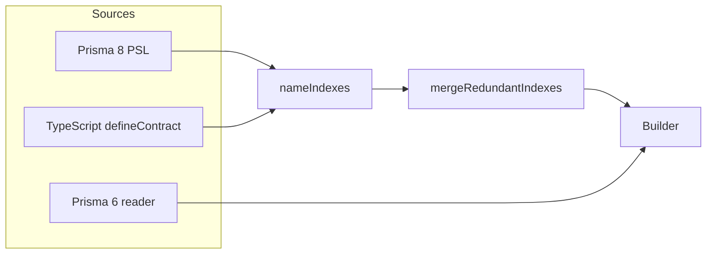

# ADR 317 — MongoDB indexes carry their names

**Status:** Accepted
**Builds on:** [ADR 188 — MongoDB migration operation model](ADR%20188%20-%20MongoDB%20migration%20operation%20model.md), [ADR 306 — One plain-data definition and one builder per family](ADR%20306%20-%20One%20plain-data%20definition%20and%20one%20builder%20per%20family.md)

## At a glance

This Prisma 8 schema asks for two indexes on `email`: a unique one and a sparse one.

```prisma
model User {
  id    ObjectId @id @map("_id")
  email String   @unique

  @@index([email], sparse: true, map: "email_sparse")
}
```

The contract records each index with its name:

```json
"indexes": [
  { "keys": [{ "direction": 1, "field": "email" }], "kind": "mongo-index", "name": "email_1", "unique": true },
  { "keys": [{ "direction": 1, "field": "email" }], "kind": "mongo-index", "name": "email_sparse", "sparse": true }
]
```

Both indexes can exist in the database at once. A migration creates each one under its name, drops it by its name, and `db verify` checks it by its name.

## Decision

`MongoIndex`, the contract's index node, has a required `name`. It is the name MongoDB stores the index under. The contract builder refuses two indexes with one name in one collection.

## Why MongoDB needs names

MongoDB identifies an index by its name, not by its keys. Several indexes in one collection may have the same keys and differ only in their options: a unique and a plain index, a plain and a sparse one, two indexes with different collations. Creating, dropping and checking an index by its keys alone cannot tell these apart, so the contract has to carry the name.

MongoDB cannot rename an index. Changing a name means dropping the index and creating it again.

## Where a name comes from

**A written name.** In Prisma 8 PSL, `map:` on `@unique`, `@@index`, `@@unique` and `@@textIndex` names the index. In TypeScript `defineContract`, the index option `name` does.

**No written name.** The index gets the name MongoDB gives an index created without one: each key's field and direction, joined by underscores, such as `email_1` or `title_text`. `defaultMongoIndexName` in `@internal/mongo-contract` builds it. Because this is MongoDB's own rule, an index created without a name already holds this name in the database.

**Two indexes with one name.** Prisma 8 PSL and `defineContract` first merge an index that another index with the same name makes redundant, as described under "Where naming sits in the pipeline". When two indexes in one collection still have the same name after that, written or not, the schema is refused. The message asks for a name with `map:` or `name`. No second name is invented, because an invented name would depend on the order the indexes are written in, or change when another index appears. Either would drop and rebuild an index the user did not touch, since MongoDB cannot rename one.

**Prisma 6 schemas.** The Prisma 6 reader gives each index the name Prisma 6 gives it, so that a database Prisma 6 built verifies as it is. The name is `map:` (or `name:` on `@@index`) when written. Otherwise it is the collection name, then the stored field names, joined by underscores, with `_key` for a unique index and `_idx` for any other, such as `User_email_key` or `User_email_idx`. The part before the suffix is cut so the whole name fits in 127 bytes. This follows prisma-engines 6.19.3 `ConstraintNames`. The reader refuses what Prisma 6 refuses: two indexes of one model with one name, an empty `map`, and a `map` longer than 127 bytes.

## Where naming sits in the pipeline

ADR 306 says each family has one plain-data definition and one builder, and the builder builds the definition it is given. Naming happens in the sources, before the builder.



1. `nameIndexes` gives every index written without a name its default name. Prisma 8 PSL and `defineContract` call it. The Prisma 6 reader names its indexes itself.
2. `mergeRedundantIndexes` removes indexes another index makes unnecessary: the later of two identical indexes, or a plain index beside a unique index that is otherwise identical. It merges only indexes with the same name. Two identical indexes with different names are both kept, because the user named them apart.
3. The builder takes each name from the definition. It refuses two identical indexes in one collection, because MongoDB cannot hold both, and two indexes with one name in one collection (`indexNameDuplicate`).

## How the planner pairs indexes

The migration planner pairs an index of the starting state with an index of the target state by content: keys and options, with the name left out. `indexLookupKey` in `@internal/mongo-contract` computes this content key. Between two contracts, both sides hold indexes as they were written, so the content compares exactly. A schema read from a database needs one more step, described in the next section.

This is why a MongoDB index name holds no content hash, unlike the SQL family's index names ([ADR 243](ADR%20243%20-%20Name-identified%20indexes%20and%20exact-name%20adoption.md)). SQL puts a hash of an index's content into its name because Postgres rewrites expression text, so SQL cannot compare two indexes' content directly and compares their names instead. MongoDB index content can be compared for equality exactly, so the planner compares the content itself, and the name only has to be the name the database holds.

A pair whose content matches but whose names differ is planned as a drop and then a create, because MongoDB cannot rename an index. A pair with the same name and the same content plans nothing. Drops run before creates in every plan, which MongoDB needs: it refuses an index with the content of one it already holds.

## Schemas read from a database

A database does not list every index as it was written. It lists a text index's keys as `_fts` and `_ftsx` and fills in weights, the default language and the language override. It fills in the unwritten fields of a collation. So a database's index must be rewritten into its written form before it can be paired with a contract's index.

Every `MongoSchemaIR` states whether it was read from a database, in its `fromDatabase` field. When the starting state was read from a database, as in `db init` and `db update`, the planner first rewrites both sides with `canonicalizeSchemasForVerification`, the rewrite `db verify` uses before it compares. It strips the values the database filled in for fields the contract did not write. When several contract indexes share a database index's keys, it matches the one with the same name.

The rewritten forms are used for pairing only. Each create is built from the contract's own index, so `db init` and `db update` create exactly what `migration plan` writes.

## The operations

`createIndex(collection, keys, options)` creates the index under `options.name`. Its prechecks require that the collection holds no index with that name and none with the same keys and options. Its postcheck requires an index with that name, those keys and those options.

`dropIndex(collection, keys, options)` drops the index named `options.name`. `options` lists every option the index has. Its precheck requires an index with that name, those keys and exactly those options. Its postcheck requires that no index with that name is left.

The operation id is `index.<collection>.<create|drop>(<name>)`, such as `index.users.create(email_sparse)`.

Both factories accept a call without a name. Then the index is named after its keys, with `defaultMongoIndexName`. A `dropIndex` without options checks the keys only.

## `db verify`

`db verify` pairs the contract's indexes with the database's indexes by content, after the rewrite described above. An index of the contract whose content the database holds under another name is a failure. The failure carries the contract's index as `expected` and the database's index as `actual`.

## Consequences

- An index's name is part of the contract's storage section, so it is part of the storage hash. Renaming an index changes the hash.
- A schema with two unnamed indexes on the same keys and different options is refused until one of them is named, unless one makes the other redundant and they merge. Naming one keeps both apart; the builder still refuses them if their content is identical.
- The schema IR's index, `MongoSchemaIndex`, carries `name`, and its `id` is the name. Introspection reads it from `listIndexes`.
- A collation field the contract does not write may hold any value in the database, because the rewrite strips unwritten fields before comparing. Removing a field from a contract's collation, such as `strength`, is seen by `migration plan`, which compares two contracts, but not by `db update` or `db verify`.
- A MongoDB contract snapshot under `migrations/snapshots/` may hold a storage hash its content does not recompute to, because database markers, the ledger and every migration's `from` and `to` refer to that hash. A content check of MongoDB snapshots must allow this.

## Alternatives considered

- **Content-hashed names, as SQL's [ADR 243](ADR%20243%20-%20Name-identified%20indexes%20and%20exact-name%20adoption.md) does (`email_1_<8 hex>`).** The hash is not needed, because MongoDB index content compares exactly, as described under "How the planner pairs indexes". And MongoDB cannot rename an index, so moving existing databases to hashed names would rebuild every index.
- **No names in the contract, with drops that look an index up by content when the migration runs.** This needs a new runner command that finds an index by content and drops it. It leaves names unchecked. And it cannot describe the names Prisma 6 gives.
- **An optional name, where a missing one means the key-derived default.** This keeps storage hashes unchanged, but the contract would not state what the database holds, and every reader of the contract would have to know the default rule.
