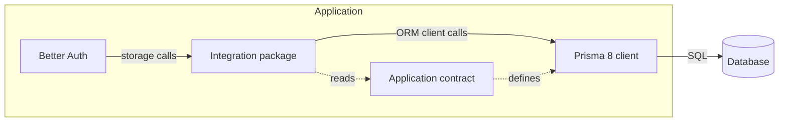

# ADR 328 — A library integration uses only published entrypoints, and its models live in the application's contract

**Status:** Accepted
**Date:** 2026-11-23
**Related:** [ADR 212 — Contract spaces](ADR%20212%20-%20Contract%20spaces.md), [ADR 226 — Cross-contract foreign-key references](ADR%20226%20-%20Cross-contract%20foreign-key%20references.md), [ADR 242 — Public npm surface](ADR%20242%20-%20Public%20npm%20surface%20-%20single%20%40prisma%20scope%20with%20consolidated%20publish%20packages.md), [ADR 308 — Community packages are named `prisma-orm-<name>`](ADR%20308%20-%20Community%20packages%20are%20named%20prisma-orm-name.md)


## At a glance

A package that connects an outside library to Prisma 8 builds only on the packages Prisma publishes, and the tables the library needs are models in the application's own contract. This section shows both with one library, Better Auth.

Better Auth is an authentication library. It keeps its users and sessions in the application's database, and it reaches that database through one object the application hands it, which Better Auth calls a database adapter. `@prisma/orm-better-auth` builds that object from the application's Prisma 8 client:

```ts
import { betterAuth } from 'better-auth';
import { prismaAdapter } from '@prisma/orm-better-auth';
import { db } from './db';

export const auth = betterAuth({
  database: prismaAdapter(db),
  emailAndPassword: { enabled: true },
});
```

Better Auth needs tables: `user`, `session`, `account` and `verification`. The application declares them as models in its own contract, the file that describes its models and the tables behind them, next to its own models. Here `User` is Better Auth's and `Post` is the application's:

```prisma
model User {
  id            String    @id
  name          String
  email         String    @unique
  emailVerified Boolean
  image         String?
  createdAt     DateTime
  updatedAt     DateTime
  sessions      Session[]
  accounts      Account[]
  posts         Post[]

  @@map("user")
}

model Post {
  id       String @id
  title    String
  authorId String
  author   User   @relation(fields: [authorId], references: [id])
}
```

`Session`, `Account` and `Verification` are the other Better Auth models, written the same way; the package README lists them.

At run time the pieces connect like this. Everything inside the box belongs to the application's process:



The integration package sits between the library and the client. It owns nothing in the database and nothing in the contract. It reads the contract to find the library's models and to check that everything the library needs is there.

When something is missing, the integration adds it to the contract on the developer's request. After the application turns on Better Auth's two-factor plugin, the developer runs Better Auth's `auth generate` command. It asks before it writes, and then the contract has these lines more, and no line less:

```diff
 model User {
   id            String    @id
   name          String
   email         String    @unique
   emailVerified Boolean
   image         String?
   createdAt     DateTime
   updatedAt     DateTime
   sessions      Session[]
   accounts      Account[]
   posts         Post[]
+  twoFactorEnabled Boolean?
+  twoFactors       TwoFactor[]

   @@map("user")
 }
@@ at the end of the file @@
+
+model TwoFactor {
+  id                      String    @id
+  secret                  String
+  backupCodes             String
+  userId                  String
+  user                    User      @relation(fields: [userId], references: [id], onDelete: Cascade)
+  verified                Boolean?
+  failedVerificationCount Int?
+  lockedUntil             DateTime?
+
+  @@index([secret])
+  @@index([userId])
+  @@map("twoFactor")
+}
```

The developer then emits the contract and changes the database the way they change it for their own models. The integration never touches the database's tables.

## Decision

A **library integration** is a package that connects a library from outside Prisma, such as Better Auth, to an application's Prisma 8 client. Every library integration follows two rules.

1. **It imports only what Prisma publishes.** Its code builds on the published packages `@prisma/orm-framework`, `@prisma/orm-family-sql` and `@prisma/orm-toolchain`, and on the client the application passes in. It imports none of this repository's private packages.
2. **The tables the library needs are models in the application's contract.** The integration ships no models and no migrations of its own. It checks the application's contract against what the library needs and reports what is missing. On the developer's request it adds the missing models and fields to the contract's source. It never changes the database's tables.

The next two sections take the rules one at a time: what each means, why it holds, and what it costs.

## Rule 1: only what Prisma publishes

### What it means

Prisma 8 is built from many private packages in this repository, named `@internal/*`. Applications never see them. What an application can install is a small set of published packages, named `@prisma/orm-*` ([ADR 242](ADR%20242%20-%20Public%20npm%20surface%20-%20single%20%40prisma%20scope%20with%20consolidated%20publish%20packages.md)).

A library integration is written against that published set only, the same set an author outside Prisma would have. Its code also depends on no database package, such as `@prisma/orm-postgres`: it receives a client and works with whichever database that client is for.

### Why

**Anyone must be able to write one.** A community author who integrates another library has only the published packages. If Prisma's own integration needed a private import, theirs could not be written. Building ours under the same limit proves the published packages are enough, and every gap we meet is a gap they would meet.

**The package is not tied to this repository.** A library integration is not part of Prisma 8's core. Because nothing in it depends on being built here, its source can live in this repository, in one of its own, or in the library's, and move between them without a rewrite. This record does not decide where any one integration lives.

### How the integration depends on Prisma's packages

The integration declares `@prisma/orm-framework`, `@prisma/orm-family-sql` and `@prisma/orm-toolchain` as peer dependencies, at the exact version of the application's database package. The database package always installs all three, so the application ends up with one copy of each, shared by its client and the integration.

One copy matters, because the integration builds query filters with functions from `@prisma/orm-family-sql` and hands them to the client. Because they are peers, the package manager reports a version mismatch at install time. If they were regular dependencies, it would silently install a second copy of those functions beside the client's.

The third package, `@prisma/orm-toolchain`, is Prisma's tooling. The integration uses it for one thing, to find the contract's source files through the project's `prisma.config.ts`, and loads it only when the developer runs the library's generate command. An application that serves requests through the integration never loads Prisma's tooling.

### How the rule is kept

Two checks fail when the rule is broken. The lint `pnpm lint:consumer-internal-imports` treats the integration like an application and refuses any `@internal/*` name in its imports or its manifest. A test inside the package refuses any `@repo/*` name, the repository's other private prefix, apart from the shared build and TypeScript configuration.

### What it costs

- **Looser types inside the package.** No published type says "a client whose contract contains these models". The integration treats the client loosely on the inside, and its correctness rests on the contract check described under rule 2 and on its tests.
- **Gaps are worked around, and written down.** Where the published packages lack something, the integration carries its own small substitute. Each one marks a gap to close in the published packages. For example, `@prisma/orm-better-auth` keeps its own table of the kind of JavaScript value each codec reads, because nothing published gives that at run time.
- **The rule covers Prisma's packages, not the library's.** An integration may need a hook that the library itself labels internal; `@prisma/orm-better-auth` uses one to register its contract check with Better Auth. The integration then accepts only the library's minor version it has been tested against, because a new minor version may change the hook.

## Rule 2: the library's tables are models in the application's contract

### What it means

A contract describes an application's models and the tables behind them. The client is built from it, and Prisma plans every change to the database from it. An application has one contract of its own.

Prisma 8 also lets a package own tables. Such a package ships a **contract space**: a contract and a migration history of its own, applied beside the application's ([ADR 212](ADR%20212%20-%20Contract%20spaces.md)). A library integration does not do this. The library's tables are ordinary models in the application's contract, as `User` is in the example above.

### Why

**The integration works through the application's client, and that client reaches only the application's contract.** The client cannot query models that live in another contract space ([ADR 226](ADR%20226%20-%20Cross-contract%20foreign-key%20references.md)). An integration that runs every one of the library's storage calls through the client therefore needs the library's models in the contract the client was built from.

**The library decides its tables from the application's configuration.** Better Auth works out its tables from its options. Each plugin adds tables and columns, the application can add fields of its own, and it can rename models and fields. No fixed set of models shipped inside a package would match what one application has configured. The models have to be written where the configuration is: in the application.

**The application relates its own models to the library's.** A `Post` belongs to a `User`. With both in one contract this is an ordinary relation that the client can follow in a query. A model in another contract space can be pointed at only with a foreign key that the client cannot follow ([ADR 226](ADR%20226%20-%20Cross-contract%20foreign-key%20references.md)).

**One migration history.** The application already has a way to change its database. The library's tables change through it, in the same migrations as the application's own tables, reviewed in the same way.

### What the integration does instead of owning the models

**It compares.** The integration takes the list of models and fields the library needs under the application's configuration and checks each against the contract. It finds a missing model or field, a field of the wrong type, and a field whose optionality the library cannot work with.

**It reports.** Wherever the library gives the integration a place to run that check, a problem stops the library with a message that says what to add or change, with the PSL to add. Better Auth runs the check before it serves requests and from its `auth check` command.

**It adds what is missing, when the developer asks.** A library usually has a command that generates the tables it needs; Better Auth's is `auth generate`. Under that command the integration adds the missing models and fields to the contract's source, as in the example at the top. The edit reuses what Prisma already publishes:

- The project's `prisma.config.ts`, read with Prisma's own config loader, names the contract's source files.
- Prisma's PSL parser returns a syntax tree that keeps every comment and space and gives the position of each model and field.
- The integration inserts the new lines as text at those positions: new fields after a model's last field, new models at the end of the file. It does not reformat or reprint the file, so every line the developer wrote stays as it was.
- The library's command asks the developer and writes the file. The integration hands it the edited text and writes nothing itself.

The edit is all or nothing. When the contract needs anything other than additions, or the additions cannot all be placed in one PSL file, the command writes nothing and prints the same message the check gives. That covers a contract written in TypeScript, a file that does not parse, and a field that must change type.

**It never changes the database.** The integration reads and writes rows, as the library asks. Creating and altering tables stays with Prisma, driven by the application's contract.

### What it costs

After the library's generate command has added the models, two steps remain with the developer: emitting the contract with `prisma contract emit`, and updating the database with `prisma db update` or a migration. The integration does not run them, because both belong to the application's own way of changing its database.

The integration compares against the emitted contract but edits the contract's source. Between an edit and the next emit the two disagree, so a second run of the generate command refuses and tells the developer to emit first.

## Who does what

| Who | Does what |
| --- | --- |
| The library | Decides which models and fields it needs, and makes its storage calls through the integration |
| The integration package | Translates those calls into calls on the application's client; checks the contract against what the library needs; reports what is missing; adds missing models and fields to the contract's source when the developer asks |
| The application | Owns the contract that holds the library's models, emits it, and changes the database with Prisma |
| Prisma 8 | Runs the queries and checks them against the contract; plans and applies changes to the database |

## Consequences

- A library integration published by Prisma is hand-written source, where the other published packages are thin shells over private packages. While it is developed in this repository it sits in `packages/9-public/@prisma/`. It is named `@prisma/orm-<library>` ([ADR 242](ADR%20242%20-%20Public%20npm%20surface%20-%20single%20%40prisma%20scope%20with%20consolidated%20publish%20packages.md)). One published by someone else is named as any community package is ([ADR 308](ADR%20308%20-%20Community%20packages%20are%20named%20prisma-orm-name.md)).
- An integration accepts the databases it has been proven correct on and refuses a client for any other, with an error that names the database. `@prisma/orm-better-auth` accepts Postgres and SQLite.
- Revisit this decision for a library whose tables are the same in every application, and which the application never changes and never queries through its own client. A contract space owned by a package may fit that case better, as it does for Supabase's auth tables.

## Alternatives considered

### The integration ships the library's models as its own contract space

The package would own the library's models and their migrations, as a package that adds a database extension owns the tables it adds. Rejected for the reasons under rule 2. The first reason is enough on its own: the integration runs every call through the application's client, and that client cannot query another contract space.

### The integration only prints what to add

The generate command would print the PSL and leave the developer to copy it into the contract. Rejected because a library's users expect its generate command to write the models, and because the edit can be made safely with what Prisma publishes: it adds lines at positions from the syntax tree and changes nothing else. Printing remains what the command does whenever it cannot make the whole edit.

### The integration reprints the contract file

It would parse the contract into a structure, add the models and fields to it, and print the whole file again with Prisma's PSL printer. Rejected because the printer keeps no comments and rewrites every line, so the developer would lose what they wrote.

### Prisma publishes an operation that adds models to a contract

The integration would call a new framework operation. Rejected because the published config loader and syntax tree are already enough, and a new framework operation for one kind of package is surface that nothing else needs. Revisit it if integrations start to repeat the same editing code.

### The integration imports this repository's private packages

It could then reach the SQL runtime and the contract's internal types, and be typed more tightly. Rejected because the package could be built only in this repository, and because it would hide gaps in the published packages that every community integration would still meet.

### The integration sends SQL of its own, beside the ORM client

It would build SQL statements for the library's calls and not use the ORM client. Rejected because the ORM client already checks every model and field against the contract, converts values with the contract's codecs on each database, and runs inside the application's transactions. A second query path would have to repeat all three.
