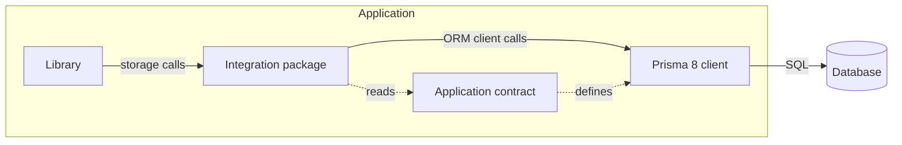

# ADR 328 — A library integration uses only published entrypoints, and its models live in the application's contract

**Status:** Accepted
**Date:** 2026-11-23
**Related:** [ADR 212 — Contract spaces](ADR%20212%20-%20Contract%20spaces.md), [ADR 226 — Cross-contract foreign-key references](ADR%20226%20-%20Cross-contract%20foreign-key%20references.md), [ADR 242 — Public npm surface](ADR%20242%20-%20Public%20npm%20surface%20-%20single%20%40prisma%20scope%20with%20consolidated%20publish%20packages.md), [ADR 308 — Community packages are named `prisma-orm-<name>`](ADR%20308%20-%20Community%20packages%20are%20named%20prisma-orm-name.md)


## At a glance

Many libraries keep data in the application's database. An authentication library keeps users and sessions, a job queue keeps jobs, and a billing library keeps subscriptions. Such a library does not talk to the database itself: the application hands it an object to store data through.

A **library integration** is a package that builds that object from the application's Prisma 8 client. This record decides how every such package is structured, whoever writes it. Everything inside the box belongs to the application's process:



The integration package sits between the library and the client, and follows two rules.

First, it is built only on the packages Prisma publishes, so anyone can write one.

Second, the tables the library needs are models in the application's own contract, which describes its models and the tables behind them. The developer writes the contract's source, here in PSL, Prisma's language for models, and Prisma emits from it the contract the client is built from. The integration ships no models. Here `User` is a model an authentication library needs, and `Post` is the application's own:

```prisma
model User {
  id    String @id
  email String @unique
  posts Post[]
}

model Post {
  id       String @id
  title    String
  authorId String
  author   User   @relation(fields: [authorId], references: [id])
}
```

The integration owns nothing in the database and nothing in the contract. It reads the contract to find the library's models and to check that everything the library needs is there. When the library needs a model or field the contract lacks, the integration says what to add, and adds it to the contract's source when the developer asks. The developer then emits the contract and changes the database the way they change it for their own models.

The first library integration is `@prisma/orm-better-auth`, for the authentication library Better Auth. How that package works is described in its own README and developer notes, not here.

## Decision

A **library integration** is a package that connects a library from outside Prisma, such as an authentication library, to an application's Prisma 8 client. Every library integration follows two rules.

1. **It imports only what Prisma publishes.** Its code builds on `@prisma/orm-framework`, on the published family package for the databases it supports (`@prisma/orm-family-sql` for SQL databases), on `@prisma/orm-toolchain` when it adds models to the contract, and on the client the application passes in. It imports none of this repository's private packages.
2. **The tables the library needs are models in the application's contract.** The integration ships no models and no migrations of its own. It checks the application's contract against what the library needs and reports what is missing. On the developer's request it adds the missing models and fields to the contract's source. It never changes the database's tables.

The next two sections take the rules one at a time: what each means, why it holds, and what it costs.

## Rule 1: only what Prisma publishes

### What it means

Prisma 8 is built from many private packages in this repository, named `@internal/*`. Applications never see them. What an application can install is a small set of published packages, named `@prisma/orm-*` ([ADR 242](ADR%20242%20-%20Public%20npm%20surface%20-%20single%20%40prisma%20scope%20with%20consolidated%20publish%20packages.md)).

A library integration is written against that published set only, the same set an author outside Prisma would have. Its code also depends on no database package, such as `@prisma/orm-postgres`: it receives a client and works with whichever database that client is for.

### Why

**Anyone must be able to write one.** A community author who integrates another library has only the published packages. If Prisma's own integration needed a private import, theirs could not be written. Building ours under the same limit proves the published packages are enough, and every gap we meet is a gap they would meet.

**The package is not tied to this repository.** A library integration is not part of Prisma 8's core. Because nothing in it depends on being built here, its source can live in this repository, in one of its own, or in the library's, and move between them without a rewrite. This record does not decide where any one integration lives.

### How the integration depends on Prisma's packages

The integration declares the Prisma packages it uses as peer dependencies, at the exact version of the application's database package. The database package always installs all three, so the application ends up with one copy of each, shared by its client and the integration. The application still names only its database package and the integration: the peers are met by what the database package brings in, at that package's version.

One copy matters, because an integration builds values with functions from the family package, such as query filters from `@prisma/orm-family-sql`, and hands them to the client. Because they are peers, the package manager reports a version mismatch at install time. If they were regular dependencies, it would silently install a second copy of those functions beside the client's.

`@prisma/orm-toolchain` is Prisma's tooling. An integration needs it only to find the contract's source files through the project's `prisma.config.ts`, and loads it only when the developer asks it to add models. An application that serves requests through the integration never loads Prisma's tooling. It is an exact peer like the others, because the config loader must read the project's config as the same version of Prisma's own commands reads it.

### How the rule is kept

Two checks fail when the rule is broken, and each integration developed in this repository is added to both. Its directory goes in the list that `pnpm lint:consumer-internal-imports` scans; the lint treats it like an application and refuses any `@internal/*` name in its imports or its manifest. The package also carries a test that refuses any `@repo/*` name, the repository's other private prefix, apart from the shared build and TypeScript configuration.

### What it costs

- **Looser types inside the package.** No published type says "a client whose contract contains these models". The integration treats the client loosely on the inside, and its correctness rests on the contract check described under rule 2 and on its tests.
- **Gaps are worked around, and written down.** Where the published packages lack something, the integration carries its own small substitute and records it in its developer notes. Each one marks a gap to close in the published packages.
- **The rule covers Prisma's packages, not the library's.** An integration may need a hook that the library itself labels internal. The integration then accepts only the library versions it has been tested against, because the library may change an internal hook in any release.

## Rule 2: the library's tables are models in the application's contract

### What it means

A contract describes an application's models and the tables behind them. The client is built from it, and Prisma plans every change to the database from it. An application has one contract of its own.

Prisma 8 also lets a package own tables. Such a package ships a **contract space**: a contract and a migration history of its own, applied beside the application's ([ADR 212](ADR%20212%20-%20Contract%20spaces.md)). A library integration does not do this. The library's tables are ordinary models in the application's contract, as `User` is in the example above.

### Why

**The integration works through the application's client, and that client reaches only the application's contract.** The client cannot query models that live in another contract space ([ADR 226](ADR%20226%20-%20Cross-contract%20foreign-key%20references.md)). An integration that runs every one of the library's storage calls through the client therefore needs the library's models in the contract the client was built from.

**The library decides its tables from the application's configuration.** A library of this kind works out its tables from the options the application gives it. Better Auth is an example: each plugin the application turns on adds tables and columns, the application can add fields of its own, and it can rename models and fields. No fixed set of models shipped inside a package would match what one application has configured. The models have to be written where the configuration is: in the application.

**The application relates its own models to the library's.** A `Post` belongs to a `User`. With both in one contract this is an ordinary relation that the client can follow in a query. A model in another contract space can be pointed at only with a foreign key that the client cannot follow ([ADR 226](ADR%20226%20-%20Cross-contract%20foreign-key%20references.md)).

**One migration history.** The application already has a way to change its database. The library's tables change through it, in the same migrations as the application's own tables, reviewed in the same way.

### What the integration does instead of owning the models

**It compares.** The integration takes the list of models and fields the library needs under the application's configuration and checks each against the contract. It finds a missing model or field, a field of the wrong type, and a field whose optionality the library cannot work with.

**It reports.** Wherever the library gives the integration a place to run that check, a problem stops the library with a message that says what to add or change, with the PSL to add.

**It adds what is missing, when the developer asks.** A library usually has a command that generates the tables it needs. Under that command, when the contract's source is written in PSL, the integration adds the missing models and fields to the contract's source, like this:

- It finds the contract's source files and the place for each new line with what Prisma publishes: the config loader and the PSL syntax tree.
- It only adds lines. It does not reformat or reprint the file, so every line the developer wrote stays as it was.
- The edit is all or nothing. When the contract needs anything other than additions, or the integration cannot place them all, it writes nothing and reports what to change.

**It never changes the database.** The integration reads and writes rows, as the library asks. Creating and altering tables stays with Prisma, driven by the application's contract.

### What it costs

After the library's generate command has added the models, two steps remain with the developer: emitting the contract with `prisma contract emit`, and updating the database with `prisma db update` or a migration. The integration does not run them, because both belong to the application's own way of changing its database.

The integration compares against the emitted contract but edits the contract's source. Between an edit and the next emit the two disagree, so a second run of the generate command refuses and tells the developer to emit first.

## Who does what

| Who | Does what |
| --- | --- |
| The library | Decides which models and fields it needs, and makes its storage calls through the integration |
| The integration package | Translates those calls into calls on the application's client; checks the contract against what the library needs; reports what is missing; adds missing models and fields to the contract's source when the developer asks |
| The application | Owns the contract that holds the library's models, emits it, and changes the database with Prisma |
| Prisma 8 | Runs the queries and checks them against the contract; plans and applies changes to the database |

## Consequences

- A library integration published by Prisma is hand-written source, where the other published packages are thin shells over private packages. While it is developed in this repository it sits in `packages/9-public/@prisma/`. It is named `@prisma/orm-<library>` ([ADR 242](ADR%20242%20-%20Public%20npm%20surface%20-%20single%20%40prisma%20scope%20with%20consolidated%20publish%20packages.md)). One published by someone else is named as any community package is ([ADR 308](ADR%20308%20-%20Community%20packages%20are%20named%20prisma-orm-name.md)).
- An integration accepts the databases it has been proven correct on and refuses a client for any other, with an error that names the database.
- Revisit this decision for a library whose tables are the same in every application, and which the application never changes and never queries through its own client. A contract space owned by a package may fit that case better, as it does for Supabase's auth tables.

## Alternatives considered

### The integration ships the library's models as its own contract space

The package would own the library's models and their migrations, as a package that adds a database extension owns the tables it adds. Rejected for the reasons under rule 2. The first reason is enough on its own: the integration runs every call through the application's client, and that client cannot query another contract space.

### The integration only prints what to add

The generate command would print the PSL and leave the developer to copy it into the contract. Rejected because a library's users expect its generate command to write the models, and because the edit can be made safely with what Prisma publishes: it adds lines at positions from the syntax tree and changes nothing else. Printing remains what the command does whenever it cannot make the whole edit.

### The integration reprints the contract file

It would parse the contract into a structure, add the models and fields to it, and print the whole file again with Prisma's PSL printer. Rejected because the printer keeps no comments and rewrites every line, so the developer would lose what they wrote.

### Prisma publishes an operation that adds models to a contract

The integration would call a new framework operation. Rejected because the published config loader and syntax tree are already enough, and a new framework operation for one kind of package is surface that nothing else needs. Revisit it if integrations start to repeat the same editing code.

### The integration imports this repository's private packages

It could then reach the SQL runtime and the contract's internal types, and be typed more tightly. Rejected because the package could be built only in this repository, and because it would hide gaps in the published packages that every community integration would still meet.

### The integration sends SQL of its own, beside the ORM client

It would build SQL statements for the library's calls and not use the ORM client. Rejected because the ORM client already checks every model and field against the contract, converts values with the contract's codecs on each database, and runs inside the application's transactions. A second query path would have to repeat all three.
