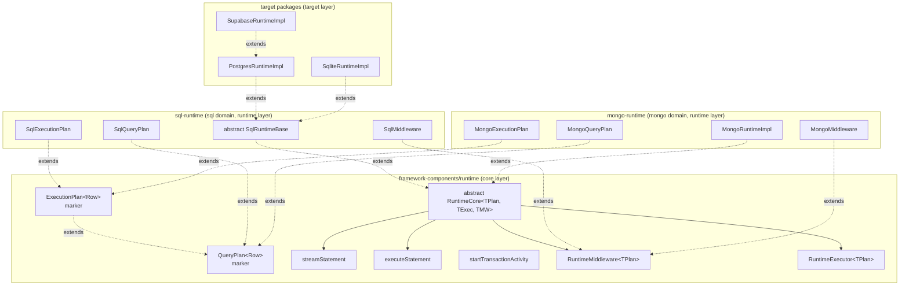
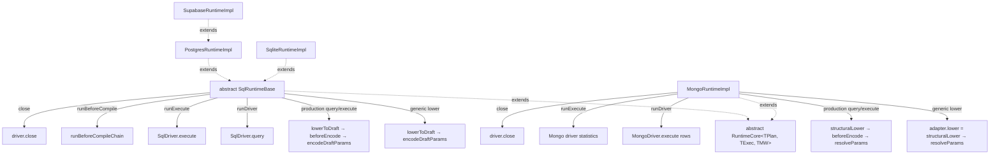
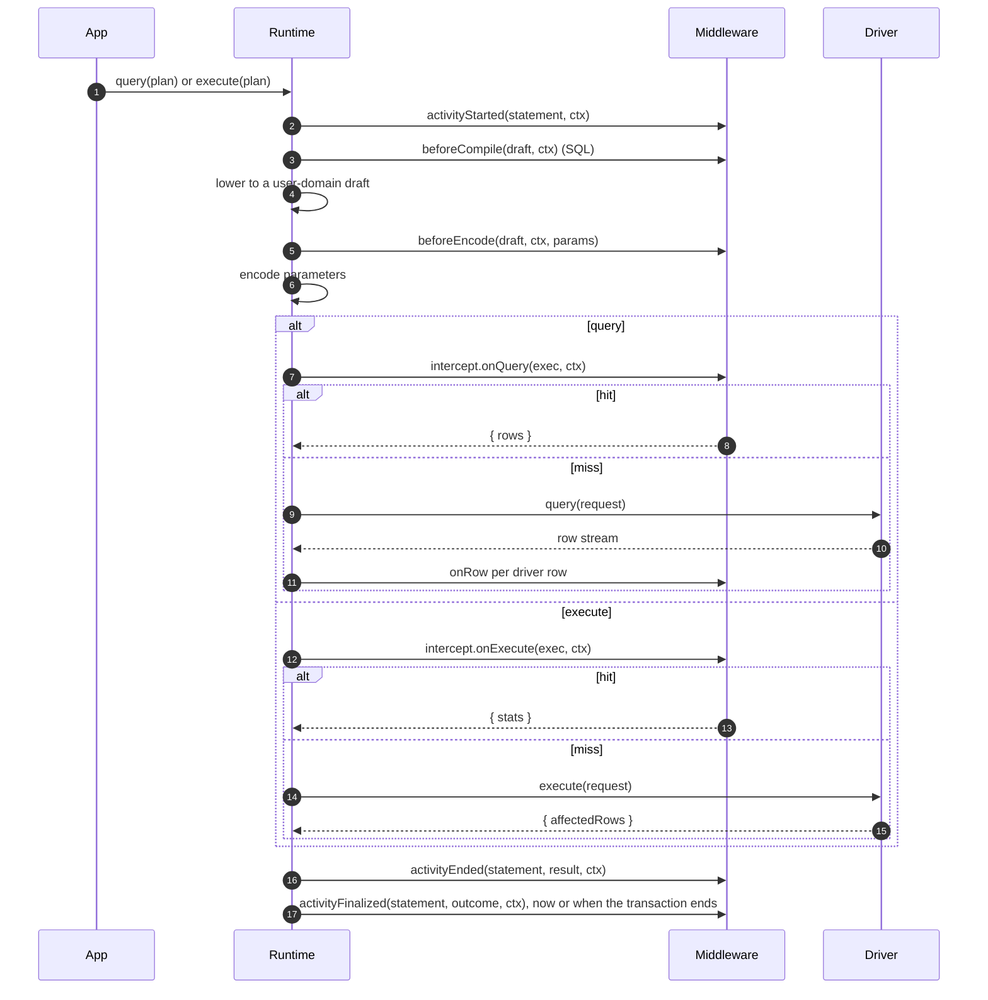

# Runtime & Middleware Framework

The runtime is the executable core of Prisma 8. Its job is to execute query plans and deliver tight feedback loops as it does so. Like the other subsystems, the runtime is simply an orchestrator of composable, primitive components responsible for execution, verification, and the middleware system.

Every query is compiled into a Plan, and every Plan the runtime sends to the database runs as a **statement activity**: one act with a start, an end and a final outcome, which middleware observe through lifecycle events and can change or stop through interceptors. A transaction is an activity too, and the statements sent on it are its children. The framework owns one canonical runner for statements and one for transactions, so behavior is explicit and problems are easy to diagnose.

The "one query, one statement" rule simplifies both verification and debugging. When a Plan fails verification or a middleware raises a violation, the surface area is small and the cause is clear.

Results stream as `AsyncIterable<Row>` so applications can start processing immediately without buffering entire result sets. For typical small queries, consumers can opt into simple collection; the streaming model is the default, not a requirement.

The middleware system keeps logic out of the core and makes behavior composable. First-party and community middleware can implement lints, budgets, telemetry, and AST rewrites. Every Plan is presented to middleware before execution so policies and checks run consistently across families.

The runtime also verifies the contract against the database marker before it executes, and it executes Plans via family drivers while composing codecs from adapters and packs to decode rows precisely.

The runtime does not orchestrate migrations or unit-of-work semantics, does not contain dialect lowering logic (which lives in adapters), does not parse arbitrary SQL beyond the structure provided by lanes, and does not allow disabling contract verification in production. This separation of concerns reflects a thin-core, fat-targets philosophy that keeps the core predictable and extensions explicit.

## Single-Tier Runtime Model

Prisma 8 has a single-tier runtime model: each family runtime is a single class that extends an abstract framework base. There is no separate target-agnostic "runtime executor" package any more — the framework owns the lifecycle template and the middleware orchestrator, and family runtimes own their family-specific overrides. See [ADR 204 — Single-tier runtime: collapse `runtime-executor` into `framework-components`](../adrs/ADR%20204%20-%20Single-tier%20runtime.md) for the rationale and the dependency direction it establishes.

The cross-family abstractions live in [`@internal/framework-components/runtime`](../../../packages/1-framework/1-core/framework-components/src/exports/runtime.ts):

- Plan markers — `QueryPlan` and `ExecutionPlan` (see [`query-plan.ts`](../../../packages/1-framework/1-core/framework-components/src/execution/query-plan.ts)).
- Middleware SPI — `RuntimeMiddleware<TPlan, TMutator>`, the activity types (`StatementActivity`, `TransactionActivity`), `ActivityContext`, and the lifecycle results `ActivityEndedResult` and `ActivityFinalizedResult` (see [`runtime-middleware.ts`](../../../packages/1-framework/1-core/framework-components/src/execution/runtime-middleware.ts)).
- Executor SPI — `RuntimeExecutor<TPlan>` (same module).
- Abstract base — `RuntimeCore<TPlan, TExec, TMiddleware>` (see [`runtime-core.ts`](../../../packages/1-framework/1-core/framework-components/src/execution/runtime-core.ts)).
- Activity runners — `streamStatement` and `executeStatement` run one statement as an activity, and `startTransactionActivity` opens a transaction activity (see [`run-with-middleware.ts`](../../../packages/1-framework/1-core/framework-components/src/execution/run-with-middleware.ts) and [`transaction-activity.ts`](../../../packages/1-framework/1-core/framework-components/src/execution/transaction-activity.ts)).

The class hierarchy has three layers: framework → family → target. Target classes are where construction happens (via target factories) and where target-specific runtime behaviour lives.



## Plan Markers: `QueryPlan` and `ExecutionPlan`

`QueryPlan<Row>` and `ExecutionPlan<Row>` are content-free framework-level marker interfaces. They exist so generic SPIs (`RuntimeExecutor`, `RuntimeMiddleware`, the abstract base, the orchestrator helper) can be parameterized over a plan type without naming any family-specific shape.

```typescript
// packages/1-framework/1-core/framework-components/src/execution/query-plan.ts
export interface QueryPlan<Row = unknown> {
  readonly meta: PlanMeta;
  readonly _row?: Row;
}

export interface ExecutionPlan<Row = unknown> extends QueryPlan<Row> {}
```

`QueryPlan` is the **pre-lowering** marker — what a query lane builds. `ExecutionPlan` is the **post-lowering** marker — what a family runtime hands to the driver. Each family extends them with its concrete payload:

- `SqlQueryPlan` — AST + meta (no SQL text yet). Lives in [`@internal/sql-relational-core`](../../../packages/2-sql-family/4-lanes/relational-core/src/plan.ts) (lanes layer; lanes can build it without a runtime dependency).
- `SqlExecutionPlan` — `{ sql, params, ast?, meta, _row? }`. Lives in [`@internal/sql-relational-core`](../../../packages/2-sql-family/4-lanes/relational-core/src/sql-execution-plan.ts) and is re-exported from `@internal/sql-runtime` via `./plan`. Co-located with `SqlQueryPlan` so lane utilities (`SqlPlan`) can compose against the executable shape without depending on the runtime layer. The raw statement terminators are not among them — they mint `SqlQueryPlan` through `planFromAst`, and lowering to the executable shape stays the runtime's job.
- `MongoQueryPlan` — typed Mongo command shape; lives in [`@internal/mongo-query-ast`](../../../packages/2-mongo-family/4-query/query-ast/src/query-plan.ts).
- `MongoExecutionPlan` — `{ command, meta, _row? }`. Lives in [`@internal/mongo-runtime`](../../../packages/2-mongo-family/7-runtime/src/mongo-execution-plan.ts) (runtime layer; the wire-command shape lives in transport, which the lanes layer cannot depend on).

The framework domain owns no SQL- or Mongo-shaped concrete plan type. The previous SQL-shaped `ExecutionPlan` that lived in `@internal/contract/types` has been replaced by these family-specific subtypes.

The phantom `_row` on every plan lets type-level utilities recover the row type from a plan value (`type Row = ResultType<typeof plan>`), and lets `RuntimeExecutor.query<Row>(plan: TPlan & { readonly _row?: Row })` thread a caller-supplied `Row` into the result stream. `RuntimeExecutor.execute(plan)` is the separate statistics operation.

## Abstract `RuntimeCore` Lifecycle Template

`RuntimeCore<TPlan, TExec, TMiddleware>` provides the family-agnostic operation split. Concrete subclasses provide lowering and driver terminals; the framework keeps row and statistics lifecycles explicit.

```typescript
// packages/1-framework/1-core/framework-components/src/execution/runtime-core.ts
export abstract class RuntimeCore<
  TPlan extends QueryPlan,
  TExec extends ExecutionPlan,
  TMiddleware extends RuntimeMiddleware<TExec>,
> implements RuntimeExecutor<TPlan> {
  protected abstract lower(plan: TPlan, ctx: CodecCallContext): TExec | Promise<TExec>;
  protected abstract runDriver(exec: TExec): AsyncIterable<Record<string, unknown>>;
  protected abstract runExecute(exec: TExec): Promise<RuntimeStatementStats>;
  abstract close(): Promise<void>;

  query<Row>(plan: TPlan & { readonly _row?: Row }): AsyncIterableResult<Row>;
  execute(plan: TPlan): Promise<RuntimeStatementStats>;
}
```

`RuntimeCore` runs each `query()` and `execute()` as a statement activity with no parent, in this order: `activityStarted` → `runBeforeCompile` → `lower` to the executable `TExec` → `beforeEncode` → `intercept` → the driver terminal → `activityEnded` → `activityFinalized`. It does not own parameter encoding or a pre-encode draft. SQL and Mongo override their production operation paths to place their family-specific split before encoding: `beforeEncode` sees a structural draft, then SQL calls `encodeDraftParams` or Mongo calls `resolveParams`. Interceptors therefore observe the encoded execution plan on those paths. `runDriver` is the row/query terminal and `runExecute` is the statistics terminal; both are required abstract driver seams alongside `lower` and `close`.

`close()` is abstract; subclasses dispose family-specific resources. Each statement has its own context, shared by all of its hooks, and the context carries no operation discriminator: the activity's `returns` field (`'rows'` or `'stats'`) and the result types carry that distinction.

## Family and Target Inheritance Pattern

Each family runtime binds the three generics to concrete family types and implements the family-specific overrides. Target classes extend the family class to add target-specific runtime behaviour; there is no two-layer composition — no outer "family runtime" wrapping an inner "runtime core" instance.



**SQL family.** [`SqlRuntimeBase extends RuntimeCore<SqlQueryPlan, SqlExecutionPlan, SqlMiddleware>`](../../../packages/2-sql-family/5-runtime/src/sql-runtime.ts) is **abstract** and overrides:

- `lower(plan: SqlQueryPlan, ctx: SqlCodecCallContext): SqlExecutionPlan` — composes `lowerToDraft` and `encodeDraftParams` for the abstract `RuntimeCore` contract. The production query and execute helpers instead call `lowerToDraft`, run the statement's `beforeEncode` hooks, and then call `encodeDraftParams` so mutations are encoded afterward.
- `runDriver(exec: SqlExecutionPlan): AsyncIterable<Record<string, unknown>>` — the row/query path, delegating to `SqlDriver.query()`.
- `runExecute(exec: SqlExecutionPlan): Promise<SqlStatementStats>` — the statistics path, delegating to `SqlDriver.execute()`.
- `beforeCompile` — the production paths run the `beforeCompile` chain over the plan's draft (AST + meta) inside the statement activity, with the statement's context, and continue with the rewritten plan when middleware mutates the AST. `prepare()` runs the same chain once, outside any statement, with a context of its own.
- `close()` — waits for runtime-scope work that has started, then closes the driver. See [Shutdown](#shutdown).

`SqlRuntimeBase` wraps its query path with codec row-decoding and wraps both query and execute with marker verification and telemetry fingerprinting; these stay SQL-side rather than living in the abstract base.

`SqlRuntimeBase` also exposes a raw-connection primitive and separate protected query/statistics helpers for target subclasses that need to issue SQL outside the middleware chain — see [Raw Connection Seam](#raw-connection-seam) below.

**SQL target classes.** [`PostgresRuntimeImpl`](../../../packages/3-targets/postgres/9-facade/src/runtime/postgres-runtime.ts) and [`SqliteRuntimeImpl`](../../../packages/3-targets/sqlite/9-facade/src/runtime/sqlite-runtime.ts) extend `SqlRuntimeBase` and are currently identity-thin — their value is structural. Future Postgres-specific runtime behaviour (prepared-statement caching, `LISTEN`/`NOTIFY`, etc.) lands on `PostgresRuntimeImpl` and flows into `SupabaseRuntimeImpl` by inheritance.

Target factories (`postgres()`, `sqlite()`, `supabase()`) construct their concrete target class; app code receives the `Runtime` interface and never sees the class hierarchy.

**Mongo family.** [`MongoRuntimeImpl extends RuntimeCore<MongoQueryPlan, MongoExecutionPlan, MongoMiddleware>`](../../../packages/2-mongo-family/7-runtime/src/mongo-runtime.ts) overrides:

- `lower(plan: MongoQueryPlan): MongoExecutionPlan` — composes the adapter's one-shot `lower`, which is `resolveParams(structuralLower(plan))`, for the abstract `RuntimeCore` contract. The production query and execute paths call `structuralLower`, run the statement's `beforeEncode` hooks, and then call `resolveParams`.
- `runDriver(exec: MongoExecutionPlan): AsyncIterable<Record<string, unknown>>` — drives the driver's row/query stream via `driver.execute(exec.command)`.
- `runExecute(exec: MongoExecutionPlan): Promise<RuntimeStatementStats>` — drives the statistics path and maps update `modifiedCount` or delete `deletedCount`.
- `close()` — closes the driver.

Mongo does not override `runBeforeCompile`; the base's identity default is sufficient because Mongo has no typed AST-rewrite chain today.

Adding a new family runtime requires one constructor and four abstract method overrides (`lower`, `runDriver`, `runExecute`, and `close`; `runBeforeCompile` is an optional fifth override when the family wants typed pre-lowering rewrites). No other extension points are required.

## Raw Connection Seam

`SqlRuntimeBase` exposes a raw-connection primitive and separate protected query/statistics helpers for target subclasses that need to run SQL outside the middleware chain — for example, to apply session-scoped Postgres settings before a typed query runs.

```ts
protected acquireRawConnection(
  options?: Pick<ActivityExecuteOptions, 'activityParent'>,
): Promise<SqlConnection>

protected queryAgainstQueryable<Row>(
  plan: SqlExecutionPlan<unknown> | SqlQueryPlan<unknown>,
  queryable: SqlQueryable,
  options?: RuntimeExecuteOptions,
): AsyncIterableResult<Row>

protected executeStatisticsAgainstQueryable(
  plan: SqlExecutionPlan<unknown> | SqlQueryPlan<unknown>,
  queryable: SqlQueryable,
  options?: RuntimeExecuteOptions,
): Promise<SqlStatementStats>
```

`acquireRawConnection()` returns a raw `SqlConnection` from the driver. SQL issued directly on it (e.g. via `conn.query(...)`) runs outside the middleware/codec/telemetry pipeline. The caller owns the connection's lifecycle (`release`/`destroy`/`beginTransaction`). `connection()` is built on it, so a raw connection and an ordinary one follow the one close rule that `Runtime.close()` states: opening a connection goes through the entry check, so once `close()` refuses it is refused with `DRIVER.NOT_CONNECTED` "Runtime is closed", unless `activityParent` is an activity that is still open; the statements and the transactions run on the connection are work `close()` waits for, a transaction from its start until its commit or rollback settles; a connection merely held between statements is not, and the driver's close waits for its release.

A runtime built with `ownsDriver: false` does not close its driver: its `close()` refuses new work and waits for the work in flight, and leaves the driver open. An owner of several runtimes on one driver builds them all this way, closes them, then closes the driver once; the Supabase facade does this for its application runtime and its runtime for the Supabase contract.

`queryAgainstQueryable()` runs a typed row plan through the full middleware/codec/telemetry pipeline against a caller-supplied queryable, while `executeStatisticsAgainstQueryable()` runs the corresponding statistics path. Passing the raw connection from `acquireRawConnection` lets a subclass issue its setup SQL first, then hand the same connection to the appropriate helper.

**Why below-middleware matters.** SQL issued on the raw connection runs outside any activity. User middleware cannot observe, reorder, or strip it. This makes setup SQL structurally non-bypassable — the property that makes Postgres RLS role enforcement sound.

[`SupabaseRuntimeImpl`](../../../packages/3-extensions/supabase/src/runtime/supabase-runtime.ts) is the canonical user: its `openRoleSession` method acquires a raw connection and issues `SELECT set_config('role', ...)` and `SELECT set_config('request.jwt.claims', ...)` before handing the connection to the typed query path. `forRole(binding)` returns a `SupabaseRoleScope`, the runtime operations under one role (`query`, `execute`, the prepared-statement operations and `connection`), each run on a session `openRoleSession` opens. A transaction under the role runs on a session from `connection()`, as `withTransaction` and the ORM open it.

## Activities

The middleware sees a tree of **activities**. An activity is one act by an actor: a statement a client sent, a transaction a client opened, or an act a client started itself, such as an ORM call. Each activity has an `id` (a fresh `crypto.randomUUID()`), a `kind`, and the `annotations` the user put on it. An activity may have a parent, to any depth; a statement sent on an open transaction is that transaction's child, and a statement sent through an activity handle is that activity's child. The decision and its prior art are recorded in [ADR 271](../adrs/ADR%20271%20-%20The%20runtime%20middleware%20observes%20a%20tree%20of%20activities%2C%20each%20started%2C%20ended%20and%20finalized.md).

The runtime defines two kinds:

- **`statement`** — one statement sent to the database. `query()` sends it for its rows and `execute()` for its statistics; the activity's `returns` field is `'rows'` or `'stats'`, and its `plan` is the plan the caller sent. Its `annotations` are the plan's branded user annotations. A statement is a leaf.
- **`transaction`** — started by `transaction()`, ended by `commit()` or `rollback()`. It has no annotations.

Clients add their own kinds, described in [Client activities](#client-activities). A client activity has a `contentHash()` method, computed from the function the client supplied on its first call and memoized for that activity, and the annotations the client passed.

```typescript
// packages/1-framework/1-core/framework-components/src/execution/runtime-middleware.ts
interface StatementActivity<TPlan extends QueryPlan = QueryPlan> extends ActivityBase {
  readonly kind: 'statement'
  readonly returns: 'rows' | 'stats'
  readonly plan: TPlan
}
interface TransactionActivity extends ActivityBase {
  readonly kind: 'transaction'
}
type ClientActivityKind = `${string}-${string}`   // a client kind contains a hyphen, such as 'orm-call'
interface ClientActivity<K extends ClientActivityKind = ClientActivityKind> extends ActivityBase {
  readonly kind: K
  contentHash(): Promise<string>   // computed on the first call, then the same promise
}
type Activity = StatementActivity | TransactionActivity | ClientActivity
```

### Lifecycle events

Every activity has the same three events, and each is one hook whatever the activity's kind:

- **`activityStarted(activity, ctx)`** — the act begins. A statement starts when the runtime accepts it, before `beforeCompile`; a statement the runtime refuses at entry, because it is closed, gets no activity. A transaction starts when `transaction()` is called, before `BEGIN`. An error thrown here fails the activity: it ends `failed`, is finalized, and the caller receives the error. The middleware after the one that threw never saw the activity start, so they receive no `activityEnded` or `activityFinalized` for it; the middleware before it, and the one that threw, receive both.
- **`activityEnded(activity, result, ctx)`** — the act ends, with its outcome as the actor saw it. A statement ends `succeeded`, `failed`, or `stopped` when the caller stopped reading its rows; its result also carries `latencyMs`, `source` (`'middleware'` only when an `intercept` handler supplied the result or threw; `'driver'` otherwise, including for a statement that `beforeCompile` or `beforeEncode` blocked before it ran), and `rowCount` or `stats` according to `returns`. A transaction ends `succeeded` or `failed` according to how `commit()` or `rollback()` settled. When the activity succeeded, an error thrown here fails it and reaches the caller; this is how a latency budget fails a statement. Every middleware that saw the activity start still receives `activityEnded`, and when several throw the caller receives the first error. Finalization follows what the database did, not the hook: a statement that succeeded outside a transaction is finalized `committed` even when a hook failed it. After a failure the error is passed to `ctx.log.error` as `middleware.activityEnded.error`, so it does not mask the original one; for a transaction whose `BEGIN`, `COMMIT` or `ROLLBACK` failed, the caller receives the driver's error. A transaction whose `COMMIT` or `ROLLBACK` the database has already settled cannot fail any more: it is finalized with the database's outcome, `commit()` rejects with the hook's error, and `withTransaction` and the ORM report the callback's original error after a `ROLLBACK`.
- **`activityFinalized(activity, result, ctx)`** — the act's effects are final, with `committed`, `rolled-back` or `unknown`. An error thrown here is passed to `ctx.log.error` and swallowed, and later middleware still run.

Every started activity ends and is finalized exactly once. That includes a statement whose `beforeCompile`, `beforeEncode` or parameter encoding fails: it never reached the database, but it started, so it ends `failed` and is finalized.

### When an activity is finalized

A statement with no enclosing transaction is finalized right after it ends: `committed` when it succeeded, `unknown` when it failed or was stopped, because a statement that errors on the response path, or whose caller stopped reading, may already have applied.

A client activity with no enclosing transaction holds nothing: each of its children is finalized when it ends, by its own rule. The client activity is finalized right after it ends: `committed` when it succeeded and everything beneath it was finalized `committed`, otherwise `unknown`. A transaction beneath it that rolled back makes it `unknown`.

An activity inside a transaction is finalized when the nearest enclosing transaction ends, with the transaction's outcome:

| What happened | Outcome |
|---|---|
| `commit()` resolves and no statement in the transaction failed | `committed` |
| `commit()` resolves after a statement in the transaction failed | `unknown` |
| `rollback()` settles and no commit was attempted | `rolled-back` |
| `commit()` rejects, whether or not a rollback follows | `unknown` |

`unknown` means the runtime cannot tell whether the writes landed. A rejected `COMMIT` may have landed on the server before the error came back, and Postgres answers a `COMMIT` after a failed statement with a silent `ROLLBACK`, while other databases commit. A statement the caller stopped reading is not a failure. Only a failed statement makes a resolved `COMMIT` `unknown`: a statement's failure is passed up through every client activity above it to the nearest transaction, and a client activity that fails with no failed statement beneath it does not change the outcome. A consumer that must not miss a committed write treats `unknown` like `committed`.

When a transaction ends, the activities beneath it that have ended are finalized in post-order: each activity's children in the order they started, depth first, then the activity; then the transaction itself. A client activity inside a transaction keeps its own children for this. `commit()` and `rollback()` resolve only after these `activityFinalized` hooks have run, and a `rollback()` called while a `commit()` is finalizing resolves only after the commit's hooks have run. An activity's end cannot stand in for its finalization: inside a transaction a statement ends before the `COMMIT`, and acting then lets a concurrent read store rows the transaction is about to replace.

An activity still running when its transaction ends, such as a row stream the caller is still reading or a client activity not yet ended, is finalized when it ends, with the outcome the transaction recorded; a client activity finalizes the children it holds first. No new statement or activity may start beneath a client activity whose transaction no longer accepts children. So every activity is started, then ended, then finalized, and the statement keeps its `ctx.state` until it is finalized. `commit()` and `rollback()` do not wait for it. The statement may reach the database after the `COMMIT` or `ROLLBACK` and run outside the transaction, and its own failure is not counted.

A transaction, and a client activity inside one, holds its finished children until the transaction ends only so that it can finalize them. The runtime decides once, when it is created, whether any of its middleware implements `activityFinalized`; if none does, nothing is held at any depth, and a transaction keeps only whether a statement beneath it failed, which still makes a resolved `COMMIT` after a failed statement `unknown`. Failure forwarding and the count of open children work either way. A middleware given `activityFinalized` after the runtime was created sees its transactions finalized, but not their statements. So any middleware that implements `activityFinalized` and is registered when the runtime is created makes every transaction hold its finished children, with their plans and parameters, until it ends, and the memory a transaction holds grows with the number of statements it runs. The cache middleware is one: it implements the hook to run the invalidation a write carries.

Inside a transaction the `activityFinalized` hooks run one after another while the transaction's connection is still checked out, so their time adds to how long the connection is held. A hook must not wait on a connection from the same pool, for example by awaiting a query through the same runtime. A write that a hook sends through the same runtime is a statement of its own, with its own finalization.

### The statement runner

The framework runs a statement through one of two functions. A family runtime calls the one for the operation, with the middleware, the plan the caller sent, the context fields and the parent, and a body that does the family's work:

```typescript
// packages/1-framework/1-core/framework-components/src/execution/run-with-middleware.ts
export function streamStatement<TExec, TMutator, TContext, Row>(
  options: StatementOptions<TExec, TMutator, TContext>,
  body: (statement: StatementActivityRun<TExec, TMutator, TContext>) => AsyncIterable<Row>,
): AsyncIterable<Row>
export function executeStatement<TExec, TMutator, TContext>(
  options: StatementOptions<TExec, TMutator, TContext>,
  body: (statement: StatementActivityRun<TExec, TMutator, TContext>) => Promise<RuntimeStatementStats>,
): Promise<RuntimeStatementStats>
```

The runner adopts the statement into its parent, fires `activityStarted`, runs the body, then fires `activityEnded` and, unless a transaction holds the statement, `activityFinalized`. When the parent no longer accepts children, the statement is rejected at entry with `RUNTIME.ACTIVITY_NOT_ACCEPTING_CHILDREN` and no hook runs. A row stream starts on its first `next()`; a stream the caller returns before reading starts no activity. The runner decides the outcome at the outer stream, so a decode failure the family raises after a row left the driver counts as `failed`, and a caller that stops reading, calls `return()` or throws into the iterator ends the statement `stopped`. Inside the body, the `StatementActivityRun` gives the family three steps:

- `beforeEncode(draft, params?)` runs every `beforeEncode` hook in registration order, raced against `ctx.signal`, so an abort surfaces `RUNTIME.ABORTED { phase: 'beforeEncode' }` even when a hook ignores the signal.
- `runQuery(exec, runDriver)` runs `intercept.onQuery`, then the intercepted rows or `runDriver()` with `onRow` for each driver row, and records the row count, source and latency for `activityEnded`.
- `runExecute(exec, runDriver)` runs `intercept.onExecute`, then `runDriver()` when no handler supplied statistics.

The statement lifecycles are:

- **Query:** `activityStarted` → `beforeCompile` (SQL) → lower → `beforeEncode` → encode parameters → `intercept.onQuery` → driver `query` or intercepted rows → `onRow` for driver rows → `activityEnded` → `activityFinalized`, now or when the transaction ends.
- **Execute:** `activityStarted` → `beforeCompile` (SQL) → lower → `beforeEncode` → encode parameters → `intercept.onExecute` → driver `execute` or intercepted statistics → `activityEnded` → `activityFinalized`, now or when the transaction ends.

### The transaction runner

`startTransactionActivity({ middleware, context, parent, holdFinishedChildren })` opens a transaction activity and runs its `activityStarted` hooks. `parent` is the client activity the transaction starts beneath, or `undefined`. The returned `TransactionActivityRun` is an `ActivityParent`: the SQL runtime passes it as the `parent` of every statement sent on the transaction, or on its connection, from the end of `BEGIN` until `commit()` or `rollback()` is called. `end(settlement)` ends the transaction once, with how `commit()` or `rollback()` settled, and finalizes its children that have ended, in start order, and then itself; a child still open is finalized when it ends. A second call does nothing, so the cleanup `ROLLBACK` after a rejected `COMMIT` does not end the transaction twice. `stopAcceptingChildren()` makes the transaction stop accepting children: new work beneath it, and beneath the client activities inside it, is refused from the call on, and `acceptsChildren()` returns `false`; the SQL runtime calls it when `commit()` or `rollback()` is called, before the transaction ends. When `activityStarted` throws, or `BEGIN` fails, the transaction ends `failed` and is finalized `rolled-back`. Family runtimes do not reimplement these loops.

### Client activities

A client is code that calls the runtime on the user's behalf, such as the ORM or an extension. It starts an activity for an act the runtime would not otherwise see. `postgres()`, `sqlite()` and `supabase()` are facades: they build the runtime and the ORM, and start no client activities themselves. The SQL runtime, its connections and transactions, the context of `withTransaction` and every activity handle carry an `ActivitySource` (`startActivity` and `planContentHash`) through the `activitySource` symbol member, which `startActivityOn(queryable, activity)` and `planContentHashOn(queryable, plan)` read. All three are public exports of `@prisma/orm-family-sql/runtime`, so a third-party client can start activities; the public queryable types still do not show the member. A handle also has the two members itself, so a client nests an activity with `handle.startActivity` or `startActivityOn(handle, activity)`. `findActivitySource` reads only the symbol member; an object with plain `startActivity` and `planContentHash` members is not an activity source. A queryable's activity source must send its handles' statements to the same place as the queryable's own `query` and `execute`. A wrapper that replaces `query` and `execute`, for example to record or rewrite statements, must therefore also wrap `[activitySource]`, wrapping each handle it returns and the transaction a handle's `transaction()` opens; otherwise the ORM's statements, which go through the handle, skip the wrapper:

```typescript
// packages/2-sql-family/5-runtime/src/activity-handle.ts
startActivityOn<K extends ClientActivityKind>(queryable: RuntimeScope, activity: StartActivity<K>): Promise<ActivityHandle<K>>

interface StartActivity<K extends ClientActivityKind> {
  readonly kind: K
  readonly contentHash: () => Promise<string>   // called at most once, when a middleware asks
  readonly annotations?: ReadonlyMap<string, AnnotationValue<unknown, OperationKind>>
}

interface ActivityHandle<K> extends RuntimeQueryable, ActivitySource, ActivitySourceTarget {
  readonly activity: ClientActivity<K>
  readonly intercepted: { readonly result: ClientActivityResult<K> } | undefined
  readonly transaction?: () => Promise<RuntimeTransaction>
  end(end: { readonly outcome: 'succeeded' | 'failed' | 'stopped'; readonly result?: ClientActivityResult<K> }): Promise<void>
}
```

```typescript
const call = await startActivityOn(runtime, {
  kind: 'orm-call',
  contentHash: () => ormCallContentHash(runtime, method, plan),
  annotations,
})
if (call.intercepted) {
  await call.end({ outcome: 'succeeded' })
  return call.intercepted.result
}
const rows = await call.query(plan).toArray()
await call.end({ outcome: 'succeeded', result: rows })
```

- **Kinds.** A client kind contains a hyphen, such as `orm-call`, so the type system rejects `'statement'`, `'transaction'` and any other kind without one; `startActivity` also rejects them at run time with `RUNTIME.ACTIVITY_KIND_RESERVED`, for a caller that casts. Kinds the runtime defines, in every family, never contain a hyphen. `Activity` includes `ClientActivity` in every program, so a middleware that knows no client kind still receives client activities and should ignore kinds it does not handle. A client may register a kind's result type by module augmentation of `ClientActivityRegistry`, through the published entry `@prisma/orm-framework/components/runtime` (or `@prisma/orm-postgres/components/runtime`, which re-exports it); the source is `@internal/framework-components/runtime`. The augmenting file also imports from the entry it augments. The registry types the handle side only: `intercepted.result` and `end({ result })` (`ClientActivityResult<K>`). In middleware hooks a client activity's result is `unknown`, even after narrowing on its kind, because the hook types must accept unregistered kinds; a middleware checks the value it receives. An unregistered kind's result is `unknown` on the handle too. The framework names no client kind.

  ```typescript
  declare module '@prisma/orm-framework/components/runtime' {
    interface ClientActivityRegistry { 'orm-call': { result: unknown } }
  }
  ```

- **Starting.** `startActivity` runs `activityStarted`, then each `intercept.onActivity` handler in registration order until one returns a result (see [Intercepting Execution](#intercepting-execution)). When a hook or a handler throws, the activity ends `failed`, is finalized, and `startActivity` rejects with that error.
- **Children.** Statements, prepared statements and activities started through the handle are its children. Their `ctx.scope`, and the activity's own, is the scope of the queryable the handle was opened on. A handle opened on a transaction is the transaction's child. A handle opened on the context of `withTransaction` is guarded as `tx` is: after the callback, a read through it throws `RUNTIME.TRANSACTION_CLOSED`, an escaped row stream rejects with it on its next pull, and `execute`, prepared statements and nested activities are refused with it before they reach the driver.
- **`transaction()`.** It starts a transaction activity beneath the handle. A handle opened on the runtime takes a connection for the transaction and owns it: the connection is released once the transaction commits or rolls back, destroyed after a failed rollback, and kept after a failed commit for the rollback that follows. A handle opened on a connection begins the transaction on that connection, which stays held; while that transaction is open, a second `transaction()` rejects with `RUNTIME.TRANSACTION_ALREADY_OPEN`. A release that fails after an owned transaction settled is passed to `ctx.log.error` as `runtime.connection.release.error`, and `commit()` or `rollback()` keeps its own outcome: it resolves after a `COMMIT` or `ROLLBACK`, and rejects with the commit's error when a hook failed a `COMMIT` the database applied. A handle opened on a transaction, on the context of `withTransaction`, or on a connection whose transaction is already open has no `transaction` property at run time, so transactions do not nest. `transaction()` on an ended handle rejects with `RUNTIME.ACTIVITY_NOT_ACCEPTING_CHILDREN` before it takes a connection.
- **Ending.** `end()` passes the client's result to `activityEnded`; the runtime never reads it. The ended result is `{ kind, outcome, source, result? }`. When the activity was intercepted and the client passes no result, the result is the intercepted one and `source` is `'middleware'`; otherwise `source` is `'client'`. Ending an activity while a statement or activity beneath it has not ended ends it `failed`, finalizes it, and rejects with `RUNTIME.ACTIVITY_CHILDREN_OPEN`, whose `details.openChildren` is the count; each open child is finalized when it ends. A second `end()` rejects with `RUNTIME.ACTIVITY_ALREADY_ENDED`.
- **Work outside the connection's transaction.** A statement sent through a connection handle after a transaction was opened on that connection would run inside the transaction while its activity is outside it, so it would be finalized `committed` before the transaction commits. It is rejected at entry with `RUNTIME.ACTIVITY_OUTSIDE_TRANSACTION`; send it on the transaction, or start the activity there.
- **Work under an activity that no longer accepts children.** An activity stops accepting children when it ends; a transaction, when its `commit()` or `rollback()` is called, and with it every client activity inside it. A statement, prepared statement, activity or `transaction()` started through such a handle is rejected with `RUNTIME.ACTIVITY_NOT_ACCEPTING_CHILDREN` before it takes a connection or a role session, and no hook runs.
- **Open handles.** An open handle on the runtime is runtime work in flight, so `close()` waits for its `end()`. A handle never ended keeps the runtime busy, as a connection never released does; when `close()` is waiting only for open handles, or, once it refuses, for transactions still open, it logs one `ctx.log.warn` event `runtime.close.waiting-for-activities` with the counts `openActivities` and `openTransactions`. `openTransactions` counts the transactions open at that moment, which `close()` waits for until they commit or roll back. A transaction stops counting when its commit fails or its connection is released or destroyed.
- **User-facing types.** `tx`, the facades (`db`, `db.orm`), and the public `Runtime`, `RuntimeConnection` and `RuntimeTransaction` types that `db.runtime()` returns do not show `startActivity` or `planContentHash`. They are reached only through the `activitySource` member and the two helpers, and the ORM reaches them the same way: its structural `RuntimeQueryable` must carry `activitySource`, the Postgres, SQLite and Supabase facades give the ORM runtime objects they build that member (`delegatingActivitySource(() => runtime)`, or the role-aware source on Supabase), `db.runtime()` passed straight to `orm()` carries it, and `findActivitySource` returns `undefined` for a queryable without it, and every ORM terminal method on it then fails with `ORM.ACTIVITY_SOURCE_MISSING`.
- **Supabase.** The `activitySource` member of `SupabaseRuntimeImpl.forRole(binding)` is the activity source the facade gives the role-bound ORM. Its handles send each statement on a role session of their own, as a role-bound query does, with scope `'connection'`. A handle's `transaction()` opens one role session and owns it until the transaction settles. Its `planContentHash(plan)` hashes at the same `'connection'` scope, so the digest matches a role-bound statement's. The member is on the implementation the facade uses, not on the `SupabaseRuntime` interface. A role session carries an `activitySource` member like any connection.

`planContentHash(plan)`, on the same queryables and handles, computes the content hash of the statement the plan sends. It equals the digest `ctx.contentHash(exec)` returns for the statement's execution plan only when three things hold: `beforeCompile` gives the same result for the plan in both places, no `beforeEncode` hook changes the parameters, and the codecs encode deterministically. `planContentHash` compiles the plan with the scope and parent of the queryable it is called on and with fresh state (a hash taken on the runtime before the activity starts has no parent), while the statement compiles beneath the handle with the state its `activityStarted` hooks wrote; a `beforeCompile` that reads `ctx.parent` or state, or is not deterministic, gives a different digest, as does a middleware that encrypts parameters with a fresh nonce. A cache keys on the client's content hash and must not rely on the two being equal. It runs `beforeCompile` (query plans only), lowers, encodes the parameters and returns `computeSqlContentHash` of the result. It does not run `beforeEncode`, whose lints would fire twice and whose parameter changes, such as encryption, need not be deterministic. Its `beforeCompile` hooks get a context that belongs to no activity, with the `scope` and `parent` of the queryable it was called on, so `inTransaction()` is truthful, and fresh state. `prepare()` uses the same context with no parent. A client uses `planContentHash` inside the function it passes as its activity's `contentHash`, so the plan is hashed only when a middleware asks. It starts nothing, so it also works on a handle that has ended. A middleware compares it with a statement's digest by calling `await ctx.contentHash(plan)` where it has the execution plan, in `beforeEncode`, `intercept.onQuery` or `intercept.onExecute`.

The framework runner is `startClientActivity(activity, { middleware, context, parent, holdFinishedChildren })`, where `activity` is a `StartActivity`; it returns a `ClientActivityRun`, an `ActivityParent` with `activity`, `ctx`, `intercepted`, `acceptsChildren()`, `assertAcceptsChildren()` and `end()`, which the SQL runtime wraps into the handle. Both parent types, transactions and client activities, have `acceptsChildren()`.

## Intercepting Execution

`intercept.onActivity(activity, ctx)` can supply the result of a client activity with `{ result }`. It runs when the activity starts, after `activityStarted`; the first handler that returns a result wins, the runtime logs a debug event `middleware.intercept.onActivity` naming the middleware, and the handle's `intercepted` is set. Its result type belongs to the client, so the framework types it `unknown` and the client checks what it receives. Statements may still run on an intercepted handle.

The other interceptors exist only on statements. `intercept.onQuery` can supply a row query's result with `{ rows }`; `intercept.onExecute` can supply a statistics execution's result with `{ stats }`. The runner calls the handler that matches the statement's `returns`, after `beforeEncode` and parameter encoding. Middleware run in registration order and the first handler that returns a result wins. A query hit skips the driver and `onRow`; an execute hit skips only the driver execute call. `activityEnded` still fires, with `source: 'middleware'`.

```typescript
intercept?: {
  onQuery?(plan: TPlan, ctx: ActivityContext): Promise<QueryInterceptResult | undefined>
  onExecute?(plan: TPlan, ctx: ActivityContext): Promise<ExecuteInterceptResult | undefined>
  onActivity?(activity: ClientActivity, ctx: ActivityContext): Promise<ActivityInterceptResult | undefined>
}

interface QueryInterceptResult {
  readonly rows: AsyncIterable<Record<string, unknown>> | Iterable<Record<string, unknown>>
}

interface ExecuteInterceptResult {
  readonly stats: RuntimeStatementStats
}
```

Each handler's return type is fixed, so the compiler rejects a query handler that supplies statistics or an execute handler that supplies rows. The cache middleware implements `intercept.onQuery` for annotated statements and `intercept.onActivity` for annotated client activities such as ORM calls. A transaction has no handler: it has no result to supply, and skipping it would run its statements outside any transaction.

Contract-marker verification remains upstream of SQL interception, so an interceptor cannot bypass a stale-contract check. An error raised by an interceptor, the driver or the row source ends the statement `failed`.

Each statement has its own context, and every hook of the statement receives the same one. Middleware keep per-statement scratch state with `ctx.state(key)` rather than in a map keyed by plan, so concurrent statements of the same plan never share it; see [The middleware context](#the-middleware-context).

## Annotations

Annotations are a typed, namespaced way to attach per-query metadata that middleware can read. They are the opt-in mechanism the cache middleware uses ("cache this read under this key"), the audit middleware would use ("attribute this write to this actor"), and any future per-query policy hook will reuse.

The framework provides three pieces:

- `OperationKind = 'read' | 'write'` — the binary discriminator that gates which terminals an annotation can attach to. Finer-grained kinds (`'select' | 'insert' | …`) are deferred; widening is additive.
- `defineAnnotation<Payload>()({ namespace, applicableTo })` — curried two-step factory. The first call takes `Payload` explicitly; the second takes the runtime options and infers `Kinds` from `applicableTo` via a `const` type parameter, so the operation kinds appear once at the call site rather than being repeated as a type argument. The returned handle is a **callable function**: `handle(value)` produces an `AnnotationValue<Payload, Kinds>`. The function also carries `namespace`, `applicableTo: ReadonlySet<Kinds>` (frozen), and `read(source)` as properties; `source` is a plan or an activity. Both `applicableTo` (off the handle and off each value) feed the type-level and runtime applicability gates.
- `ValidAnnotations<K, As>` — mapped tuple type consumed by lane terminals. Resolves any tuple element whose declared `Kinds` does not include the terminal's `K` to `never`, surfacing the mismatch as a type error at the call site.

```typescript
// packages/1-framework/1-core/framework-components/src/annotations.ts
import { defineAnnotation } from '@internal/framework-components/runtime'

// Read-only annotation. Kinds inferred as 'read'.
export const cacheAnnotation = defineAnnotation<{ key?: string }>()({
  namespace: 'cache',
  applicableTo: ['read'],
})

// Write-only annotation (illustrative). Kinds inferred as 'write'.
export const auditAnnotation = defineAnnotation<{ actor: string }>()({
  namespace: 'audit',
  applicableTo: ['write'],
})

// Applicable to both kinds (e.g. tracing). Kinds inferred as 'read' | 'write'.
export const otelAnnotation = defineAnnotation<{ traceId: string }>()({
  namespace: 'otel',
  applicableTo: ['read', 'write'],
})
```

**Lane integration.** SQL DSL and ORM `Collection` adopt different surface shapes appropriate to their idioms; both gate by the terminal's operation kind `K`:

- SQL DSL — `.annotate(...)` is a variadic chainable method on every builder kind: `SelectQueryImpl` / `GroupedQueryImpl` accept `'read'`-applicable annotations; `InsertQueryImpl` / `UpdateQueryImpl` / `DeleteQueryImpl` accept `'write'`-applicable. The variadic parameter is constrained by `As & ValidAnnotations<K, As>`. The intersection is load-bearing — TypeScript's variadic-tuple inference is too forgiving with `ValidAnnotations<K, As>` alone, but the intersection pins `As` to the call-site tuple AND requires assignability to the gated form.
- ORM `Collection` and `GroupedCollection` — every terminal accepts an optional `configure: (meta: MetaBuilder<K>) => void` callback as its last argument. The user calls `meta.annotate(annotation)` (chainable, returns the builder) once per annotation; the conditional `K extends Kinds ? AnnotationValue<P, Kinds> : never` parameter type rejects inapplicable annotations at the call site. There is no chainable `Collection.annotate()` — annotations attach via the configurator only. The callback shape (rather than the variadic shape SQL DSL uses) is deliberate at the ORM layer: a terminal's last argument grows over time (future per-call options), and a callback configurator is extension-friendly where a variadic forecloses on additional arguments. The callback also avoids the `As & ValidAnnotations<K, As>` intersection — taking one annotation at a time avoids variadic-tuple inference entirely. Each ORM terminal runs as one `orm-call` client activity, and the recorded annotations live on that activity; the statements the call sends carry only the reserved keys the ORM sets itself.

**Runtime applicability check.** SQL DSL `.build()` and the ORM `MetaBuilder.annotate(...)` both call `assertAnnotationsApplicable(...)` against the annotation(s) and the terminal's kind. The helper throws `RUNTIME.ANNOTATION_INAPPLICABLE` naming the namespace and terminal on any annotation whose `applicableTo` set lacks `kind`. The type system fails closed for type-aware callers, and the runtime check fails closed for casts / `any` / dynamic invocations. ORM terminals construct the meta builder via `createMetaBuilder(kind, terminalName)` and let the builder's `annotate` perform the gate eagerly; lane code does not re-validate after the user callback returns.

**Storage.** A SQL DSL query's annotations land under `plan.meta.annotations[namespace]` as branded `AnnotationValue<Payload, Kinds>` objects; an ORM call's annotations are the `annotations` of its `orm-call` activity. Multiple `.annotate()` chain calls (SQL DSL) or `meta.annotate(...)` calls inside the configurator (ORM) compose; duplicate namespaces use last-write-wins. A statement activity's `annotations` hold the same branded values, keyed by namespace, so `handle.read(activity)` and `handle.read(plan)` return the same payload. Reading defensively checks the `__annotation` brand so framework-internal metadata (e.g. `meta.annotations.codecs` written by the SQL emitter) is not mistaken for a user annotation.

**Reserved namespaces.** `codecs` is consumed by the SQL emitter (`meta.annotations.codecs[alias] = 'pg/text@1'`) and read by the SQL runtime's `decodeRow`; it must not be used by user handles. Target-specific keys such as `pg` are similarly reserved. `defineAnnotation` does not structurally prevent a user from naming a reserved namespace — handles are namespaced strings, not branded types — but the framework makes no compatibility guarantees about handles that do.

**Runtime context: `contentHash` and `scope`.** Two `ActivityContext` fields support the annotation-driven middleware ecosystem:

- `contentHash(exec): Promise<string>` — the family runtime returns an opaque, bounded digest identifying the `(storage, statement, params)` tuple of an execution. SQL composes `meta.storageHash + '|' + exec.sql + '|' + canonicalStringify(exec.params)` and pipes through `hashContent` (SHA-512); Mongo composes `meta.storageHash + '|' + canonicalStringify(exec.command)` and pipes the same way. Two executions with the same storage hash, statement text and canonicalised parameters return the same digest; the text is hashed as supplied, so equivalent SQL that differs in whitespace or casing does not. Used by middleware that need per-execution identity (caching, request coalescing). The cache middleware keys a statement by the annotation's `key` when set, otherwise by its `deriveKey` option, whose default (`deriveKeyFromContentHash`) uses this digest directly — it is not (and should not be) further hashed by callers. It keys a client activity, such as an ORM call, by the annotation's `key` or else `activity.contentHash()`.
- `scope: 'runtime' | 'connection' | 'transaction'` — discriminates the queryable surface the execution is running under. Top-level `runtime.execute` populates `'runtime'`; `connection.execute` and `transaction.execute` derive a context with `'connection'` / `'transaction'`. Middleware that should only act at the top level (e.g. the cache middleware) read this field to bypass non-runtime scopes; the cache also bypasses an activity when `ctx.inTransaction()` is true, so an ORM call on `tx` inside `db.transaction(fn)` is never cached.

## Mutation defaults

Execution mutation defaults (generated values such as `timestampNow` behind `temporal.UpdatedAt`, or `uuidv4`) are filled by framework runtime code that every family shares: [`framework-components/src/execution/mutation-defaults.ts`](../../../packages/1-framework/1-core/framework-components/src/execution/mutation-defaults.ts), exported through `@internal/framework-components/runtime`. Runtime targets, adapters, and extensions contribute `RuntimeMutationDefaultGenerator`s (`{ id, generate(params?), stability }`). A family's execution context calls `collectMutationDefaultGenerators` over its stack, runs `assertMutationDefaultGeneratorsAvailable` when it is created (`RUNTIME.MUTATION_DEFAULT_GENERATOR_MISSING` lists every generator the contract names that no component provides; `RUNTIME.DUPLICATE_MUTATION_DEFAULT_GENERATOR` names both owners of a duplicate id), and exposes `applyMutationDefaults({ op, namespace, entry, values, defaultValueCache })` through the `MutationDefaults` interface the ORMs depend on. A key present in `values` is explicit whatever its value; callers drop `undefined` first. The generator contract, the three stabilities and their caches, and the rules are recorded in [ADR 256](../adrs/ADR%20256%20-%20Mutation-default%20generators%20are%20a%20framework%20runtime%20concern.md).

## ORM Client Integration

The SQL ORM client ([`@internal/sql-orm-client`](../../../packages/3-extensions/sql-orm-client/src/types.ts)) consumes the canonical executor interface rather than declaring a parallel hierarchy. The integration is anchored on a small `RuntimeScope` slice exported from the lanes layer so both the ORM client and the SQL runtime depend on the same source of truth:

```typescript
// packages/2-sql-family/4-lanes/relational-core/src/runtime-scope.ts
import type { AsyncIterableResult, RuntimeExecuteOptions } from '@internal/framework-components/runtime';
import type { SqlStatementStats } from './ast/driver-types';
import type { SqlExecutionPlan } from './sql-execution-plan';
import type { SqlQueryPlan } from './plan';

export type SqlOrmPlan = SqlExecutionPlan | SqlQueryPlan;

export interface RuntimeScope {
  query<Row>(plan: SqlOrmPlan, options?: RuntimeExecuteOptions): AsyncIterableResult<Row>;
  execute(plan: SqlOrmPlan, options?: RuntimeExecuteOptions): Promise<SqlStatementStats>;
}
```

```typescript
// packages/3-extensions/sql-orm-client/src/types.ts
import type { RuntimeScope, SqlOrmPlan } from '@internal/sql-relational-core';

export interface RuntimeQueryable extends RuntimeScope {
  connection?(): Promise<RuntimeConnection>;
  transaction?(): Promise<RuntimeTransaction>;
}

export interface RuntimeConnection extends RuntimeScope { /* release?, transaction? */ }
export interface RuntimeTransaction extends RuntimeScope { /* commit?, rollback? */ }
```

`RuntimeQueryable` is `RuntimeScope` plus optional SQL-domain `connection()` / `transaction()` methods; `RuntimeConnection` and `RuntimeTransaction` extend `RuntimeScope` with their lifecycle methods. The structural compatibility with `RuntimeExecutor<SqlOrmPlan>` is asserted by the type test at [`runtime-queryable.types.test-d.ts`](../../../packages/3-extensions/sql-orm-client/test/runtime-queryable.types.test-d.ts).

The SQL `Runtime` interface returned by target factories such as `postgres()` (in [`@internal/sql-runtime`](../../../packages/2-sql-family/5-runtime/src/sql-runtime.ts)) extends the same `RuntimeScope` from `@internal/sql-relational-core`; the type test pins this invariant.

## Example

```typescript
import postgres from '@internal/postgres/runtime'
import { contractFromJson } from '@internal/postgres/static'
import { schema } from '@internal/sql-relational-core/schema'
import type { Contract } from './contract.d'
import contractJson from './contract.json' with { type: 'json' }

const contract = contractFromJson<Contract>(contractJson)
const db = postgres({ url: process.env.DATABASE_URL, contract })
await db.connect()

const tables = schema(db.context).tables

const plan = db.sql
  .from(tables.user)
  .where(tables.user.columns.active.eq(true))
  .select({ id: tables.user.columns.id, email: tables.user.columns.email })
  .build()

for await (const row of db.query(plan)) {
  console.log(row.id, row.email)
}

const stats = await db.execute(
  db.sql.from(tables.user).where(tables.user.columns.active.eq(false)).update({ active: true }).build(),
)
console.log(stats.affectedRows)
```

### Sequence (high level)

The runtime starts the statement activity, compiles and lowers once for the selected operation, verifies the SQL marker before the terminal, and then runs the matching interceptor and driver terminal. Query terminals stream and decode rows; execute terminals resolve actual statement statistics.



## Plans, Identity, and Verification

Plans are immutable execution units produced by lanes. A `SqlExecutionPlan` carries `sql`, `params`, an optional `ast`, and `meta`; a `MongoExecutionPlan` carries `command` and `meta`. Treating Plans as the product — rather than executing intent directly — keeps behavior explicit, hashable, and auditable across environments. See the unified Plan model in Query Lanes and [ADR 011 — Unified Plan model across lanes](../adrs/ADR%20011%20-%20Unified%20Plan%20Model.md).

```typescript
type PlanMeta = {
  target: string
  storageHash: string
  profileHash?: string
  lane?: string
  refs?: { tables: string[]; columns: Array<{ table: string; column: string }> }
  projection?: Record<string, string>
  annotations?: Record<string, unknown>
}

interface SqlExecutionPlan<Row = unknown> extends ExecutionPlan<Row> {
  readonly sql: string
  readonly params: readonly unknown[]
  readonly ast?: AnyQueryAst   // optional; present for DSL/ORM lanes
}

interface MongoExecutionPlan<Row = unknown> extends ExecutionPlan<Row> {
  readonly command: AnyMongoWireCommand
}
```

AST is optional and present only for SQL lanes that build one (DSL/ORM). Raw and TypedSQL lanes omit it and rely on annotations and refs.

Verification compares the runtime's loaded contract to the database marker. Both `storageHash` and `profileHash` are enforced:

- The runtime reads marker `{ storageHash, profileHash }` and compares them to the loaded contract's hashes.
- A mismatch results in `contract/hash-mismatch` or `contract/marker-missing`, depending on configuration. See [ADR 021](../adrs/ADR%20021%20-%20Contract%20Marker%20Storage.md).
- `profileHash` is derived solely from the contract and written by the migration runner; the runtime does not compute a new profile or "negotiate" a new hash. See [ADR 004 — Storage Hash vs Profile Hash](../adrs/ADR%20004%20-%20Storage%20Hash%20vs%20Profile%20Hash.md).

## Affected-row semantics by target

The `execute()` terminal returns the target driver's statistic; it does not normalize different database definitions of an affected row.

- **Postgres:** the driver maps `pg`'s result `rowCount` from the command-complete tag to `affectedRows`. For `INSERT`, `UPDATE`, and `DELETE`, this is the number of rows matched by the command, including rows whose new values are the same as their old values. See [`postgres-driver.ts`](../../../packages/3-targets/postgres/3-driver/src/postgres-driver.ts) and its `rowCount` test.
- **SQLite:** the driver prepares a non-row-returning statement, calls `StatementSync.run()`, and maps its `changes` value to `affectedRows`. Node exposes this as SQLite's `sqlite3_changes64()` result, so it reports rows changed by the statement rather than Postgres-style matched rows. Statements with result columns, including `RETURNING`, are rejected on this terminal; use `query()` for rows. See [`sqlite-driver.ts`](../../../packages/3-targets/sqlite/3-driver/src/sqlite-driver.ts).
- **MongoDB:** Mongo is not a `SqlQueryable`, but its cross-family `execute()` follows the same statistics vocabulary. Update commands map MongoDB's `modifiedCount` to `affectedRows`; delete commands map `deletedCount`. A no-op update can therefore return zero even when a document matched.

These differences are observable application semantics. Count-returning ORM terminals expose the target's value rather than translating it into a cross-target definition.

## Execution Pipeline

The runtime executes Plans through the small set of well-defined stages defined by `RuntimeCore`, all inside one statement activity. The generic base lowers to an executable plan before running `beforeEncode`. SQL and Mongo production paths refine that by splitting structural lowering from parameter encoding or resolution, so middleware can mutate user-domain parameter values first. Each operation then runs its own interceptor and driver terminal, and the activity ends and is finalized.

```text
Generic RuntimeCore path
TPlan
  └─▶ activityStarted
       └─ runBeforeCompile (family override or identity) → lower → TExec
           └─▶ beforeEncode
               └─▶ intercept.onQuery or intercept.onExecute → driver terminal / intercepted result
                   └─▶ activityEnded → activityFinalized

SQL and Mongo production split
TPlan
  └─▶ activityStarted
       └─ family compile step (SQL beforeCompile; Mongo identity)
           └─ structural lower → beforeEncode
               └─ encode/resolve parameters → intercept.onQuery or intercept.onExecute
                   ├─ query: driver query → onRow
                   └─ execute: driver execute
                       └─▶ activityEnded → activityFinalized (now, or when the transaction ends)
```

- AST lanes lower to a single SQL statement (1q1s) for predictability and guardrails; multi-step behavior is expressed explicitly outside the runtime. See [ADR 016 — Adapter SPI for lowering](../adrs/ADR%20016%20-%20Adapter%20SPI%20for%20Lowering.md) and the Architecture Overview's "Plans are the product".
- Results are `AsyncIterable<Row>` by default; an `AsyncIterableResult.toArray()` helper can collect.
- Budgets (row/latency) enforce incrementally and can terminate streaming early ([ADR 023](../adrs/ADR%20023%20-%20Budget%20Evaluation.md)).
- Prefer reading lane/adapter refs and annotations over parsing SQL text; behavior is explicit, not inferred.

## Connection Lifecycle

The runtime does not own pooling or sockets; it delegates to a target driver. This thin-core approach keeps the runtime simple and stable while adapters and packs carry dialect and capability logic.

**Lifecycle:** instantiate stack with driver → connect at boundary → create runtime ([ADR 159](../adrs/ADR%20159%20-%20Driver%20Terminology%20and%20Lifecycle.md)).

1. Create
   - `createSqlExecutionStack({ target, adapter, driver, extensions })` - Creates SQL descriptor stack.
   - `createExecutionContext({ contract, stack })` - Creates context from contract and descriptors-only stack. Context creation uses descriptor `SqlStaticContributions` (codecs, operation signatures, parameterized codecs) — no instantiation required.
   - `instantiateExecutionStack(stack)` - Instantiates all components including driver (unbound).
   - Caller resolves binding from options and calls `driver.connect(binding)` at the boundary where env is available.
   - Target factory (e.g. `postgres()`) constructs `new PostgresRuntimeImpl({ context, adapter, driver, verifyMarker, middleware })` — a concrete subclass of `SqlRuntimeBase` / `RuntimeCore`. There is no family-level `createRuntime` factory.
   - Validates `contract.json` and caches `storageHash` / `profileHash` (contract is already validated before being passed to context).
   - Discovers environment capabilities to validate against the contract's pinned capability profile; does not compute a new `profileHash` ([ADR 065 — Adapter capability schema & negotiation](../adrs/ADR%20065%20-%20Adapter%20capability%20schema%20&%20negotiation%20v1.md)).
   - Uses `ExecutionContext` for contract, codec, and operations registries (decoupled from runtime).
   - Validates middleware compatibility (familyId / targetId) via `checkMiddlewareCompatibility` and registers middleware in order.
2. Warmup
   - Optional `driver.warmup()` and built-in contract verification if configured.
   - Codecs and operations are composed in `ExecutionContext` from adapter and extensions programmatically ([ADR 030](../adrs/ADR%20030%20-%20Result%20decoding%20&%20codecs%20registry.md), [ADR 114](../adrs/ADR%20114%20-%20Extension%20codecs%20&%20branded%20types.md)).
3. Acquire
   - On first execute, the driver acquires a pooled connection / session.
4. Execute
   - The caller selects `query(plan)` for rows or `execute(plan)` for statistics. The runtime starts a statement activity and runs `beforeCompile`, `beforeEncode`, encoding, the matching interceptor, and then either the matching driver terminal or the intercepted result. Query rows pass through `onRow`. Both then end the activity and finalize it.
5. Release
   - The driver returns the connection to the pool.
6. Shutdown
   - `runtime.close()` waits for runtime-scope work that has started, then closes the driver. See [Shutdown](#shutdown).

### Shutdown

`SqlRuntimeBase.close()` waits until the runtime has been idle for one turn of the event loop (a `setTimeout(0)`), then refuses new runtime-scope work. Every call returns the same promise. Unlike `pool.end()` and Node's `server.close()`, which refuse new work at once and wait only for work already started, it admits work that keeps the runtime busy from the close onward, so an owner with one caller, such as a serverless connection, lets that caller's chain of queries finish. An owner shared by many callers keeps its own synchronous closed check, as the pooled `postgres()` client does, so unrelated callers cannot hold the close open. The cost, one missing `await` that fails for a lazy read and succeeds for an eager one, is recorded in [ADR 263](../adrs/ADR%20263%20-%20A%20serverless%20Postgres%20connection%20has%20the%20same%20query%20interface%20as%20a%20postgres%20client.md#costs).

- **What starts.** Runtime-scope work is work on the runtime's driver, decided by the queryable, not by the `scope` option a caller passes. It starts when it enters the runtime: `execute()`, a prepared execute, `connection()` or `startActivityOn(runtime, …)` is called, or the generator behind `query()` or a prepared query begins. An activity handle opened on the runtime is work in flight until its `end()`. A lazy result starts on its first `next()`, which `toArray()`, `then()`, `first()` and `for await` trigger, so a result built before `close()` and awaited after it starts after `close()`.
- **Two close policies.** The owner passes `closeRefusal` in the runtime's options. `'when-idle'`, the default, waits for an idle turn as described below before refusing; the serverless Postgres connection uses it, because all its work belongs to one request. `'at-once'` refuses from the call of `close()` and waits only for the work already in flight, as `pool.end()` does; an activity already open when `close()` is called, such as an ORM call that started before it, counts as work in flight and finishes its work: its statements, its transaction and the activities started beneath it are admitted until it ends, while a new activity is refused; the `postgres()`, `sqlite()` and `supabase()` clients use it, because many callers share them, so a runtime captured with `runtime()` before `close()` is refused at once and steady traffic cannot keep the close open.
- **When refusal begins under `'when-idle'`.** `close()` loops on a `setTimeout(0)`, taken when the module loads so that a test which installs fake timers afterwards still closes. When the timer fires with database work in flight, or with work started since the timer was set, it waits for that work and sets another timer. Once a timer fires with the runtime idle, it starts refusing and closes the driver. Database work here includes statements on held connections and transactions and their begin, commit, rollback and release. So a chain of dependent queries that keeps the runtime busy from the close onward, such as an ORM write, its transaction and its reload, or an async helper's queries, is admitted to its end. Work that starts after the runtime was idle for a turn, such as a lazy result awaited after an `await using` scope has been disposed, is refused. The grace period is one `setTimeout(0)` measured from the last database work, so whether a query sent after waiting on something other than the database is admitted depends on when that callback runs relative to the timer; nothing should rely on it.
- **What `close()` waits for.** `execute()`, a prepared execute and `connection()` until they settle, whether they resolve or reject. A query until its first row or its completion arrives. A statement sent directly on a raw connection the same way: an `execute` until it settles, a query stream from its first read until the driver answers it. Once it refuses, a transaction from its start until its commit or rollback settles, its commit fails, or its connection is released or destroyed. A connection held between statements is not waited for. Then it calls `driver.close()`, unless the runtime was built with `ownsDriver: false`. The runtime waits for work until the driver answers; from then on the driver's close waits, which `SqlDriver.close()` requires: it waits for the connections and streams it has handed out.
- **What is refused.** Runtime-scope work that starts once refusal has begun is refused at its entry, before middleware and parameter encoding, with `DRIVER.NOT_CONNECTED` "Runtime is closed". The rejection is immediate and never waits for the close.
- **Held connections are exempt.** Work on a held connection or transaction is never refused; it is recorded only so that it keeps the runtime busy. It holds a database connection, and the driver's close waits for that connection's release: a pool waits for its checked-out clients, and the direct Postgres driver waits for its connection lease and for the client query lock. The contract-marker read of a connection or transaction that the runtime handed out runs on that connection, so it works while the close waits. The marker check is runtime-wide: it runs on the queryable of the first query, which can be a held connection or a transaction, and concurrent first queries share its result. A queryable that a subclass passes in, such as a Supabase role session, reads the marker through the driver. On a connection with cursors on, a cursor iterator started by hand and never finished holds the client query lock, so the direct driver's `close()` waits for it for ever, as it does for a leaked `connection()`; `destroy()` ends the socket at once.
- **Owners close through the runtime.** The rule applies only when the owner of the runtime calls `runtime.close()`. A serverless Postgres connection does, and lets its ORM queries, `transaction()` and `prepare()` reach the runtime after `close()`; `runtime()` throws at once. A Postgres client does too, but refuses every member at once after `close()`; it ends the pool only when it created it, so a caller's pool or client stays open. A client member that returns a promise or a result reports a failure of the client's or the transaction's state (closed, not connected, ended) through what it returns: the promise rejects, and the result rejects when it is awaited or read. A mistake in the call itself, such as an ORM query the contract's capabilities do not allow or a prepared statement given a target that is not a runtime, connection or transaction, throws at the call. A member that returns a plain value, such as `runtime()`, throws. SQLite and Mongo clients close their driver directly today, so a query pending at their close fails with the driver's error. A Supabase client's `closeDb()` closes both of its runtimes, the app runtime and the runtime for the Supabase contract, which share one driver and are built with `ownsDriver: false`. Both refuse new work at once and wait for their work in flight, the statements and transactions on role sessions included; then the client closes the driver once, and only when it created the pool.

## Transactions

Target clients expose a callback-based `transaction(callback)` API for grouping operations into an atomic unit. Implementation lives once in `@internal/sql-runtime` as `withTransaction(...)`; family clients (e.g. `PostgresClient`) re-export it as `db.transaction(...)` and may override with custom semantics if needed.

```typescript
const result = await db.transaction(async (tx) => {
  await tx.orm.account.where({ id: fromId }).update({ balance: fromBalance - amount })
  await tx.orm.account.where({ id: toId   }).update({ balance: toBalance   + amount })

  const plan = tx.sql.from(tables.auditLog).insert({ action: 'transfer', amount }).build()
  await tx.execute(plan)

  return /* anything */
})
```

The runtime's `withTransaction` hands its callback a `TransactionContext`: `query(plan)` (lazy rows), `execute(plan)` (eager statement statistics) and `invalidated`, all bound to the transaction's connection. Each facade adds the client's query members to it, with the same types as on the client, so every SQL client's `tx` offers:

- `tx.sql` — the SQL builder.
- `tx.orm` — the ORM, with the client's custom collection classes. Its statements run through the transaction.
- `tx.raw` — the raw SQL lane.
- `tx.prepare(declaration, callback)` — prepares a statement. Preparing sends nothing to the database, and a prepared statement runs on the queryable it is given, so `ps.query(tx, params)` runs inside the transaction.
- `tx.query(plan)` and `tx.execute(plan)`.
- `tx.enums` and, on Postgres, `tx.nativeEnums`.

This holds for `postgres()`, every serverless Postgres connection, `sqlite()` and every Supabase role-bound client, whose transaction runs every statement under the bound role. The facade types are `PostgresTransactionContext`, `SqliteTransactionContext` and `SupabaseTransactionContext`. A Supabase transaction has no `enums` or `nativeEnums`, since a role-bound client has none.

`tx` deliberately does **not** carry `transaction`, `close`, `[Symbol.asyncDispose]` or `runtime()` — nesting is a compile-time error.

### Lifecycle and connection scoping

The runtime acquires a connection (auto-connecting lazily, like `db.runtime()`), starts a transaction activity, issues `BEGIN`, runs the callback, and either commits and resolves with the callback's return value or rolls back and re-throws the original error. The transaction and its statements are finalized between the commit or rollback and the release, and `db.transaction(fn)` resolves or rejects only after their `activityFinalized` hooks have run; see [When an activity is finalized](#when-an-activity-is-finalized). The connection is released once the callback settles and the commit or rollback cleanup has run, on both the success and the failure branch. If the transaction cannot start, the start error is rethrown. When a transaction `activityStarted` hook threw, no `BEGIN` was sent, the runtime records the connection as clean, and it is released. After any other start failure, such as a failed `BEGIN` or a connection the runtime did not make, the connection's state is unknown and it is destroyed rather than returned to the pool. If `COMMIT` itself fails, the promise rejects with `RUNTIME.TRANSACTION_COMMIT_FAILED`. If `COMMIT` resolves and a transaction `activityEnded` hook then throws, the transaction has committed: it is finalized `committed`, no `ROLLBACK` is sent, and the promise rejects with the hook's error unchanged. The transaction itself records that its `COMMIT` or `ROLLBACK` resolved, under an internal symbol-keyed member that `withTransaction` and the ORM read and that `tx` and the client facades do not expose, so a `rollback()` called after that, by `withTransaction`, by the ORM's own transactions or by user code, does nothing and resolves. If the `ROLLBACK` after a callback throw resolves and a transaction `activityEnded` hook then throws, the promise rejects with the callback's original error, the hook's error is passed to the transaction's `ctx.log.error` as `middleware.activityEnded.error`, and the connection is released. The ORM's own transactions do the same. If `ROLLBACK` itself fails after a callback throw, the rollback error wraps the original.

ORM nested mutations (`withMutationScope` in the SQL ORM mutation executor) detect that they are running inside a transaction context and reuse the transaction's `RuntimeQueryable` instead of acquiring a new connection. This is why `RuntimeConnection` and `RuntimeTransaction` extend the same `RuntimeScope` slice that `RuntimeQueryable` does — both compose against one canonical surface (see [ORM Client Integration](#orm-client-integration) above).

### `AsyncIterableResult` and transaction scope

Query results are lazy and must be consumed while the transaction connection is valid. Statistics execution is eager:

```typescript
const posts = await db.transaction((tx) => tx.orm.posts.all())
const stats = await db.transaction((tx) => tx.execute(writePlan))
```

The transaction invalidates its queryable on commit or rollback. A later pull from an escaped query result, or a later operation through the transaction context, fails clearly instead of using a released connection.

### Non-goals

Default isolation level only (typically `READ COMMITTED` on Postgres); savepoints / nested transactions; automatic retry on serialization failures; an interactive `db.begin()` API; built-in transaction timeouts; and Mongo-family transactions. Each is an explicit deferral with its own follow-up. Users who need any of these wrap `transaction(...)` themselves or use the lower-level `RuntimeTransaction` SPI directly.

## Middleware API

Middlewares are async and run in registration order. They have two kinds of hook: **lifecycle events**, which observe every activity, and **interceptors**, which can change or stop a statement while the runtime executes it. Any interceptor may block a statement by throwing a structured error, and `activityStarted` and `activityEnded` can fail an activity the same way. See [ADR 271](../adrs/ADR%20271%20-%20The%20runtime%20middleware%20observes%20a%20tree%20of%20activities%2C%20each%20started%2C%20ended%20and%20finalized.md), [ADR 215 — Runtime middleware lifecycle](../adrs/ADR%20215%20-%20Runtime%20middleware%20lifecycle%20beforeExecute%20before%20encodeParams.md) for why parameter mutation runs before encoding, and [ADR 239 — Errors are structural envelopes with dotted namespace codes](../adrs/ADR%20239%20-%20Errors%20are%20structural%20envelopes%20with%20dotted%20namespace%20codes.md).

```typescript
// packages/1-framework/1-core/framework-components/src/execution/runtime-middleware.ts
export interface RuntimeMiddleware<TPlan extends QueryPlan = QueryPlan, TMutator extends ParamRefMutator = ParamRefMutator> {
  readonly name: string
  readonly familyId?: string    // restrict to a family ('sql', 'mongo')
  readonly targetId?: string    // restrict to a target ('postgres', 'sqlite')

  // Lifecycle events, for every activity
  activityStarted?(activity: Activity, ctx: ActivityContext): Promise<void>
  activityEnded?(activity: Activity, result: ActivityEndedResult, ctx: ActivityContext): Promise<void>
  activityFinalized?(activity: Activity, result: ActivityFinalizedResult, ctx: ActivityContext): Promise<void>

  // Interceptors, for statements, and onActivity for client activities
  beforeEncode?(draft: TPlan, ctx: ActivityContext, params?: TMutator): void | Promise<void>
  intercept?: {
    onQuery?(plan: TPlan, ctx: ActivityContext): Promise<QueryInterceptResult | undefined>
    onExecute?(plan: TPlan, ctx: ActivityContext): Promise<ExecuteInterceptResult | undefined>
    onActivity?(activity: ClientActivity, ctx: ActivityContext): Promise<ActivityInterceptResult | undefined>
  }
  onRow?(row: Record<string, unknown>, plan: TPlan, ctx: ActivityContext): Promise<void>
}
```

A middleware that only cares about some kinds checks `activity.kind` at the top of the hook, and narrows a statement's result by `result.kind` and `result.returns`:

```typescript
const tracing = Symbol('tracing')

export const slowStatements: CrossFamilyMiddleware = {
  name: 'slow-statements',
  async activityStarted(activity, ctx) {
    ctx.state(tracing).startedAt = ctx.now()
  },
  async activityEnded(activity, result, ctx) {
    if (result.kind === 'statement' && result.latencyMs > 200) ctx.log.warn({ event: 'slow', id: activity.id })
  },
  async activityFinalized(activity, result, ctx) {
    if (activity.kind === 'transaction') ctx.log.info({ event: 'transaction', outcome: result.outcome })
  },
}
```

- **Generic middleware** (no `familyId`): works across all families. Examples: telemetry, rate limiting, the cache middleware. `CrossFamilyMiddleware` names this type; a middleware with only lifecycle events is one.
- **Family-specific middleware** (`familyId: 'sql'`): uses narrowed plan/context types. Example: SQL lints, budgets, the SQL `beforeCompile` rewriters.
- **Compatibility validation:** `checkMiddlewareCompatibility()` runs during runtime construction; mismatched middleware throws `RUNTIME.MIDDLEWARE_FAMILY_MISMATCH` / `RUNTIME.MIDDLEWARE_TARGET_MISMATCH` with a clear message.
- Plans are immutable; middleware must not mutate in place. See [ADR 011](../adrs/ADR%20011%20-%20Unified%20Plan%20Model.md).
- Behavior is composed, not configured: middleware make policy explicit and testable; the only global tuning is a transparent `mode` (`strict` / `permissive`).
- `beforeEncode` runs once per statement, before parameter encoding, with the lowered draft plan and the family's parameter mutator. Throwing blocks the statement, which still ends `failed` and is finalized. A middleware that needs to know whether the statement returns rows reads `activity.returns` in `activityStarted` and keeps what it needs in `ctx.state`.
- `intercept.onQuery` and `intercept.onExecute` are optional and short-circuit only their matching operation; see [Intercepting Execution](#intercepting-execution).
- `onRow` is for queries only and runs for driver rows, not intercepted rows. Throwing stops the stream.

### The middleware context

Each activity has its own `ActivityContext`, and every hook of that activity receives the same object.

- `contract`, `mode`, `now` and `log` come from the runtime. `signal` is the caller's cancellation signal, when it passed one; a middleware that wraps a network SDK forwards it. `contentHash(exec)` is a bounded opaque digest of an execution's identity, described in [Annotations](#annotations).
- `scope` (`'runtime' | 'connection' | 'transaction'`) is the scope of the queryable the activity was started on.
- `parent` is the parent activity's context, or `undefined` at the root. A statement sent on a transaction, or on that transaction's connection while it is open, has the transaction's context as its parent. A statement or activity sent through an activity handle has the handle's activity as its parent. A transaction has a parent only when an activity handle started it.
- `inTransaction()` walks up the parents and returns whether any of them is a transaction.
- `state(key)` returns the state object stored under `key` for this activity, created empty on first use. The key is a string or a symbol. Two middleware that use the same key share the object, and a middleware that wants its state to itself uses a `Symbol()`. The state is dropped when the activity is finalized.

An activity's `id` identifies it across its hooks, for tracing, timing and audit; two runs of the same plan have distinct ids.

### Family-Specific Middleware Interfaces

- `SqlMiddleware` (in `@internal/sql-runtime`): extends `RuntimeMiddleware<SqlExecutionPlan, SqlParamRefMutator>` with `familyId: 'sql'`, passes `SqlMiddlewareContext` (an `ActivityContext` whose `contract` is the SQL contract) to every hook, and adds a `beforeCompile` hook for AST rewrites (see below).
- `MongoMiddleware` (in `@internal/mongo-runtime`): extends `RuntimeMiddleware<MongoExecutionPlan, MongoParamRefMutator>` with `familyId: 'mongo'` and `MongoMiddlewareContext`. In `beforeEncode`, `plan.command` is still the unresolved draft, so a Mongo middleware reads parameters through the mutator and does not call `ctx.contentHash` there. Mongo has no transactions, so every Mongo statement is finalized right after it ends.

## Rewriting ASTs (SQL family)

`SqlMiddleware` offers one hook beyond the generic lifecycle: `beforeCompile`. It runs on the pre-lowering `SqlQueryPlan` so middleware can inspect and rewrite the query AST before the adapter turns it into SQL. This is the mechanism behind cross-cutting concerns like soft-delete, tenant isolation, and audit-row scoping — each expressed as a composable middleware rather than a bespoke wrapper around the lane.

```typescript
interface DraftPlan {
  readonly ast: AnyQueryAst   // typed SQL AST from sql-relational-core
  readonly meta: PlanMeta
}

interface SqlMiddleware extends RuntimeMiddleware<SqlExecutionPlan> {
  beforeCompile?(draft: DraftPlan, ctx: SqlMiddlewareContext): Promise<DraftPlan | undefined>
  // ... plus the lifecycle events, beforeEncode, intercept and onRow
}
```

The SQL runtime runs `runBeforeCompileChain` ([source](../../../packages/2-sql-family/5-runtime/src/middleware/before-compile-chain.ts)) inside each statement activity, after `activityStarted`, with the statement's context. It iterates the registered middleware in order.

**Chained composition.** Middleware run in registration order; each sees the output of the previous. A soft-delete middleware registered before a tenant-isolation middleware means tenant isolation sees the already-soft-deleted draft and can combine its predicate with the existing `WHERE`. The runtime registers no ordering metadata — the array order is the source of truth.

**Passthrough is free.** Returning `undefined` (or a draft whose `ast` reference equals the input's) signals no rewrite: the chain continues with the same draft, no log event, no state change. `adapter.lower()` runs exactly once after the chain completes, regardless of how many middleware participated.

**Traceability.** When a middleware returns a draft with a new `ast` reference, the runtime emits a `middleware.rewrite` event via `ctx.log.debug` naming the middleware. No annotation is attached to the plan — logs are the audit trail.

**Working example — soft-delete.**

```typescript
import { AndExpr, BinaryExpr, ColumnRef, LiteralExpr } from '@internal/sql-relational-core/ast'
import type { SqlMiddleware } from '@internal/sql-runtime'

export const softDelete: SqlMiddleware = {
  name: 'softDelete',
  familyId: 'sql',
  async beforeCompile(draft) {
    if (draft.ast.kind !== 'select') return
    const notDeleted = BinaryExpr.eq(
      ColumnRef.of('users', 'deleted_at'),
      LiteralExpr.of(null),
    )
    const nextWhere = draft.ast.where
      ? AndExpr.of([draft.ast.where, notDeleted])
      : notDeleted
    return { ...draft, ast: draft.ast.withWhere(nextWhere) }
  },
}
```

**AST toolkit.** Use `AstRewriter`, `SelectAst.withWhere` / `.withJoins` / `.withLimit`, and the frozen-node factories (`BinaryExpr.eq`, `AndExpr.of`, `ColumnRef.of`) from `@internal/sql-relational-core/ast`. Every node is immutable; `with*` methods return new instances.

**Security note.** Predicates built via `BinaryExpr` / `AndExpr` and literals via `LiteralExpr.of` are lowered through the adapter's parameterization — no SQL-injection surface is introduced by the hook itself. The one risk to flag in authoring guides: constructing `LiteralExpr.of(userInput)` from untrusted input bypasses parameterization. Use `ParamRef.of(userInput, ...)` for any value originating from user input.

**Error handling.** A middleware that throws inside `beforeCompile` surfaces via the standard `runtimeError` envelope — no silent swallow. Invalid ASTs (e.g. tables not in the contract) are caught downstream at lowering or contract verification time; the spec does not add a pre-lowering validation layer — middleware authors are responsible for producing structurally valid AST.

**Raw SQL lanes.** `beforeCompile` only runs when the lane produces a `SqlQueryPlan` (AST present). Raw SQL plans arrive as fully-lowered `SqlExecutionPlan` values and bypass the hook; the SQL runtime's `queryAgainstQueryable` and `executeStatisticsAgainstQueryable` preparation paths distinguish the plan shape.

**Scope.** `beforeCompile` is the current AST-rewrite surface for SQL. Mongo has no typed `beforeCompile` chain today; the abstract base's `runBeforeCompile` defaults to identity for it. Short-circuiting a query or execute with a static result is provided by the `intercept.onQuery` and `intercept.onExecute` handlers (see "Intercepting Execution" above); user-authored query annotations are provided by the framework `defineAnnotation` helper plus lane-side `.annotate(...)` (see "Annotations" above) — both are family-agnostic and live on `RuntimeMiddleware` / lane terminals rather than in the SQL `beforeCompile` chain.

## Guardrails via Middleware

Guardrails are applied by a deterministic middleware pipeline that runs before, during (per-row), and after execution. With zero middleware, the runtime only verifies the contract and executes the Plan. When middleware are present, lints and budgets enforce policy while telemetry records outcomes. This keeps behavior composable and explicit, with middleware executing in registration order and clear failure semantics.

The **lints middleware** is implemented in the SQL domain ([`packages/2-sql-family/5-runtime/src/middleware/lints.ts`](../../../packages/2-sql-family/5-runtime/src/middleware/lints.ts)) and exported from `@internal/sql-runtime`. It inspects `plan.ast` when present (AST-first), applying structural rules rather than SQL string parsing. When `plan.ast` is missing, it falls back to raw heuristic guardrails or skips linting, configurable via `fallbackWhenAstMissing`.

- Lints (defaults depend on mode)
  - `no-select-star` (selectAll intent)
  - `mutation-requires-where`
  - `no-missing-limit` for unbounded reads
  - `no-unindexed-predicate` using `meta.refs` and contract indexes when available
  - See [ADR 022](../adrs/ADR%20022%20-%20Lint%20Rule%20Taxonomy.md)

- Budgets
  - Row budget and latency budget ([ADR 023](../adrs/ADR%20023%20-%20Budget%20Evaluation.md)). `beforeEncode` estimates a `SELECT`'s rows from its AST. `onRow` counts the rows the driver returns in `ctx.state` and, past `maxRows`, fails the stream with `BUDGET.ROWS_EXCEEDED` when the row severity is `error` or the mode is `strict`, and otherwise logs one warning for the statement and keeps streaming. `activityEnded` checks a statement's latency.

- Telemetry
  - Emits `planId`, `sqlFingerprint`, `latencyMs`, `rowCount`, `errorCode` to configured sinks ([ADR 024 — Telemetry schema & privacy](../adrs/ADR%20024%20-%20Telemetry%20Schema.md)).

## Capabilities, Packs, and Codecs

Adapters report capabilities at connect time; the contract only declares requirements. Packs contribute capability manifests and codecs; adapters implement lowering and driver integration. Descriptor-level `SqlStaticContributions` (codecs, operation signatures, parameterized codecs) are the source of truth for codec and operation composition during context creation. At runtime, the adapter's reported capabilities are validated against the contract's declared requirements; capabilities are adapter-reported / negotiated, not target-defined. Shared adapter capability keys use the `sql.*` namespace. Codecs from adapters and packs are composed to decode branded values per row without bloating core logic.

- Adapters report / negotiate capabilities at connect time; the contract declares requirements. Missing required capabilities fail fast with `adapter/capability-missing`. The runtime does not recompute `profileHash` ([ADR 065](../adrs/ADR%20065%20-%20Adapter%20capability%20schema%20&%20negotiation%20v1.md), [ADR 004](../adrs/ADR%20004%20-%20Storage%20Hash%20vs%20Profile%20Hash.md)).
- Codecs are composed from app, packs, and the adapter for per-row decode / encode ([ADR 030](../adrs/ADR%20030%20-%20Result%20decoding%20&%20codecs%20registry.md), [ADR 114](../adrs/ADR%20114%20-%20Extension%20codecs%20&%20branded%20types.md)).
- Extension guardrails consult adapter-negotiated capability flags to avoid false positives and enforce pack-specific policies ([ADR 115](../adrs/ADR%20115%20-%20Extension%20guardrails%20&%20EXPLAIN%20policies.md)).

## Error Taxonomy

Errors are structured and machine-readable ([ADR 239 — Errors are structural envelopes with dotted namespace codes](../adrs/ADR%20239%20-%20Errors%20are%20structural%20envelopes%20with%20dotted%20namespace%20codes.md)). Runtime and driver failures use stable dotted codes such as `RUNTIME.MIDDLEWARE_FAMILY_MISMATCH`, `RUNTIME.ABORTED`, `RUNTIME.ACTIVITY_NOT_ACCEPTING_CHILDREN`, `RUNTIME.ACTIVITY_ALREADY_ENDED`, `RUNTIME.ACTIVITY_CHILDREN_OPEN`, `RUNTIME.ACTIVITY_KIND_RESERVED`, `RUNTIME.ACTIVITY_OUTSIDE_TRANSACTION`, `RUNTIME.TRANSACTION_ALREADY_OPEN` and `DRIVER.PREPARE_FAILED`; the namespace is part of the code, not a separate legacy category field. Middleware compatibility errors follow the same envelope.

Policy determines whether a violation blocks (`error`) or logs (`warn`). A global `mode` can tune defaults (for example, `strict` versus `permissive`).

## Performance and Caching

The runtime aims to keep guardrails on by default without noticeable overhead. We cache where identity is stable (e.g., per-adapter lowering and per-pool verification), stop work on the first blocking violation, and prefer lane-supplied metadata over SQL parsing to keep checks O(1) or near-constant.

Targets:

- < 5 % overhead on p95 latency for CRUD-class Plans with lints and budgets enabled.
- < 1 ms median overhead for the hook pipeline with first-party middleware enabled and no EXPLAIN issued.
- Zero-middleware runtime adds ~0.2–0.4 ms median on a local driver baseline.

Strategies:

- Keep contract verification O(1) via a single hash comparison and cache the result per pool.
- Cache adapter lowering by `(sqlFingerprint, adapter.version)` for AST lanes.
- Short-circuit the hook chain on first blocking violation.
- Prefer precomputed `meta.refs` from lanes for lints; avoid SQL parsing.
- See [ADR 025 — Plan caching & memoization](../adrs/ADR%20025%20-%20Plan%20Caching%20Memoization.md).

## Testing Strategy

Tests ensure the middleware contract remains stable, plan identity is preserved, and guardrails produce deterministic outcomes under different modes and capability sets. Benchmarks validate that feedback remains tight without sacrificing performance.

- Activity runner unit tests cover registration order, the lifecycle order on the driver and intercepted paths, first-wins query and execute interception, row versus statistics results, the `activityEnded` and `activityFinalized` error rules, exactly-once end and finalization (including a failing `beforeEncode` and a stopped stream), `ctx.state`, one context per activity, and the transaction finalization table with children finalized in start order.
- `RuntimeCore` mock-family tests demonstrate that a minimal subclass with concrete `lower` / `runDriver` / `runExecute` / `close` typechecks, constructs, and exercises both lifecycles.
- Cross-family proof: the same generic middleware observes query and execute operations from both SQL and Mongo runtimes, and operation-specific interceptors short-circuit the matching terminal without a context operation discriminator.
- Annotations: unit + type tests for `defineAnnotation`, `ValidAnnotations<K, As>` (positive + negative on both kinds), `assertAnnotationsApplicable` (cast-bypass coverage), and lane-side `.annotate(...)` on every SQL DSL builder kind plus every ORM terminal.
- Family `contentHash` implementations: SQL and Mongo unit tests cover stability across object-key order, discrimination on `storageHash` and params/command, fixed-size opaque output (`sha512:HEXDIGEST`), and round-trip determinism.
- Cache middleware: package unit tests (opt-in semantics, hit/miss paths, `bypass`, scope guard, key composition incl. user-supplied `key` override and Mongo-style mock parity, `meta` forwarded to the store, `deriveKey` and its bypass cases; default store mechanics — LRU, lifetime with an injected clock, `ttlMs: Infinity`, `unset` by keys and its refusal of `meta`, values of any type, per-key versions (0 for an unseen key, moved by `unset` even for a key without a value, forgotten `ttlMs` later), `get` returning a `CacheEntry` that is empty on a miss, `set(entry, value)` storing on the entry `get` returned and returning `false` once the version moved; `invalidate` by keys, by `meta` and by both in one `unset` call; the annotation's `meta` reaches `store.get` and `store.set`; a miss passes the entry `get` returned to `set(entry, rows)`, so a miss overlapping an `invalidate` that moves its key's version does not store, nor one for a never-seen key overlapping an `invalidate({ meta })` that names its `meta` on a store that folds `meta` versions, while one overlapping an `invalidate` of another key or `meta` does) plus integration tests against real Postgres covering the April stop condition (driver invocation count = 1 on a repeated annotated read), composition with a `beforeCompile` rewriter (cache key reflects rewritten SQL), composition with telemetry (`source` round-trip), concurrency (parallel executes do not cross-talk through their per-statement buffers in `ctx.state`), invalidation by key (a read after `invalidate` sees a committed write) and by `meta` against the default store (it throws), and writes annotated with `invalidateAnnotation`: an ORM update outside a transaction invalidates after its own transaction commits, one inside `db.transaction(fn)` only when that transaction commits, a rolled-back one never, a failed write and a write with a relation callback or on a multi-table-inheritance variant like any other, an annotated SQL builder write from its statement, and a store error is logged while the write stands.
- SQL runtime scope plumbing: `connection.query` / `connection.execute` and `transaction.query` / `transaction.execute` populate `ctx.scope` correctly; round-trips through `runtime → connection → transaction → runtime` route to the right scope each time.
- Golden SQL and hash stability tests to ensure Plan immutability and identity do not drift.
- Violation matrix ensuring built-in rules behave consistently under `strict` and `permissive` modes.
- Benchmarks to validate overhead budgets.
