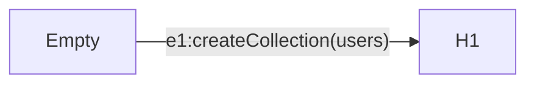
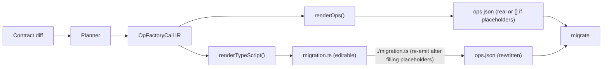
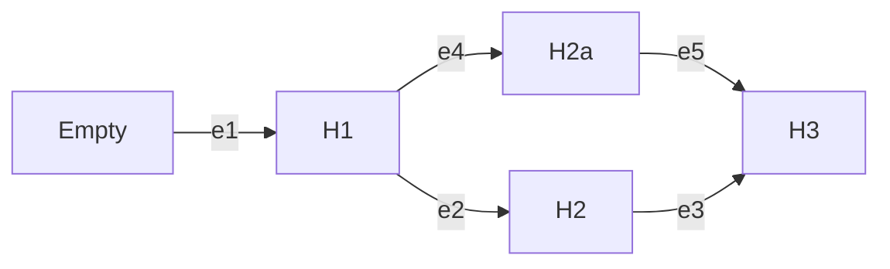

# Migration System

> **Conceptual domain reference.** For the conceptual model of the migration system — ubiquitous language, entities, operations, mental model, and CLI mapping — see [`docs/design/10-domains/migration/`](../../design/10-domains/migration/). This subsystem doc focuses on *implementation*: planner, runner, emitter, on-disk structure, ADR cross-references.

## Overview

The migration subsystem turns data contract changes into deterministic, verifiable state transitions in a database. Each migration is an edge from one contract state to another. Safety comes from explicit preconditions and postconditions, idempotent operations, and a verifiable contract marker in the database.

**Constitutional principle:** `ops.json` is the migration contract — the authoritative artifact that gets attested, hash-verified, and replayed by the runner. `migration.ts` is authoring sugar — a TypeScript file that the developer edits and that *emits* `ops.json` when evaluated. No TypeScript runs at apply time. See [ADR 192 — ops.json is the migration contract](../adrs/ADR%20192%20-%20ops.json%20is%20the%20migration%20contract.md).

The system is designed for tight feedback loops between authoring and verification. The planner makes it cheap to produce an edge from an origin contract to a destination contract. Pre- and post-operation checks make migrations self-verifying. When verification fails, errors direct agents toward concrete remedies — never "drop database" — and the graph model prevents typical catastrophic operations.

### Mental model: Git as the analog

The CLI surface is deliberately Git-shaped. Where the model maps cleanly, the vocabulary borrows from Git rather than inventing parallel names:

| Git | Prisma 8 |
|---|---|
| Commit / tree | **Contract** (with `storageHash` as identity) |
| Commit hash | `storageHash` |
| Parent edge + computed diff | **Migration** (we make the edge explicit and addressable) |
| `git format-patch` output | **Migration package** (the cleanest Git analog) |
| Ref / branch | **Ref** (environment-named: `production`, `staging`) |
| HEAD's tree | The emitted `contract.json` |
| Working tree | The **live database** |
| `git checkout <ref>` | `prisma db migrate --to <ref>` |
| `git log` | `prisma migration log` (executed) and `prisma migration list` (on disk) |
| Short-SHA prefix matching | Hash-prefix matching in the contract / migration reference grammars |
| `<commit>^` | `<migration-dir-name>^` (the migration's `from`-contract) |

**Key divergence from Git:** a migration is a *patch*, not a commit. Git has no first-class addressable-patch object; we do. That means the verb for "produce a migration" cannot borrow `commit` from Git — `migration plan` is closer to `format-patch` than to `commit`.

See [the glossary](../../glossary.md#migration--database-lifecycle) for the full vocabulary.


## Example

Consider adding a `user` collection to an empty MongoDB database. The planner computes a single edge from `H∅` to `H1` with one operation `createCollection(users, ...)`. The runner verifies the database marker equals `H∅`, acquires a lock (via CAS for MongoDB), applies the op with pre/post checks, and updates the marker to `H1`.



The migration directory on disk:

```
migrations/
  snapshots/
    <H1-hex>/                 # destination contract, keyed by storage hash
      contract.json
      contract.d.ts
  20260118T1205_add_users/
    migration.ts            # authoring surface — the developer edits this
    migration.json          # manifest: from/to hashes, migrationHash
    ops.json                # the actual operations as JSON
```

`db migrate` reads `migration.json` and `ops.json`. It never loads `migration.ts`.

References: [ADR 001 — Migrations as Edges](../adrs/ADR%20001%20-%20Migrations%20as%20Edges.md); [ADR 021 — Contract Marker Storage](../adrs/ADR%20021%20-%20Contract%20Marker%20Storage.md); [ADR 039 — Migration graph path resolution & integrity](../adrs/ADR%20039%20-%20Migration%20graph%20path%20resolution%20&%20integrity.md); [ADR 169 — On-disk migration persistence](../adrs/ADR%20169%20-%20On-disk%20migration%20persistence.md); [ADR 190 — CAS-based concurrency and migration state storage for MongoDB](../adrs/ADR%20190%20-%20CAS-based%20concurrency%20and%20migration%20state%20storage%20for%20MongoDB.md).


## Authoring Pipeline

The canonical pipeline from contract change to applied migration:



1. **Plan.** The planner diffs origin and destination contracts and produces an `OpFactoryCall[]` IR — a discriminated union of frozen AST classes, one per factory function. See [ADR 195 — Planner IR with two renderers](../adrs/ADR%20195%20-%20Planner%20IR%20with%20two%20renderers.md).

2. **Render.** The IR renders to a `PlannerProducedMigration` — a `Migration` subclass that also implements `MigrationPlanWithAuthoringSurface`. Two renderers consume the IR: one materializes runnable operations (`renderOps`), the other emits TypeScript source (`renderTypeScript`). The plan carries its own authoring surface; no separate scaffolding SPI is needed. See [ADR 194 — Plans carry their own authoring surface](../adrs/ADR%20194%20-%20Plans%20carry%20their%20own%20authoring%20surface.md).

3. **Scaffold.** The CLI calls `plan.renderTypeScript(resolveImportSpecifier)` and writes the result to `migration.ts`. The resolver comes from the consuming project's own `package.json` (`projectImportRoot` in `@internal/cli`), so the package names in the scaffold are ones that project can resolve — the same resolver `contract.d.ts` emission gets, for the same reason: both are files the application keeps. See [ADR 242 — Public npm surface](../adrs/ADR%20242%20-%20Public%20npm%20surface%20-%20single%20@prisma%20scope%20with%20consolidated%20publish%20packages.md). The destination contract is snapshotted into the migration directory so queries are typed against the schema at planning time. See [ADR 197 — Migration packages snapshot their own contract](../adrs/ADR%20197%20-%20Migration%20packages%20snapshot%20their%20own%20contract.md). Unfilled slots use `placeholder(slot)`: the bodies of a data transform the planner cannot derive, the `using` of a Postgres `alterColumnType` and a column's copy expression in a SQLite `recreateTable`. The planner writes them only for a field that a `--convert` or `--backfill` statement names (see [Convert and backfill statements](#convert-and-backfill-statements)). A placeholder is a `never`-returning function that throws a structured `PN-MIG-2001` error at emit time. See [ADR 200 — Placeholder utility for scaffolded migration slots](../adrs/ADR%20200%20-%20Placeholder%20utility%20for%20scaffolded%20migration%20slots.md).

4. **Edit.** The developer opens `migration.ts`, replaces placeholders with real queries, and iterates by running the file with node (`node <directory>/migration.ts`) thanks to the shebang and `Migration.run(...)`. The file loads the config `--config` names. Without `--config`, it uses the config that owns the migration, whose migrations directory holds the file: the nearest `prisma.config.ts` above the migration's directory if it owns it, else the `prisma.config.ts` in the working directory if that one does; otherwise it stops with `CLI.MIGRATION_CONFIG_NOT_FOUND`.

5. **Emit.** Every migration package is **fully attested on disk**: `migration plan` writes `migration.ts`, `migration.json` (with a content-addressed `migrationHash`), and `ops.json` (the planned ops, or `[]` if the planner could not lower any calls because of unfilled placeholders). After the developer fills any `placeholder(...)` slots, **self-emission** rewrites `ops.json` and the `migrationHash`: running the file via `./migration.ts` (shebang) or `node migration.ts` causes `Migration.run(...)` to detect it is the main module and re-emit artifacts in-process. See [ADR 196 — In-process emit for class-flow targets](../adrs/ADR%20196%20-%20In-process%20emit%20for%20class-flow%20targets.md).

6. **Apply.** `db migrate` reads `ops.json` and `migration.json`, **rehashes `(manifest, ops)` per bundle and confirms it matches the stored `migrationHash`** (defense in depth — catches FS corruption, partial writes, and post-emit hand edits before touching the database), then executes via the runner's three-phase loop — dispatching DDL through visitor SPIs and DML through the standard adapter+driver transport. See [ADR 198 — Runner decoupled from driver via visitor SPIs](../adrs/ADR%20198%20-%20Runner%20decoupled%20from%20driver%20via%20visitor%20SPIs.md).

The authored `migration.ts` — a `Migration` subclass (or a default-exported factory returning an object with a `plan()` method) — is the canonical authoring surface for every target. See [ADR 193 — Class-flow as the canonical migration authoring strategy](../adrs/ADR%20193%20-%20Class-flow%20as%20the%20canonical%20migration%20authoring%20strategy.md) for the historical record of this decision.


## Model

### Edges, Node Tasks, and Marker

An edge is a state transition from one contract storage hash (`from`) to another (`to`). The full source and destination contract IRs live in the migrations root's shared content-addressed store, keyed by their storage hash — the manifest itself records only the storage-hash bookends, not the contracts themselves. The contract marker stores the current `storageHash` per contract space (one row per loaded space — application plus each schema-contributing extension; see [Pinned per-space artefacts on disk](#pinned-per-space-artefacts-on-disk) below); the runner compares the relevant space's marker against the edge's `from` hash before apply. See [ADR 021 — Contract Marker Storage](../adrs/ADR%20021%20-%20Contract%20Marker%20Storage.md) and [ADR 212 — Contract spaces](../adrs/ADR%20212%20-%20Contract%20spaces.md).

Edges on disk form a directed graph from the empty contract to the current one. The graph tolerates cycles (e.g., rollback migrations like C1→C2→C1) — the pathfinder uses BFS with visited-node tracking to select the shortest path. When multiple shortest paths exist, tie-breaking is deterministic (`createdAt` → `to` → `migrationHash`). Named refs (`migrations/<space>/refs/<name>.json`) allow commands to target specific contract hashes for multi-environment workflows (e.g., staging at C2 while production stays at C1). See [ADR 039 — Migration graph path resolution & integrity](../adrs/ADR%20039%20-%20Migration%20graph%20path%20resolution%20&%20integrity.md) and [ADR 169 — On-disk migration persistence](../adrs/ADR%20169%20-%20On-disk%20migration%20persistence.md).



## Planner

The planner diffs two canonical contracts and produces an IR (intermediate representation) that can be rendered into both runnable operations and an editable TypeScript file.

### Planner IR

The planner produces `OpFactoryCall[]` — a discriminated union of frozen AST classes, one per migration factory function (`CreateIndexCall`, `DropIndexCall`, `CreateCollectionCall`, `DropCollectionCall`, `CollModCall`). Each call carries the factory name, arguments, `operationClass`, and `label`. A visitor interface provides exhaustive dispatch. See [ADR 195 — Planner IR with two renderers](../adrs/ADR%20195%20-%20Planner%20IR%20with%20two%20renderers.md).

Two renderers consume the IR:
- **Operation renderer** (`renderOps`): calls the factory functions to produce `MigrationPlanOperation[]` — runnable, serializable to `ops.json`.
- **TypeScript renderer** (`renderTypeScript`): produces a complete, runnable `migration.ts` file that imports and calls the same factories.

A scaffolded SQL `migration.ts` writes the SQL of a contract as a `sql` template, the same value a TypeScript contract uses ([ADR 268](../adrs/ADR%20268%20-%20Raw%20SQL%20is%20a%20value%20of%20the%20data%20type%20sql-expression.md)): `` checkExpression('user_kind_check', sql`"kind" IN ('admin', 'user')`) ``, and `` fn(sql`now()`) `` for a function default. A multi-line text is written on its own lines inside the template, and no quote is escaped. This covers every place that [Opaque SQL in DDL](#opaque-sql-in-ddl) lists, except the `USING` conversion of `alterColumnType`, which the planner never writes; the column defaults include the function default that the Postgres `setDefault` and the SQLite `addColumn` and `recreateTable` write. The file imports `sql` from the target's migration module only when it writes one. The renderer (`tsTaggedTemplateSource`) writes a template only when the `sql` tag reads it back as the same text. Otherwise it falls back to a string: for text whose indentation, blank edge lines or carriage returns the tag would remove; for a line that ends in a space or a tab, which an editor stripping trailing whitespace would change; and for a lone surrogate, a control character other than a line break or a tab, or U+2028 and U+2029. The fallback is the string form `tsQuotedTextSource` writes: an untagged template literal when the text holds both quote kinds on one line, else a quoted string. The rule is by where the SQL sits: a fragment a method places inside a DDL statement takes a `sql` value; a whole statement or query, such as `rawSql` or the postcheck SQL of the SQLite `recreateTable`, stays a string. The SQL is the same either way, so `ops.json` does not change.

Planner-derived semantics (`operationClass`, `label`) ride on the IR because only the planner has the origin context needed for classification (e.g., whether a Postgres type change keeps every value, which makes it `widening`, or not, which makes it `destructive`). The renderers read these values; they don't re-derive them.

### Offline planning via contract-to-schema

`migration plan` is fully offline (no database connection). Each target's migrations capability provides `contractToSchema(contract, options): TSchema` that converts the "from" contract to that target's structural schema IR (`SqlSchemaIR` for Postgres, `MongoSchemaIR` for MongoDB), then feeds it into the target's planner. This reuses the same planner that `db init` and `db update` use — no second diff engine is required.

The conversion is intentionally lossy (for example drops runtime codec details), but the planner only needs structural information.

For Postgres the schema covers tables, columns, and indexes. For MongoDB the same role is played by collections, indexes, JSON Schema validators and collection options. See [ADR 169](../adrs/ADR%20169%20-%20On-disk%20migration%20persistence.md) and [ADR 187](../adrs/ADR%20187%20-%20MongoDB%20schema%20representation%20for%20migration%20diffing.md).

Schema-contributing extensions own their own contract spaces, not a node in the application's `SqlSchemaIR`. See [Per-space planner / runner / verifier](#per-space-planner--runner--verifier) below and [ADR 212 — Contract spaces](../adrs/ADR%20212%20-%20Contract%20spaces.md) for how extension schema is planned and verified.

The canonical contract IR stays planner-agnostic and hash-stable; it only encodes application expectations as described in the Data Contract subsystem. What the contracts cannot say, such as that a model was renamed rather than replaced, the user states on the command line; see [Statements](#statements).

A table rename is a core operation the author states: `this.renameTable({ table, to })` in a hand-written migration returns the table rename plus a rename of every object whose name the planner derives from the table name, and the planner refuses a drop-and-create pair that is the signature of the older storage-naming rule with `MIGRATION.TABLE_NAME_CASE_CHANGED`. See [ADR 264 — A model names its storage verbatim, and a rename is an operation](../adrs/ADR%20264%20-%20A%20model%20names%20its%20storage%20verbatim,%20and%20a%20rename%20is%20an%20operation.md).

On Postgres a hand-written migration can also move a table to another schema with `this.setTableSchema({ schema, table, to })` (`ALTER TABLE … SET SCHEMA`; leave out `schema` for a table of the unbound namespace), rename a schema with `this.renameSchema({ schema, to })` (`ALTER SCHEMA … RENAME TO`), and drop one with `this.dropSchema({ schema })` (`DROP SCHEMA`, without `CASCADE`). All three are `widening`. A moved table keeps its rows, primary key, unique constraints, indexes and owned sequences, and a foreign key from another table keeps pointing at it. A schema drop fails its precheck while the schema still holds a table, view, sequence, type or function, so its tables are dropped or moved first. The failure names each object that blocks the drop, up to ten, and asks the user to drop or move them and run the command again. The planner orders schema drops after table drops and moves.

On Postgres and SQLite a hand-written migration can rewrite the values stored in a column. `this.replaceStoredValue({ table, column, from, to })` changes the stored value `from` to `to` in every row that holds it (`UPDATE … SET column = to WHERE column = from`), and is `widening`. `this.removeStoredValue({ table, column, value })` sets the column to NULL in every row that holds `value`, and is `destructive`. The values are stored values: a string or a finite number, passed as a parameter. With `codecRef`, the column's codec reference, each value is written as the contract stores it and the codec writes it as the database stores it; without `codecRef`, pass each value in the form the column stores it, or no row matches. Any other value, such as `null`, which would match no row, is refused with `CONTRACT.ARGUMENT_INVALID` when the operation is built. On Postgres both take `schema`, left out for a table of the unbound namespace, and `many: true` for a list column: the value then changes inside each list with `array_replace`, or leaves it with `array_remove`. SQLite has no list columns. `removeStoredValue` on a scalar column checks first that the column takes NULL or that no row holds the value, so on a column that takes no NULL it fails with `MIGRATION.PRECHECK_FAILED` while rows hold the value, and changes nothing; with `enumValue`, the enum value's coordinate in its JSON form (`{ enum: 'Status', member: 'ARCHIVED' }`, with `namespaceId` outside the unbound namespace), the runner counts those rows and the error's next actions say how to keep that data. `replaceStoredValue` has no precheck. The postcheck states that no row, or no list, holds the old value, so a run that finds no such row skips the operation.

Core operations cover additive structure: create table, add nullable column, add index/unique, add foreign key, set column default (SQL); create collection, create index (Mongo). Setting a Mongo validation is a core operation too, classed `widening` (see [Operation Model](#operation-model)). A rename needs a statement (see [Statements](#statements)), and a destructive change needs a policy that allows it; the planner fails fast without them. See [ADR 028 — Migration Structure & Operations](../adrs/ADR%20028%20-%20Migration%20Structure%20&%20Operations.md) and [ADR 161 — Explicit FK constraint and index configuration](../adrs/ADR%20161%20-%20Explicit%20foreign%20key%20constraint%20and%20index%20configuration.md).

### `migration plan`

`prisma migration plan` diffs a `from` contract against a `to` contract and writes one or two attested migration packages. It is fully offline — no database connection. See [ADR 218](../adrs/ADR%20218%20-%20Refs%20with%20paired%20contract%20snapshots%20and%20universal%20graph-node%20invariant.md).

**Default `from` resolution** ([`resolveFromForPlan`](../../../packages/1-framework/3-tooling/cli/src/control-api/operations/plan-resolution.ts)):

1. Explicit `--from <contract>` — any [contract reference](#contract-reference-grammar) that names a recorded contract, or `@empty`.
2. No `--from` — resolve the `db` ref via `migrations/app/refs/db.json`.
3. No `db` ref — resolve `from` to the `null` empty-graph sentinel (greenfield). When the graph is also empty, the human output adds a muted notice (`No db ref set — planning from an empty database. Run db init, db update, or db sign if a database already exists.`) and the JSON document carries `fromDefaulted: true`; an explicit `--from @empty` prints neither.

The from-contract always materialises by reading the content-addressed snapshot store entry for the resolved hash — the ref-resolved hash comes from the ref's pointer, the hash-resolved `from` on a graph node from the matching bundle; either way the store is keyed by hash, so no bundle lookup is needed.

**Default `to` resolution:** when `--to` is omitted, the destination is the emitted `contract.json`. When `--to <contract>` is supplied, it takes the [contract references](#contract-reference-grammar) that name a recorded contract (`@empty` is an origin only); the resolved contract becomes the planner destination and is written into the snapshot store keyed by its storage hash. Use `--to <migration-dir>^` to plan a reverse (rollback) edge toward a predecessor state.

**Emission cases:**

| Case | Condition | Output |
|---|---|---|
| Greenfield | Graph empty, `from` = `null` | One bundle: `null → to_contract` |
| Auto-baseline | Graph empty, `from` non-null, store entry available | Two bundles: baseline `null → from` + delta `from → to_contract` |
| Normal delta | Graph non-empty, `from` is a graph node | One bundle: `from → to_contract` |
| Forgot-the-flag | Graph non-empty, `from` not a graph node | Refuse: `MIGRATION.HASH_NOT_IN_GRAPH` |
| Snapshot missing | `from` non-null, no contract source | Refuse: `MIGRATION.SNAPSHOT_MISSING` |

When `--to` is omitted, `to_contract` is the emitted contract; when `--to` is supplied, `to_contract` is the resolved destination.

**A plan with no operations.** Two different storage hashes are two different database states, so a migration between them is expected to do something. When the planner produces no operations for a changed storage hash anyway, `migration plan` still writes the package, with an empty `ops.json`, and says so: the summary, a warning in the human output, names each storage entity whose content differs between the two contracts, and `--json` lists them as `changedStorageEntities` (entity coordinates, from `changedElementCoordinates` in `@internal/framework-components/ir`; a coordinate in the unbound namespace leaves out `namespaceId`, as `appliedStatements` does). The field is filled for every migration `migration plan` writes, and a migration written with no operations is one whose `operations` is empty. `noOp` means something else: nothing was written, because the storage hash did not change. `db migrate` and `db update` apply such a migration by moving the marker to the new hash; every runner already does this for an edge between two different hashes. This holds for a baseline with no operations and for the delta after it. Only a greenfield plan (no earlier contract) with no operations is refused, with `MIGRATION.PLANNING_FAILED` of kind `nothingToCreate`, since the contract describes nothing to create. When the storage hash does not change, nothing is written, as before.

An auto-baseline dates the delta package at the current time and the baseline package one minute earlier, so the baseline sorts first. Folder names have minute resolution, so packages planned within the same minute sort by name.

**Data loss.** Before it writes either package, including the baseline of an auto-baseline, `migration plan` asks what each operation that would lose data means (see [The questions](#statements)). It does not ask about access: a written package is reviewed before it is applied.

The diff never compares constraint names, so the planner compares names itself: a primary key, unique constraint or foreign key that the start tree and the end contract both have, otherwise unchanged, is renamed with `RENAME CONSTRAINT` when its start name and end name differ, each the stated name or the one the planner derives. The start tree comes from the start contract for `migration plan` and from the database for `db update`, and `renameTable` applies the same rule across a table rename. The runner skips a rename when the database already has the new name ([`constraint-name-renames.ts`](../../../packages/3-targets/postgres/1-target/src/core/migrations/constraint-name-renames.ts)).

Postgres cannot change a foreign key's `onDelete` or `onUpdate` in place, so a foreign key whose actions change plans `DROP CONSTRAINT` under its start name and `ADD CONSTRAINT` under its end name. A primary key whose columns change plans a drop of the old key and an add of the new one, and a removed key plans the drop. Postgres refuses to drop a key while a foreign key depends on its index, so every foreign key in the start tree, in any table or schema, that references the old key's columns is dropped first, and each one the end contract keeps is added back after the new key. A foreign key that changes in its own right is planned by that change, and one on a table the plan drops goes with its table. The plan refuses the change, naming the foreign key, in five cases, and each refusal's advice is written for the commands that can show it: the control policy keeps the plan away from that foreign key's table (any command); another contract space owns that table (`db update` only, because the start tree of `migration plan` comes from this space's start contract); under `db init`'s additive-only policy, the contract does not declare that table (`db init` only); under the same policy, the contract keeps the table but leaves out the foreign key (`db init` only); or the table is in a schema the end contract does not declare, whose tables a plan never drops (`migration plan`, when the start contract declared that schema; `db update` does not introspect a schema that no contract space declares, so it does not see that foreign key: the key drop then fails at apply with Postgres's dependency error and the run rolls back, filed as TML-3623) ([`primary-key-change.ts`](../../../packages/3-targets/postgres/1-target/src/core/migrations/primary-key-change.ts)). The rename pass never renames a constraint the plan drops ([`constraint-name-renames.ts`](../../../packages/3-targets/postgres/1-target/src/core/migrations/constraint-name-renames.ts)). Inside the drop step, foreign key drops come first, then primary key and unique constraint drops, then the rest: a constraint never needs another object dropped before it, and a column or table drop takes its constraints with it. Foreign keys are added last, after primary keys, unique constraints and indexes. Each drop is `widening` and each add `additive`, so `db init` refuses these changes and `migration plan`, `db migrate` and `db update` plan them without a data-loss question. A whole `db migrate` run is one transaction, so the database never commits a state without the constraint. SQLite rebuilds the table for any constraint change.

Plan-time refuse diagnostics name the resolved hash, list refs pointing at graph nodes, and suggest `--from <reachable-ref>`. Snapshot-missing diagnostics suggest `db update --advance-ref <name>` to repopulate or `migration ref delete <name>` to clear an orphan pointer.

### Statements

The origin and destination contracts cannot say whether a model or field that is gone was renamed or meant to be deleted, nor whether an operation that changes who can read or write a model's data is meant. The user says so on the command line with statements, each a repeatable flag:

- `--rename <old>:<new>` keeps a model's or field's data under a new name.
- `--convert <Model.field>` answers a type change that would lose data with a conversion the user writes. `migration plan` only.
- `--backfill <Model.field>` asks for a step that fills a field becoming required in the existing rows, in place of a temporary value. `migration plan` only; it answers no question.
- `--delete <subject>` lets the plan lose a subject's data. A namespace of the origin contract, `--delete billing`, lets it lose the data of every model and field in that namespace.
- `--allow <subject>` lets `db update` change who can read or write a model's data, one operation at a time.

Renames, conversions and backfills reach the planner, which takes them as its third input, beside the destination contract and the origin schema. Deletes and allows never do: the CLI matches them against the questions. Statements are never part of `contract.json` or its hashes.

```bash
prisma migration plan --name tidy-users --rename Profile:User --rename User.name:User.fullName --delete Legacy
prisma db update --rename Profile:User --rename User.name:User.fullName --delete Legacy --allow User
```

**The questions.** The planner's success result lists what the plan would lose (`dataLoss`) and whose access it would change (`accessChanges`), each entry an operation's position and its subject (a `MigrationSubject`: a model, a field, or a storage name no model of the origin contract stores). Before `migration plan` writes anything, and before `db update` applies anything, the command asks one question per data-loss subject. Each `dataLoss` entry says how the operation loses the data (`loss`): `drop` removes the subject, and its question is answered by `delete` or, for a model or field the destination no longer has, `rename`; `typeChange` changes a field's type, and its question is answered by `delete` or, in `migration plan`, `convert`. Each entry carries the label of the operation that loses the data, and the question starts with it. When the planner knows how to keep the data where no statement can, the entry carries `keepDataAdvice` and the question ends with it: MongoDB's, when it drops a collection whose model's documents a collection the plan creates would hold, and the SQL planners', for a table whose `@@map` changes while its model keeps its name. A field whose model the destination names differently, with no statement renaming the model, is asked about with `delete` only, and the question says to pass the model rename first; the next question then offers the field rename. `db update` also asks one question per operation that changes who can read or write a model's data, answered by `allow`: the question says the operation widens access when it does, and that it changes access otherwise. On Postgres, disabling row-level security widens access, and dropping a policy changes it, since a permissive policy grants access. Two such operations on one model are two questions, each answered by its own `--allow`. The questions go through the CLI engine's statement prompt (`ctx.prompt.statements(questions, { last: true })`), which answers them from the flags first. In a terminal it asks the rest in turn, and the user types `delete`, `allow` or `rename <subject>:<new name>`; a typed rename is planned again with the other renames, and a plan that still has the operation asked about fails with `MIGRATION.STATEMENT_DID_NOT_RESOLVE_LOSS`; a loss the new plan has on the same subject, such as a type change on the renamed field, is asked next. Where nobody can answer (not interactive, or `--yes`), the command fails with `CLI.CONSENT_REQUIRED`, listing every unanswered question with the flags that answer it, and a `--delete` or `--allow` that answers no question fails with `CLI.CONSENT_UNUSED`; both happen before anything is written or applied. A `db update --dry-run` asks nothing; it checks the same flags against the subjects an apply would ask about and fails an unmatched one with `MIGRATION.STATEMENT_ANSWERS_NO_QUESTION`, so a script that checks the code handles both. `--confirm` answers none of these questions. The `--rename` values are taken from the run first (`ctx.statements.take('rename')`) and planned from the start, so the drop a rename replaces is never asked about. The shared question loop is `askPlanQuestions` in [`plan-questions.ts`](../../../packages/1-framework/3-tooling/cli/src/control-api/statements/plan-questions.ts); the control API takes the answers through a callback, so it never depends on the engine's prompt.

#### Rename statements

**Grammar.** `--rename <old>:<new>` can be given more than once. Each side is one of `namespace`, `Model`, `namespace.Model`, `Model.field`, `namespace.Model.field`, `Enum.value` or `namespace.Enum.value`, and both sides name the same kind of thing. An enum value is named through its enum by the member name the contract source uses, such as `Status.ARCHIVED`, never by its stored value; the namespace is needed only when several namespaces declare an enum of that name. Both sides of an enum value rename name a value of the same enum, and `--delete Status.ARCHIVED` names it the same way. One name on each side reads as a namespace rename when the old name is a namespace of the origin contract, and as a model rename otherwise; exactly one reading must resolve, and a statement that reads as both is refused with `MIGRATION.STATEMENT_UNRESOLVED`, whose message says to name the model with its namespace. Two names read as `namespace.Model`, `Model.field` or `Enum.value`, and three as `namespace.Model.field` or `namespace.Enum.value`; when more than one reading resolves, the refusal names each and how to write it with its namespace. A field is named through its model as the destination contract names it, so the field statement above names `User`, not `Profile`. A field cannot move to another model. The CLI parses each statement in [`parse-rename.ts`](../../../packages/1-framework/3-tooling/cli/src/control-api/statements/parse-rename.ts); a malformed statement fails with `MIGRATION.STATEMENT_INVALID`, and so does a field statement that names the model by its old name, with the corrected statement in the message.

**Resolution.** The framework resolves each statement against the origin and destination contracts of the application contract space, in [`resolve-statements.ts`](../../../packages/1-framework/3-tooling/cli/src/control-api/statements/resolve-statements.ts). The old name must be in the origin and not in the destination; the new name must be in the destination and not in the origin. A resolved statement is a `ResolvedMigrationStatement` in domain coordinates (namespace, model and field), with no table or column names, so the framework stays family-blind. A statement that does not resolve fails with `MIGRATION.STATEMENT_UNRESOLVED`. The framework passes the resolved statements to the family planner as `statements` in the `plan` options; the aggregate planner passes them to the application space only, through `PlannerInput.appSpace`.

**Application.** The SQL family planner applies the statements in order to a working copy of the origin schema, then diffs the working copy against the destination contract as usual ([`statement-planning.ts`](../../../packages/2-sql-family/9-family/src/core/migrations/statement-planning.ts)). The family works out each statement's storage effect from the two contracts, and the target builds the operations:

- A namespace statement renames the schema on Postgres with `ALTER SCHEMA … RENAME TO`, the operation `this.renameSchema({ schema, to })` returns, before the rest of the plan. The working copy renames the schema too, so its tables, the foreign keys that reference them and later statements see the new name, and a table the diff creates in the renamed schema comes after the rename. It is refused for `public`, which Prisma owns and Postgres puts on every search path (move each model with `--rename <Model>:<namespace>.<Model>` instead), and for a rename to `public`, which every database already has (move each model with `--rename billing.<Model>:<Model>` instead). The target says these; the SQL family planner refuses the rest. It refuses a namespace another contract space declares, which it learns from the ownership oracle's `namespaceDeclaringSpaces`, a namespace with a table whose control policy is not `managed`, and a new name the database already has as a schema the origin contract does not declare: the user drops or renames that schema in the database if it is empty, or moves each model instead. A target with one namespace, such as SQLite, gives the planner no namespace calls, and the planner refuses a namespace rename or a model move there.
- A namespace the origin contract declares and the destination does not is removed. `public` is never removed: a contract that stops declaring it leaves the schema in place. With an origin contract, the plan diff owns the origin's schemas as well as the destination's, so the removed schema's tables are dropped one by one, each a data-loss question about its model, a table before a table its foreign keys reference, and each with its policies, which raise no question of their own. A table in the schema that another contract space declares is left to that space: the planner asks the ownership oracle about it under the origin's namespace, since the destination no longer has one. The schema itself is dropped after its tables with `DROP SCHEMA`, without `CASCADE` (`this.dropSchema({ schema })`), except a schema another contract space declares. A table in the schema that the origin contract never declared is dropped too, as its own question in the storage form, `--delete billing.audit_log`, which `--delete billing` does not answer. Any other object the contract never declared, such as a view or a function, blocks the schema drop at its precheck. A view on one of the schema's tables blocks that table's drop instead: Postgres refuses the `DROP TABLE`, and the runner failure names each dependent object from Postgres's error detail and reports them as `meta.blockingObjects`. A dry run cannot show either case, because the schema the planner reads holds tables, not views or functions. The first question about a removed namespace adds a line saying that `--delete billing` answers every question about a model or field of it, so the `CLI.CONSENT_REQUIRED` refusal says it too. When the destination adds a namespace the origin lacks, a further line offers `--rename billing:finance` instead, naming the new namespace when there is only one. A `db update --dry-run` lists the same answers once per removed namespace, `every question about namespace "billing": --delete billing, or --rename billing:finance if it was renamed`, and its JSON marks each question with `removedNamespace` and with `answeredBy`, the statement that answers it as `{ "verb": "delete", "text": "billing" }` (`answered` is true exactly when `answeredBy` is present). At the top level it lists `removedNamespaces`, each `{ "namespaceId": "billing" }` with the `answeredBy` of a `--delete` of it, and `addedNamespaces`, the namespaces a rename of a removed one may name. The planner decides both lists: its success result reports `namespaces: { removed, added }` beside `dataLoss`, and the CLI reads them; a planner without namespaces reports none, and so does a recorded migration of an extension space. A dry run matches `--delete` and `--allow` values to questions as an apply does, whatever their order: a `--delete` that names a subject answers its questions first, then a `--delete` of a namespace answers that namespace's questions still open, and an `--allow` answers one operation; so both refuse the same left-over flags with `CLI.CONSENT_UNUSED`. At the prompt, `delete billing` typed for one of the namespace's questions answers the rest of them too. `rename billing:finance` typed there answers only that question: the command plans again with the rename and asks what is left, such as a model of the namespace that also changed its name. After a namespace rename, questions name its models and fields through the new namespace, and a field question offers `--rename finance.Invoice.note:finance.Invoice.<new name>`. In JSON output a namespace rename statement names each side as a coordinate, `{ "namespaceId": "billing" }`, as a model rename does. `--delete billing` answers every question about a model or field of `billing`: the control API matches it to each subject, and because the CLI engine answers a question only with a value equal to its subject, the command takes the `--delete` values from the engine and answers those questions itself; each is reported as `delete model "billing.Invoice"`. A rename of one of its models given in the same run, `--rename billing.Invoice:public.Invoice`, is planned first, so that table is moved instead of dropped. Namespace renames are planned before every other statement, whatever order they are given in, since model and field statements name the origin and destination contracts. Without an origin contract nothing changes, and a schema the origin never declared, such as Supabase's `auth`, is still left alone.
- A model statement whose namespace changes moves the table on Postgres with `ALTER TABLE … SET SCHEMA`, the operation `this.setTableSchema({ schema, table, to })` returns. When the working copy has no schema of that name, the plan creates it first with `CREATE SCHEMA`; the statement accounts for the move, not the creation. The table keeps its rows, constraints, indexes and owned sequences, and foreign keys from other tables keep pointing at it, so the diff plans nothing for them. A move with a new table name moves the table, then renames it in its new schema as below. A move onto a table the destination schema already has is refused, and so is a move into the unbound namespace, which has no fixed schema: its tables live wherever the connection's search path looks. A move out of the unbound namespace finds the table through the search path, as every operation on that namespace does. SQLite has one namespace, so no statement moves a table there.
- A model statement whose table name changes renames the table, and renames every primary key, unique constraint, foreign key and index whose name the planner derives from the table name, using the names the destination contract derives. These are the operations `this.renameTable({ table, to })` returns.
- A field statement whose column name changes renames the column, and renames the constraints and indexes whose names derive from it. These are the operations `this.renameColumn({ table, column, to })` returns. SQLite cannot rename an index, so there a renamed index is dropped and created. On Postgres, a check, a row-level-security policy, or an expression or partial index whose SQL text names the column is dropped and created again: Postgres rewrites that text when it renames the column, but the working copy keeps the old text, so the diff sees a changed object. Adding the check back reads every row of the table while holding an `ACCESS EXCLUSIVE` lock, and an index is rebuilt, so on a large table such a column rename is not instant.
- A statement whose storage name does not change, because `@@map` or `@map` keeps it, or because the field is a relation, produces no operations.
- Enum values are compared by their stored values, not by member names ([`enum-value-planning.ts`](../../../packages/2-sql-family/9-family/src/core/migrations/enum-value-planning.ts)). A stored value of an origin enum that the destination enum lacks is rewritten in every column of the working copy whose field the destination enum types, scalar and list, in managed tables; a column the plan creates holds no rows and is left out, and a table or field the plan drops is asked about as that model or field. An enum value statement replaces the old stored value with the new member's in each column, with `this.replaceStoredValue(...)`; without a statement the value is removed with `this.removeStoredValue(...)`: set to NULL in a scalar column and taken out of each list in a list column. Each removal is a data-loss question about the enum value, one question however many columns hold it, which offers `--rename Status.ARCHIVED:Status.<new name>` first and `--delete Status.ARCHIVED` second. A required scalar column is asked about the same way: the removal's precheck passes when no row holds the value, and while rows hold it the apply fails with `MIGRATION.PRECHECK_FAILED` and changes nothing. The runner counts the rows and reports `rowsHoldingValue`: the enum value as a coordinate, the stored value, the count, and the edit to `migration.ts` that keeps the data, which the target renders from the removal call. The CLI words the next actions around it, one per way to keep that data: add a member to the enum and rename the value to it (under `db migrate`, after deleting the written migration and planning it again), or keep it by hand, changing the stored value in the database yourself under `db update`, or making the edit in the `migration.ts` under `db migrate`. A member renamed with its stored value kept rewrites nothing, and its statement has no operations. A member that keeps its name but changes its stored value cannot be stated; its removal is asked about with `--delete` only, even when another member stored the new value before, as when two members swap stored values. Each removal carries the edit that keeps its data (the removal call, replaced by one or more replacements), and the question, worded by the command, names the operation of every column and the edit of every column: under `migration plan`, answer with `--delete`, make the edits in the `migration.ts` it writes and run it with `node`; under `db update`, which cannot keep that data in one run, plan the change with `migration plan --from <hash> --delete …` and the run's other statements and make the edits there, or rename the member to a new member and back in two runs of `db update`. For members that swap stored values, the two runs would rename values in a cycle, which is refused, so `db update` offers only the plan, and with no migration at the database's contract it says that it cannot keep the data and that `--delete` removes it. The plan it prints deletes every value whose data the edits keep. When `db update` cannot answer, its `CLI.CONSENT_REQUIRED` leads its next actions with these ways. The changes are ordered so that none overwrites a value another still has to read: when renames shift values along (3 to 4 while 4 to 5), the last value moves first. Members that keep their names and swap stored values in a cycle keep their data through a temporary value no member stores: the next integer for numbers, otherwise `prisma_swap`. The replacements run between the old and the new check. A rename is refused (`statementRefused`) when the destination enum still stores the old stored value under another member that no other change moves it to, since every row holding the value would change; when another member of the origin enum already stores the new stored value and keeps it, since the rename would merge the data of the two members; and when renames move stored values in a cycle, which the message says to write by hand through a temporary value. That conflict carries `leaveOut`, the renames of the cycle, and the CLI's next action prints the plan to write the rewrites in: the run's statements without them, from the database's contract when it is known. Messages write a stored value as the enum's codec reads it, so a number is not quoted. The planner gives each call the column's codec reference, and the operation writes each value through that codec as the database stores it, as a literal default is written: a codec writes asynchronously and the planner runs synchronously, so the encoding happens when the operation is built. On Postgres the rewrites run after the old enum checks are dropped and before the new ones are added; on SQLite they run after the table rebuilds, so a column the same change makes optional takes the NULL. Without an origin contract nothing is known to have changed, so nothing is rewritten or asked: `--delete Status.ARCHIVED` answers nothing, and on Postgres the apply fails at the new check while data holds the old value. Native Postgres enums are not domain enums and keep their own rules.

Move and rename operations are `widening`, so neither command asks about them. The `migration.ts` that `migration plan` writes contains `this.setTableSchema(...)`, `...this.renameTable(...)` and `...this.renameColumn(...)` calls, as a user would write them by hand, and running it again writes the same `ops.json` and `migration.json`.

The MongoDB planner does the same with collections and documents ([`mongo-statement-planning.ts`](../../../packages/3-targets/mongo/1-target/src/core/migrations/mongo-statement-planning.ts)). A statement names a field by its name in the contract, as on SQL, so `id @map("_id")` is `User.id` in a statement. The planner compares the stored names on each side, as SQL compares columns: a rename that keeps the stored name plans nothing, and one that changes it plans `renameField`. A field whose `@map` changes while its name stays is planned as a removal of the old stored name, as SQL plans a column whose `@map` changes, so the plan asks about it; as on SQL, a statement cannot state a stored-name-only change, and keeping the values takes a `renameField(...)` written into `migration.ts`. Data-loss questions name the field; `$unset` and `$rename` name stored names.

- A model statement whose collection name changes renames the collection in the working copy and plans `renameCollection`. MongoDB keeps the documents, indexes and validator, so the diff then plans only what really changed.
- A field statement whose stored name changes plans `renameField`: one `updateMany` with `$rename` on the documents that hold the old name, skipping validation, since the old validator requires the old field. A variant's field is renamed only in that variant's documents, filtered by its discriminator value, so another variant that stores a field with the same name keeps it. A base field that a variant now stores itself is renamed only in the documents of the other variants.
- A field that an origin model stores and its destination model no longer stores, in a collection the plan keeps, is data loss. The plan unsets it with `unsetField` (`$unset`, skipping validation) from the documents that hold it, with the same variant filters, and asks about it as a `field` subject, so `--delete User.nickname` or a `--rename` answers it. Without an origin contract, a removed field is found from the origin validator's top-level properties and named `<collection>.<field>`; a collection whose destination has no validator is skipped, and a variant's removed field is not found.
- Operations run in this order: collection renames, collection creates, index drops, document rewrites, index creates, validator changes, option changes, collection drops. Rewrites run after the index drops, so a unique index on the old field does not fail once documents lose it, and before the index creates, so a unique index on the new field sees the moved values.

`renameCollection` and `renameField` are `widening` and `unsetField` is `destructive`, so `db update` runs them. Document rewrites are DML operations (`MongoDmlOperation`): the runner and the operation serializer tell a DML operation from a DDL operation by its shape (`run` against `execute`), with `isMongoDmlOperation`, not by its class; a hand-written `dataTransform` is a DML operation that keeps the class `data`. Each rewrite's after-check, that no matching document holds the old name, lets a run that stopped part way finish when run again. The `migration.ts` that `migration plan` writes calls `renameCollection(...)`, `renameField(...)` and `unsetField(...)` from the target's migration module.

**Result.** The planner's success result carries `appliedStatements` (`AppliedMigrationStatement`): one entry per statement, in order, with `operationIndexes`: the positions, in the plan's operations, of the operations the statement accounts for, empty when its storage did not change. A convert or backfill statement always has empty `operationIndexes`: the planner does not attribute the calls it plans for one to the statement, and re-running `migration.ts` reports no statements. Statements point at operations by position because operation ids are not unique within a plan (on Postgres, same-named tables in two schemas share them), and ids stay as they are so that re-emitting an existing migration does not change its hash. The framework's `describeMigrationStatement` writes the statement in domain names, such as `rename model "Profile" to "User"`, for every family's messages and for the CLI. A model moved to another namespace is written with both namespaces, as `move model "billing.Invoice" to namespace "public"`, or `rename model "billing.Invoice" to "finance.Bill"` when its name changes too. `migration plan` and `db update` print each statement with its description and number of operations, and their JSON output carries the description and the operation positions, which index the output's `operations`. Messages name a model of the unbound namespace by its name alone, and JSON output leaves `namespaceId` out of a coordinate in the unbound namespace (`migrationStatementJson`), because that namespace's id is internal.

**Refusals.** When the planner cannot carry out a resolved statement, planning fails with `MIGRATION.PLANNING_FAILED` and a conflict of kind `statementRefused` that carries the statement in its `refusedStatement` field. The [error reference](../../reference/error-reference.md#migrationplanning_failed) lists the cases.

**Rename limits in this release.**

- A model that keeps its name but changes its table cannot be renamed by a statement, because the model has the same name on both sides. Rename the table by hand with `this.renameTable(...)` in its own `migration.ts`. A field statement on such a model is refused with the same advice.
- Only namespaces, models, fields and enum values can be renamed. Value objects and their fields cannot, and neither can an enum value inside value object JSON. An enum value statement cannot give a member a new stored value under the same name. On Postgres, `public` cannot be renamed and no namespace can be renamed to it. No SQL target renames a namespace another contract space declares; SQLite moves no model and renames no namespace; MongoDB renames no namespace.
- On MongoDB, a statement cannot rename a variant whose discriminator value changes, since its documents would keep the old value; it cannot rename `_id`, a field whose stored name MongoDB reads as a path or an operator (it contains `.` or starts with `$`), a time-series collection or a field of one, or a field inside a value object. A field removed from a model on a time-series collection fails planning with a `fieldRemovalRefused` conflict, because MongoDB cannot remove it from those documents; keeping the field in the contract plans nothing. A collection rename onto a name the database already has, or onto a name MongoDB rejects, is refused too.

#### Delete and allow statements

**Delete statements.** `--delete <subject>` consents to losing the data of a subject the planner's `dataLoss` names: a model or field of the origin contract written as a statement names it (`Legacy`, `User.name`, with the namespace when the origin contract has several), or the storage name of data no model stores. A field of a model the plan renames is written through the model's new name, as a field rename is written (`--delete User.nickname` after `--rename Profile:User`); the CLI matches answers by subject, not by its text. A delete never reaches a planner: the CLI matches it, by equality, against the subjects of the plan's `dataLoss` entries. It needs no origin contract, so with no snapshot a rename fails with `MIGRATION.STATEMENT_ORIGIN_UNKNOWN` and a delete still works. The CLI writes a delete as its question named the subject (`consentDescription` in [`plan-questions.ts`](../../../packages/1-framework/3-tooling/cli/src/control-api/statements/plan-questions.ts)): `delete model "Legacy"`, `delete field "User.nickname"` after a model rename, or `delete storage "audit_log"`, and `migration plan` and `db update` list it under `Statements applied` with the positions of the operations it consented to; in JSON each `appliedStatements` entry carries its `verb`.

**Allow statements.** `--allow <subject>` consents to one operation the planner's `accessChanges` names (a `MigrationAccessChange`, whose `widens` says whether it widens access or only changes it): disabling row-level security, or dropping a policy that no other operation of the plan creates again, on Postgres. A policy whose generated name changes with its body is created again when the plan creates a policy with the same name prefix on the same table, so editing its body asks nothing, as editing a policy with a stated name does. Only `db update` asks about access: `migration plan` writes a package, and the package is reviewed before it is applied. Like a delete, an allow never reaches a planner and is matched by subject; the CLI writes it the same way, as `allow model "User"` or `allow storage "user"`.

#### The origin of `db update`

`migration plan` already has an origin contract: the one `--from` resolves to. `db update` introspects the database instead, and on every run reads the contract for the marker's hash from the [snapshot store](#contract-resolution-through-the-snapshot-store). The planner gets it as `fromContract`, and names each subject of `dataLoss` and `accessChanges` through it. `db update` also reads from the database the namespaces that contract declares, besides the destination's, so the tables of a namespace the destination removed reach the plan. A missing or unreadable snapshot fails only a run with `--rename`; otherwise each subject is named by its storage name. The plan it hands the runner keeps `origin: null` either way (see [`db update`](#db-update-live-reconciliation)). On SQL, the planner's operations do not depend on whether the snapshot was read: every strategy that emits a data transform needs the `data` operation class, which `db update` does not allow, and codec field-event hooks get the prior contract only when the plan has an origin, which a `db update` plan never has. On MongoDB they can: without the snapshot, a removed field is found only from the origin validator, as described under [Rename statements](#rename-statements). `db update` stores a snapshot only when it advances a ref: the `db` ref by default, or with `--db <url>` only the ref named by `--advance-ref <name>`. So a database last updated with `--db <url>` and no `--advance-ref` has no snapshot, and renames fail there with `MIGRATION.STATEMENT_ORIGIN_UNKNOWN`, which names the hash and the directory it looked in. Running `db update` again with the same statements fails with `MIGRATION.STATEMENT_UNRESOLVED`, because the origin is then a contract without the old names.

#### Convert and backfill statements

**What the planners write.** Placeholders appear in a plan only where one of these statements asks for them.

| Statement | Postgres | SQLite |
| --- | --- | --- |
| `--convert User.age` | `alterColumnType` with `using: placeholder('User.age:convert')`, classed `data` | A table rebuild whose copy expression for the column is `placeholder('User.age:convert')` |
| `--backfill`, new field | Add the column nullable, a data transform with `check` and `run` slots, `SET NOT NULL` | Add the column nullable, a data transform with a `run` slot, a tightening rebuild |
| `--backfill`, optional field made required | A data transform, `SET NOT NULL` | A data transform, a tightening rebuild |
| No statement, new required field | Add the column with a temporary default (`''`, `0`, …), drop the default | A rebuild that copies the temporary value into the new column, from the call's `temporaryValues` |
| No statement, optional field made required | `SET NOT NULL` | A tightening rebuild |

The planner reports each new required field that takes a temporary value as `temporaryValues` on its success result, beside `dataLoss` and `accessChanges` and, like them, empty when there are none: the operation's position, the field named through the destination contract, and the value as the target writes it. `migration plan` and `db update` print one line per field naming the value and the `--backfill` statement that lets the user choose it, and list them as `temporaryValues` (`{ field, value }`) in their JSON output.

A converted type change is classed `data` and is not asked about again. A step that converts a column's values is marked `meta.convertedColumn` (`{ table, column, by }`), where `by` says who converts them: `cast`, the database's own cast, or `conversion`, the migration's own code. A failure of a marked step is reported as `failedTypeChange`, with the field, `by`, and a `reason`. On Postgres the alter step that carries `using` is marked `by: 'conversion'`, and every SQL error of it is the conversion's, except a connection, transaction or server failure: a data exception is `value`, an integrity violation `invalidResult`, anything else, such as `operator does not exist`, `expressionError`. A SQLite rebuild does not refuse a value its new type cannot hold, so it checks after its copy that every value of a retyped column took the new type. The `recreateTable` call lists the columns whose type changes in `retypedColumns`; the planner lists every one, converted or not. Each listed column gets the check: marked `by: 'conversion'` when it has a copy expression in `copyExpressions`, and `by: 'cast'`, SQLite's type affinity, when it has none, as for `--delete` or a `--convert` whose copy expression was deleted. A column with a copy expression that is not listed, such as a hand-written conversion, gets the check marked as a conversion too: `copyExpressions` holds only conversions. A temporary value for a new required column is written in its own option, `temporaryValues: { price: "''" }`, which the copy reads the same way but which gets no type-change check and no conversion mark. The copy step is marked `meta.conversionCopy` with each copy expression. A conversion that leaves a value its type cannot hold, or a NULL in a required column, fails as `invalidResult`. An error of the copy is the conversion's only with evidence: a copy expression that fails on its own, such as with `no such function`, is an `expressionError`, and a broken constraint that names a converted column is an `invalidResult`. Any other error of the copy, such as a duplicate in another column made unique, is not blamed on the conversion. When a cast check fails in a migration that `migration plan` wrote, the advice says that `migration.ts` has no conversion for the field and to write one there, or to plan the migration again with `--convert`. The advice for every conversion failure says what failed, and to fix the conversion in that `migration.ts`, run it with the printed `node` command, and re-run `db migrate`. `--convert` names the field by its new name and needs the origin contract, as `--rename` does. A new unique, primary-key or foreign-key field, or one whose values come from a value set, gets no temporary value: it is added for an empty table only.

**On `db update`.** Both statements fail with `MIGRATION.STATEMENT_NEEDS_MIGRATION_FILE` before anything is planned, since `db update` writes no file to fill. The error prints the `migration plan` command with the run's statements. When the database already exists and a migration of the graph ends at the contract its marker names, the command starts with `--from <that hash>`; reading the marker opens only an existing database and never creates one, and when it cannot be read the command has no `--from`.

**A type change answered with `--delete`.** The database's own cast converts the values, and it may cut or round them; it fails where it cannot cast a value. On Postgres the alter is `ALTER COLUMN … TYPE … USING "age"::<type>`: the cast cuts a longer text to a shorter `varchar` and rounds a number to fewer digits, and fails on a value such as `'abc'` made an integer, or a number too large for the new type. SQLite does not cast on a table rebuild, so a value its new column cannot hold would keep its old storage class, and a value it converts may still be rounded, such as a large integer made a floating-point number: the rebuild checks after its copy, inside the same operation, that every value of the column has a storage class the column's type affinity holds (the column is listed in `retypedColumns`). The statement is listed as `accept lossy type change of field "User.age"`. When the cast fails, the runner failure carries `failedTypeChange` with `by: 'cast'`: the field, and whether the database met a value it could not cast (`value`: a Postgres data exception, or the SQLite check) or has no cast between the two types (`noCast`: Postgres `42846`). The step that casts is marked in `ops.json` with `meta.convertedColumn`, so the runner can name the field through the destination contract. The CLI advice names `--convert <Model.field>`: for `db update`, `migration plan --convert …`, starting with `--from <hash>` only when a migration of the graph ends at the contract the database's marker names, as for the `db update` refusal above; for `db migrate`, delete the failed migration's directory, after copying any code written in its `migration.ts`, and plan it again from its origin with the statements it was planned with and `--convert …`.

**Rows without a value.** An operation that makes a column required fails when existing rows have no value for it: the Postgres `SET NOT NULL` precheck, the empty-table precheck of a column added for an empty table only, or the copy of a SQLite tightening rebuild. Those steps are marked with `meta.requiredColumn`. On Postgres the operation builders add the mark, so a hand-written `setNotNull` or `addRequiredColumnToEmptyTable` call carries it too. On SQLite the planner writes it into `migration.ts`, as the `requiredColumn` field of a `recreateTable` postcheck (`{ column, reason }`), beside the call's `retypedColumns` and `copyExpressions`, which write the storage-class checks; `recreateTable` cannot work them out from its other arguments, since it does not know which columns held NULL before. A hand-written `recreateTable` without these fields still fails the same way, with the database's own message instead of the count and the advice. The runner then counts the rows of the failed column, and of every other marked column of the same migration, and reports them as `rowsWithoutValue`, the failed field first. The summary names the count, such as `3 rows of "Item" hold NULL in "note", so it cannot become required.` The advice depends on the command: `db update` says to set the values, keep the field optional, or plan a migration with `--backfill` for each such field, with `--from` under the same condition; `db migrate` says to set the values and re-run, to plan the failed migration again with the backfills, or, for rows that hold NULL, to keep the field optional and plan it again; `db init` says to initialize with the field optional and make it required with `db update`. A backfill step that left rows without a value is marked with the reason `backfillMissedRows`, so it fails naming the step, and the advice says to fix its `run` and run the same migration again rather than plan it again. On Postgres the mark is on the postcheck of the backfill's data transform, which the planner writes with `backfillsColumn: { schema, table, column }`; the transform's own postcheck fails before `SET NOT NULL` runs, and the runner counts the rows that still hold NULL. On SQLite the transform has no `check`, so the mark is on the rebuild that tightens the field. None offers a default: one value in every row breaks a unique or key field, and a default does not fill rows that hold NULL. Every piece of this advice that plans a migration says to fill in the `migration.ts` it writes, run that file with the `node` command `migration plan` prints, and only then apply it with `db migrate`: until the file runs, its `ops.json` holds no operations.

The rest of the migration-statements work adds the remaining renames and model moves across namespaces, and `--convert` and `--backfill` on MongoDB.

## Authoring Surface

`migration.ts` is the user-editable authoring surface for a migration package. See [ADR 193 — Class-flow as the canonical migration authoring strategy](../adrs/ADR%20193%20-%20Class-flow%20as%20the%20canonical%20migration%20authoring%20strategy.md) for the historical record of this decision.

### Authoring a migration.ts

`migration.ts` accepts two authoring shapes. Both funnel through `plan()` at emit time.

**Shape 1: Class subclass.** A class that extends `Migration` (a framework base class that `implements MigrationPlan`). The class overrides `plan()` to return an array of migration operations, and `describe()` to return manifest metadata (`from`, `to` hashes). The plan *is* the class — no separate data structure.

```ts
#!/usr/bin/env -S node
import { createIndex, dataTransform } from '@internal/target-mongo/migration'
import { Migration } from '@internal/family-mongo/migration'

class M extends Migration {
  override describe() {
    return { from: 'abc', to: 'def' }
  }

  override plan() {
    return [
      createIndex('users', [{ field: 'email', direction: 1 }], { unique: true }),
    ]
  }
}

export default M
Migration.run(import.meta.url, M)
```

The file is itself runnable (shebang + `Migration.run(...)` at the bottom). Running it directly produces `ops.json` and `migration.json`. The `Migration.run(...)` side-effect is guarded to fire only when the file is the main module — when the CLI imports it, the guard doesn't fire. See [ADR 196 — In-process emit for class-flow targets](../adrs/ADR%20196%20-%20In-process%20emit%20for%20class-flow%20targets.md).

**Shape 2: Factory function.** A default-exported function (sync or async) that returns an object with a `plan()` method. This is a lightweight alternative for simple migrations that don't need the full `Migration` base class:

```ts
import { createCollection } from '@internal/target-mongo/migration'

export default () => ({
  plan() {
    return [createCollection("users")]
  }
})
```

At emit time, the target's `emit` capability calls the factory, validates the result has a `plan()` method, then calls it — the same dispatch as the class path. See [ADR 196](../adrs/ADR%20196%20-%20In-process%20emit%20for%20class-flow%20targets.md).

### Data transforms

Data transforms are migration operations that modify data alongside structural DDL. They use the same three-phase envelope as DDL operations (`precheck[]`, `run[]`, `postcheck[]`) but carry `operationClass: 'data'`. The `run` array contains `MongoQueryPlan` objects (aggregations, updateMany, etc.) instead of DDL commands.

Both DDL and data-transform checks share a unified shape: `{ description, source, filter, expect }`. DDL checks use inspection commands (`ListIndexesCommand`, `ListCollectionsCommand`) as the source; data-transform checks use `MongoQueryPlan` objects. Both are evaluated by the same `FilterEvaluator` path. See [ADR 188 — MongoDB migration operation model](../adrs/ADR%20188%20-%20MongoDB%20migration%20operation%20model.md) (amended for unified checks).

A `dataTransform` factory derives both precheck and postcheck from a single `check` configuration — the user specifies `{ source, filter?, expect? }` and the factory flips `expect` for the postcheck. This gives idempotency and verification from one check specification.

### Contract snapshot

When a migration is scaffolded (`migration plan` / `migration new`), the destination contract is written write-if-absent into the migrations root's content-addressed store at `migrations/snapshots/<hex>/contract.json` + `contract.d.ts`, keyed by its `storage.storageHash` (bare 64-hex); the `contract.d.ts` is rendered from that `contract.json` through the control client's `renderContractDts`, never copied from the emitted `contract.d.ts`, and the render happens before the package is written. A source contract resolved through a ref or an existing package already has its store entry. `migration.ts` imports the typed handles from the store (`../../snapshots/<hex>/contract.json` for app-space and consumer-project extension spaces, `../snapshots/<hex>/contract.json` for extension source repos), so the migration's authored code keeps working even if the project's root schema evolves further after the migration is written.

Because the store is content-addressed, a contract shared by more than one migration's bookends is written once and referenced by every migration that names its hash — the migration package itself carries no contract copy. These snapshots are author-time conveniences, not structural runtime inputs (see "Runner-side independence from contract snapshots" below). For complex data transforms that need queries typed against an intermediate schema state, the user can create additional contracts within the migration directory. See [ADR 197 — Migration packages snapshot their own contract](../adrs/ADR%20197%20-%20Migration%20packages%20snapshot%20their%20own%20contract.md) and [ADR 240 — Contract snapshots live in a content-addressed store](../adrs/ADR%20240%20-%20Contract%20snapshots%20live%20in%20a%20content-addressed%20store.md).

### Placeholder safety

Scaffolded operations use `placeholder(slot)` for slots the planner can't fill: a `dataTransform`'s `check.source` and `run`, a Postgres `alterColumnType`'s `using`, and a SQLite `recreateTable`'s copy expression for a converted column. `placeholder()` is a `never`-returning function that throws a structured `PN-MIG-2001` error when called at emit time. This makes the scaffold-then-emit handoff safe — evaluating an unfilled scaffold produces a precise diagnostic rather than silent nonsense. See [ADR 200 — Placeholder utility for scaffolded migration slots](../adrs/ADR%20200%20-%20Placeholder%20utility%20for%20scaffolded%20migration%20slots.md).


## Runner

### Responsibilities

The runner computes a path in the migration graph, acquires a lock, validates each edge against the marker, executes operations idempotently with postcondition checks, and updates the marker and ledger on success. This enables tight feedback loops: drift is detected before apply, safety is enforced during apply, and audit is written after apply.

### Decoupled from the driver

The runner depends on abstract visitor interfaces and a `MarkerOperations` interface — not on the concrete database driver (`Db`, `pg.Client`, etc.). Concrete executors stay in the adapter package; composition happens at the family descriptor. DDL commands dispatch via `command.accept(executor)`. DML execution (data transforms) goes through `Adapter.lower()` → `Driver.execute()` — the same transport used by runtime queries. See [ADR 198 — Runner decoupled from driver via visitor SPIs](../adrs/ADR%20198%20-%20Runner%20decoupled%20from%20driver%20via%20visitor%20SPIs.md).

### Three-phase execution

Each operation follows the same loop: evaluate postchecks, and skip the operation if they all hold; otherwise evaluate prechecks → execute → evaluate postchecks. DDL and data-transform operations use the same loop; only the command dispatch differs. See [ADR 191 — Generic three-phase migration operation envelope](../adrs/ADR%20191%20-%20Generic%20three-phase%20migration%20operation%20envelope.md).

### Hash verification

Per [ADR 192 — Apply-time verification](../adrs/ADR%20192%20-%20ops.json%20is%20the%20migration%20contract.md), `db migrate` performs two checks before executing operations:

1. **On-disk consistency.** For every loaded bundle, recompute `migrationHash` from the on-disk manifest + `ops.json` (`verifyMigrationBundle`) and compare against the stored `migrationHash`. A mismatch aborts apply with a structured runtime error pointing at the offending directory and asks the developer to re-emit the package (`node <package dir>/migration.ts`) or restore from version control. This catches FS corruption, partial writes, and post-emit hand edits before the runner touches the database.
2. **Emit-drift detection.** When `migration.ts` is present, re-emit in-memory and compare against `ops.json`. *(Architecturally required; not yet implemented — tracked as a follow-up.)*

### Pre-DDL marker drift check

Before invoking the runner, `db migrate` reads the live DB marker and compares it against on-disk graph membership ([`migrate.ts`](../../../packages/1-framework/3-tooling/cli/src/orm/migrate.ts)). When the marker's storage hash is not a graph node, the command refuses with `MIGRATION.MARKER_MISMATCH` ([`errorMarkerMismatch`](../../../packages/1-framework/3-tooling/cli/src/utils/marker-mismatch.ts)). The error names the marker hash and, from the database's ledger, the last graph contract it applied and the applied migrations that are no longer on disk; its next actions are listed under [Recovery affordances](#recovery-affordances). The control API's `migrate` raises the same envelope, so a Composer deploy shows it too. This check lives at the CLI layer, not inside the runner ([ADR 198](../adrs/ADR%20198%20-%20Runner%20decoupled%20from%20driver%20via%20visitor%20SPIs.md)).

When path resolution fails, `MIGRATION.PATH_UNREACHABLE` payloads include actionable `fix` text suggesting `migration plan --from <fromHash> --to <targetHash>`. See [Recovery affordances](#recovery-affordances).

### Opt-in ref advancement

`db migrate --advance-ref <name>` writes the named ref's pointer (and its snapshot store entry, write-if-absent) to the post-apply marker hash after successful apply. There is **no implicit** `db` ref advancement — unlike `db init` / `db update` / `db sign`. Use `--advance-ref db` to advance the dev ref in the same step, or run `db update` afterward to refresh it.

### Advisory Locks and Concurrency

For Postgres, the runner uses `pg_advisory_lock` with deterministic keys to prevent concurrent applies. See [ADR 043 — Advisory lock domain & key strategy](../adrs/ADR%20043%20-%20Advisory%20lock%20domain%20&%20key%20strategy.md). For MongoDB, concurrency is handled via compare-and-swap (CAS) on the marker document. See [ADR 190 — CAS-based concurrency and migration state storage for MongoDB](../adrs/ADR%20190%20-%20CAS-based%20concurrency%20and%20migration%20state%20storage%20for%20MongoDB.md).

### Idempotency

Before the Postgres, SQLite and MongoDB runners apply an operation, they run its postchecks. If the list is not empty and every postcheck holds, the operation is already applied and the runner skips it (Postgres and SQLite record the reason `postcheck_pre_satisfied`). An empty list never skips. Otherwise the runner runs the prechecks, executes the operation, and runs the postchecks again; a failed check halts with a structured error. Because a postcheck decides whether its operation runs, every postcheck follows one rule: before an operation runs, its postchecks may all hold only when the operation's full effect is already in place. A postcheck that also holds for another state lets the runner skip work that was never done. So postchecks compare structure from the catalog (kind, table, ordered columns, foreign key target and actions), never text Postgres reprints in its own form (expressions, predicates, check and policy bodies, defaults). Two kinds of text are compared: a Postgres column type as `format_type` prints it, which the plan predicts the same way schema verification does, and, on SQLite, a column's default and the table's stored `CREATE TABLE` text, which SQLite keeps as written. Where the full effect cannot be checked, the operation carries a weaker postcheck, such as structure only for a check constraint, a policy or an index with a predicate, or none at all, and the post-apply schema verification below catches most differences. ADR 038 lists each case and what catches it. The Postgres `setDefault` is the example: a postcheck "the column has a default" would hold for the old default and skip the change, and comparing the value would need the text Postgres stores for the default predicted at plan time. Running `SET DEFAULT` again is harmless, and the post-apply schema verification below compares the value. See [ADR 038 — Operation idempotency classification & enforcement](../adrs/ADR%20038%20-%20Operation%20idempotency%20classification%20&%20enforcement.md) and transactional DDL fallback in [ADR 037 — Transactional DDL Fallback](../adrs/ADR%20037%20-%20Transactional%20DDL%20Fallback.md).

### Runner Phases

1. Resolve: read marker; reconstruct graph; compute path
2. Apply: lock; verify `from`; apply ops with three-phase loop; **post-apply schema verification** (see below); update marker and ledger
3. Report: emit telemetry and diagnostics

#### Post-apply schema verification

After the operation loop and before writing the marker / ledger, every runner introspects the live schema and compares it with the end contract, the same comparison `prisma db verify --schema-only` runs: the family's `verifySchema` on Postgres, `verifySqliteDatabaseSchema` on SQLite, and `verifyMongoSchema` on MongoDB. Postgres and SQLite verify the app space only, because an extension space does not own the user's tables. On drift the runner returns `MIGRATION.SCHEMA_VERIFY_FAILED` with the issues in `meta.schemaIssues`; the marker stays at its origin. The two surfaces agree on "matches the contract" by construction — both compose the same primitive rather than each implementing their own diff. See [ADR 204 — Domain actions vs composable primitives in the control plane](../adrs/ADR%20204%20-%20Domain%20actions%20vs%20composable%20primitives%20in%20the%20control%20plane.md) for why the Mongo runner composes `family.introspect` + `verifyMongoSchema` instead of calling the peer `family.schemaVerify` action, and [ADR 198](../adrs/ADR%20198%20-%20Runner%20decoupled%20from%20driver%20via%20visitor%20SPIs.md) for the introspection-via-deps pattern that keeps the runner decoupled from the driver.

**How a runner reports a failure.** A runner returns a failure as a `MigrationRunnerFailure`, a structured error (ADR 239) with the runner's own `MIGRATION.*` code, a summary as its message, an optional `why`, and a typed `meta`. The framework declares the facts the CLI needs in `meta` — `failingSpace`, `failedCheck`, `failedTypeChange`, `rowsWithoutValue`, `schemaIssues` and `databaseUnchanged` (whether the database is as it was before the apply) — each target's runner fills them, and each fact is written once. `db init`, `db update` and `db migrate` report the runner's error as it is: the same code, message, `why` and `meta`, with the runner's error as its `cause`. They add only the advice (`fix` and `nextActions`), which only the CLI can write, because it names the command, the `--config` it was given and paths from where it ran. The CLI never reads a target's code or untyped `meta` to choose what to say; it reads the typed facts. See [ADR 245](../adrs/ADR%20245%20-%20Errors%20are%20structured%20at%20origin%3B%20results%20carry%20one%20ok%20discriminator.md).

**A check says what it expects.** A precheck or postcheck that tests whether one object exists carries an `expectation`, `{ expects: 'absent' | 'present', object }`, where `object` names the thing checked as a reader would, such as `index "Item_state_idx"` or `column "email" on "user"`. The target writes it when it builds the check, it is stored with the check in `ops.json` (optional when read, so migrations written before it keep their bytes and hashes), and the runner copies it onto `failedCheck`. The `why` of a failed check is written from it; nothing reads a check's description to work out what it meant. A check about data or state, such as no NULL values or row-level security being enabled, carries none.

Postgres and SQLite verify on every run, including one where the marker is already at the destination and no operation runs. MongoDB skips verification on a run where no operation ran and the marker is already at the destination. An optional `strictVerification` flag (defaults to `true`) lets tests and lenient tooling treat out-of-band structure as warnings.


## File Layout

```
migrations/
  snapshots/                 # content-addressed contract store, shared by every migration
    <hex>/                   # the contract's 64-hex storage hash
      contract.json
      contract.d.ts
    <hex>/
      contract.json
      contract.d.ts
  20260118T1205_add_users/
    migration.ts            # authoring surface — TypeScript the developer edits
    migration.json          # from/to hashes, migrationHash — no inlined contracts
    ops.json                # serialized operations (the contract)
  20260119T0830_add_email_index/
    migration.ts
    migration.json
    ops.json
  refs/
    db.json                 # named ref pointer (see § Refs) — resolves through snapshots/ by hash
```

The folder name is human-friendly; identity lives in `migration.json`. The optional `graph.index.json` is a lockfile-style cache and can be regenerated deterministically (see ADR 039). Most teams won't need it with squash-first hygiene (ADR 102).

### Runner-side independence from contract snapshots

The `migrations/snapshots/<hex>/contract.{json,d.ts}` store entries are **authoring/planning surface, not an apply input**. Their job is to give `migration.ts` data-transform code a typed handle on the contract states it bridges, and to let `prisma migration plan` read the predecessor's destination contract when computing the next diff.

The runner and the surrounding apply / verify pipelines depend on **`migration.json` + `ops.json` only** for each migration package, plus the project-root `contract.json` for app-space current head state (an extension space's current head resolves through its `refs/head.json` hash into the shared `snapshots/` store). A user who keeps only those two files per migration directory (and the project-root contract) can still run `prisma db migrate` end-to-end — `migrations/snapshots/` can be deleted entirely and app-space apply is unaffected, since the runner never reads it. The property is pinned by a regression test in `@internal/migration-tools` that constructs a migration package containing exactly `migration.json` + `ops.json` on disk and asserts the loader accepts it.

The migration identity (`migrationHash`) is anchored on the storage-hash bookends (`from`, `to`) and the ops payload — never on the full contract IRs — so dropping the store entries (or evolving them) cannot perturb a migration's identity. See [ADR 199 — Storage-only migration identity](../adrs/ADR%20199%20-%20Storage-only%20migration%20identity.md).

### Graph-based ordering

Migrations form a directed graph (not necessarily acyclic) via their `from` / `to` edges. Cycles are valid — a rollback path like `C1 -> C2 -> C1` is a legal graph shape. Ordering is determined by BFS shortest-path traversal from a source hash to a target hash, with deterministic tie-breaking when multiple shortest paths exist (`createdAt` ascending → `to` lexicographic → `migrationHash` lexicographic). The pathfinder uses visited-node tracking to terminate in cyclic graphs. No node is privileged: multiple branch tips are a legal graph shape, and every command resolves its origin and destination from a ref, the emitted head, the live marker, or an explicit flag rather than by walking to a tip. See [ADR 169 — On-disk migration persistence](../adrs/ADR%20169%20-%20On-disk%20migration%20persistence.md).

### Refs (environment targets)

Refs map logical environment names to contract hashes in `migrations/<space>/refs/<name>.json` (e.g., `{ "hash": "...", "invariants": [] }`). They are version-controlled alongside migration artifacts. `db migrate --to production` uses the ref hash as the target instead of the current contract. `migration status --to staging` reports state relative to that ref. Refs are managed via `prisma migration ref set <name> <contract>`, `prisma migration ref list`, and `prisma migration ref delete <name>`. See [ADR 169 — On-disk migration persistence](../adrs/ADR%20169%20-%20On-disk%20migration%20persistence.md).

#### Contract-reference grammar

A contract reference names one contract. Five forms name a contract recorded in the migrations directory: a full storage hash, a unique hash prefix, a ref name, a migration directory name (the migration's `to` contract), and `<dir>^` (the migration's `from` contract). Three reserved references, written as tokens, resolve without the migrations directory: `@contract` is the hash of the emitted `contract.json`, `@db` is the database marker (so it needs a connection), or the empty contract when the database has none, and `@empty` is the empty contract. When an input matches more than one form, the command refuses it as ambiguous; a longer or different form, such as a full hash, resolves it.

| Argument | `@contract` | `@db` | `@empty` |
|---|---|---|---|
| `migration status --from`, `--to` | yes | yes | yes |
| `db migrate --to`, `db migrate --show --from`, `--to` | yes | yes | yes |
| `migration plan --from` | no | no | yes |
| `migration plan --to`, `migration ref set`, `db update --to`, `db sign` | no | no | no |

`db update --to` and `db sign` refuse the reserved references with `MIGRATION.REF_WRONG_GRAMMAR`, as `migration plan --to` refuses `@empty`. In `migration status`, `db migrate` and `db migrate --show`, `--from` and `--to` apply to the app space. Each extension space goes to its own head: from its own marker when the command reads the database for the origin (no `--from`, or `--from @db`), and from the empty contract when `--from` names a contract.

#### Contract resolution through the snapshot store

A ref is only its pointer file — `{ hash, invariants }`. It carries no contract copy of its own; the contract it names resolves through the shared content-addressed store at `migrations/snapshots/<hex>/contract.{json,d.ts}` by that hash, the same store every graph node resolves through. See [ADR 218 — Refs with paired contract snapshots and universal graph-node invariant](../adrs/ADR%20218%20-%20Refs%20with%20paired%20contract%20snapshots%20and%20universal%20graph-node%20invariant.md) (its paired-snapshot part is superseded — see the ADR's Status note) and [ADR 240 — Contract snapshots live in a content-addressed store](../adrs/ADR%20240%20-%20Contract%20snapshots%20live%20in%20a%20content-addressed%20store.md).

```text
migrations/app/refs/
├── db.json
└── production.json
```

A command that advances a ref (`db sign`, `db init`, `db update`, `db migrate --advance-ref`) writes the store entry for the hash it advances to before writing the pointer. Like every store writer, it renders the entry's `contract.d.ts` from the `contract.json` being snapshotted through the control client's `renderContractDts`, never copying the emitted `contract.d.ts` next to the project's `contract.json`: the declarations a `migration.ts` type-checks against are the declarations of that snapshot's JSON by construction, and nothing reads a `.d.ts` out of the store. The render runs before any migration is applied or any marker is written, so a contract whose types cannot be rendered refuses the command (`CONTRACT.VALIDATION_FAILED` when the family rejects it, `CONTRACT.TYPES_RENDER_FAILED` when the emitter does) instead of leaving the database migrated with no ref and no snapshot.

- `<name>.json` — pointer: `{ hash, invariants }`. This is the entire on-disk footprint of a ref.

**Write rule:** advancing or setting a ref writes the store entry write-if-absent ([`writeContractSnapshot`](../../../packages/1-framework/3-tooling/migration/src/contract-snapshot-store.ts)), then writes the pointer ([`writeRef`](../../../packages/1-framework/3-tooling/migration/src/refs.ts)) — store first, so a crash between the two steps leaves at worst a harmless orphan store entry, never a dangling pointer. `migration ref delete` removes only the pointer; store entries are shared by hash across every ref and graph node that names it, so delete never touches them.

**Read rule:** when `migration plan` resolves `from` via a ref name, it reads the pointer, then reads the store entry keyed by the pointer's hash ([`resolveContractAt`](../../../packages/1-framework/3-tooling/migration/src/aggregate/aggregate.ts)). A pointer that names a hash with no store entry is a hard error (`MIGRATION.CONTRACT_SNAPSHOT_MISSING`) — it is never swallowed into the graph-node fallback. When the pointer itself doesn't exist and the hash is a graph node, resolution falls back to the graph-node bundle's store entry instead.

The `db` ref records which contract hash the project's dev database has been brought up to. It is a default write target for dev-mode commands, not a reserved name.

#### Universal graph-node invariant (cross-cutting)

Any hash used as a `from` end — via explicit `--from`, default `db` ref resolution, ref-name resolution, or raw hash — must be a **node in the on-disk migration graph** (a hash appearing as `from` or `to` of any bundle, or the `null` sentinel), or the command refuses with a structured diagnostic. Enforcement uses [`isGraphNode`](../../../packages/1-framework/3-tooling/migration/src/graph-membership.ts) and planner-side checks in [`plan-resolution.ts`](../../../packages/1-framework/3-tooling/cli/src/control-api/operations/plan-resolution.ts). The auto-baseline emission path in `migration plan` is the one well-defined exception on an empty graph. `migration ref set` applies the same invariant to the hash being set.


## Edge Attestation and Migration Identity

Edited migrations must be content-addressed so tools and services can verify exactly what will run. Each edge includes a deterministic hash (`migrationHash`).

### Storage-only identity

`migrationHash` is computed from `(strippedManifest, ops)` only. The full contract IRs never enter the hash — they live in the migrations root's shared snapshot store, keyed by storage hash, rather than inside the manifest. This means non-storage contract changes (operation renames, docstring edits, codec metadata changes) don't invalidate the `migrationHash` — only changes to the `from`/`to` storage hashes or the operations themselves do.

`strippedManifest` contains: `from`, `to`, `providedInvariants`, `createdAt`. These plus `ops` are the full input to the hash. `from` is `string | null`: a non-null value is the prior-state storage hash, and `null` denotes a baseline edge with no prior storage state. `to` carries the destination storage-projection commitment. `providedInvariants` participates in identity because it captures which routing-visible data transforms the migration declares; changing the set changes which refs the migration satisfies, so it is part of the migration's physical identity rather than metadata about it.

See [ADR 199 — Storage-only migration identity](../adrs/ADR%20199%20-%20Storage-only%20migration%20identity.md).


## Operation Model

Every operation has a class that says what it does to the data (`MigrationOperationClass`):

- `additive` adds structure and leaves existing structure and data as they are.
- `widening` changes existing structure without losing data. An operation that cannot keep every value fails instead of losing it, so tightening a constraint is `widening`: `SET NOT NULL` fails on a NULL (Postgres checks first; a SQLite table rebuild fails on the copy), and a MongoDB validator, new or stricter, applies to later writes only. A rename, a relaxed constraint, a type change that keeps every value (`int2` to `int4` to `int8`, `float4` to `float8`, a number to `text` on Postgres; `Int` to `BigInt` or `String` on SQLite), a drop of an object that holds no data (an index; a unique, foreign-key or check constraint; a default; a native enum type; a row-level-security policy), disabling row-level security and changing MongoDB's change-stream image setting are `widening` too. On Postgres, disabling row-level security widens who can read and write a table's rows, and dropping a policy changes it; `db update` asks about both.
- `destructive` can lose rows or values: dropping a table, a column or a collection, and any other type change, including a SQLite table rebuild that changes a column type.
- `data` reads and writes rows, such as a backfill or a type conversion. It runs what its author wrote, which may lose data by design; only the planner's own classification promises that an operation loses data exactly when it is `destructive`.

`db update` applies `additive` operations, and `widening` operations that do not widen access, without asking. Before an apply it asks about each operation that would lose data and each that would change who can read or write a model's data (see [`db update`](#db-update-live-reconciliation)).

Each migration operation is a data envelope with three phases — `precheck[]`, `execute[]`, `postcheck[]`. The phases are composed from existing AST primitives (DDL commands, inspection commands, filter expressions for Mongo; SQL statements for Postgres) that serialize naturally to JSON. The envelope carries no behavior of its own; the semantic richness lives in the commands and expressions inside it.

### DDL operations

DDL operations carry commands like `CreateIndexCommand`, `CreateCollectionCommand`, etc. Checks use inspection commands (`ListIndexesCommand`, `ListCollectionsCommand`) as the source, with `MongoFilterExpr` for client-side filtering and `'exists' | 'notExists'` for expectation. See [ADR 188 — MongoDB migration operation model](../adrs/ADR%20188%20-%20MongoDB%20migration%20operation%20model.md).

### Data transform operations

Data transforms carry `operationClass: 'data'` and use the **same three-phase envelope** as DDL operations. The runner has a single execution loop; there is no DT-specific dispatch path. The two families fill the envelope with their own query shapes:

- **Postgres.** The `dataTransform` factory lowers the user-authored `check` / `run` query plans into the standard envelope at factory time. `precheck` is `[{ sql: 'SELECT EXISTS (<check.sql>) AS ok', params: <check.params>, … }]` (asserts "work to do"); `execute` carries the run plans as `SqlMigrationPlanOperationStep` entries with `params` threaded through `driver.query`; `postcheck` is `[{ sql: 'SELECT NOT EXISTS (<check.sql>) AS ok', params: <check.params>, … }]` (asserts "work done"). Idempotent re-apply uses the same pre-satisfied-skip path that DDL ops already use — when the postcheck is already satisfied, the runner records a `postcheck_pre_satisfied` skip without re-running execute. Routing the run-plan parameters through the driver's parameter binder (rather than inlining values into SQL text) is strictly safer than rolling a per-driver literal serializer.
- **Mongo.** The `run` array carries `MongoQueryPlan` objects. Checks use the same `{ description, source, filter, expect }` shape as DDL checks, with `MongoQueryPlan` as the source type. Both are evaluated by the same `FilterEvaluator` path. DML commands execute through `Adapter.lower()` → `Driver.execute()` — the same transport as runtime queries. Such an operation is a DML operation (`MongoDmlOperation`), and the runner and the serializer recognise it by its `run` array, with `isMongoDmlOperation`, not by its class: the planner's own document rewrites (`renameField`, `unsetField`) have the same shape but carry the class of their effect, `widening` or `destructive`, so `db update` runs them.

The shared envelope means policy gating on `operationClass: 'data'` (CI checks, audit, "this run may not perform data work") is uniform across families and decoupled from how each family describes its check/run payload.

### Opaque SQL in DDL

Some SQL is opaque to Prisma, in the sense of [ADR 244](../adrs/ADR%20244%20-%20Check%20constraints%20are%20opaque%20wire-named%20expressions.md): text it does not parse, from the contract or from a migration file. It is a CHECK or policy predicate, an index element list or predicate, a column default, or an `ALTER COLUMN … TYPE … USING` conversion. The SQL planners place that text inside a larger statement, so a `--` comment on its last line would comment out whatever the statement writes after it, such as the closing parenthesis.

The DDL nodes hold such text as an `OpaqueSql` value (`@internal/sql-relational-core/ast`): `FunctionColumnDefault.expression`, `CheckExpressionConstraint.expression`, `PostgresCreatePolicy.using` and `.withCheck`, `PostgresCreateIndex.where` and the expression arm of `.elements`, and `AlterColumnTypeAction.using`, an action of `PostgresAlterTable`. Adding a CHECK to an existing table is a `PostgresAlterTable` with an `AddConstraintAction` holding a `CheckExpressionConstraint`, rendered by the same code as a CHECK inside `CREATE TABLE`. The functions a migration file calls with such text (`fn`, `checkExpression`, the `createIndex`, `addCheckConstraint`, `createRlsPolicy`, `alterColumnType` and `addColumnWithTemporaryDefault` methods of a Postgres migration, the `addColumn` and `recreateTable` methods of a SQLite migration for a function default, and `recreateTable`'s `copyExpressions`) take a `sql` value or a string and read its text with `sqlTextOf`; all but `copyExpressions` then wrap it as `OpaqueSql`. A string is kept as written, so migration files committed with strings keep their exact text; a `sql` value's text is canonical.

The rule: every site that places opaque SQL inside a statement renders it through `renderOpaqueSql`. That function returns the text unchanged unless it contains `--`, in which case it appends a line break. Text without `--` renders byte for byte as before, so this changes no existing `ops.json` or migration hash.

Every site that adds the line break is an adapter rendering a DDL node, so the type of the node's field enforces the rule. SQLite's `copyExpressions` and `temporaryValues` are the exception: they go into the `SELECT` of a table rebuild as plain text, and are checked instead (below). The data-transform `SELECT [NOT] EXISTS (…)` wrapper is not such a site: it wraps a lowered query plan, not opaque SQL.

Two kinds of hand-written SQL must be one SQL expression, and are checked: the `using` of a Postgres `alterColumnType` call, which goes into `ALTER COLUMN … TYPE … USING` and is also rendered as `OpaqueSql`, and the `copyExpressions` and `temporaryValues` of a SQLite `recreateTable` call, which go into the `SELECT` that copies the old table's rows as plain text. `checkSqlExpressionText` (`@internal/family-sql/control`) checks each when the call is built, with the quoting rules the target passes in (each target's `sql-utils` defines them beside `quoteIdentifier`). A text that holds a semicolon, a SQL comment, dollar quoting, or, outside parentheses, a comma or a keyword that would end the expression fails with `MIGRATION.SQL_EXPRESSION_INVALID`, so a `--` comment never reaches the statement. A `copyExpressions` key that names no column of the new table fails with `MIGRATION.COPY_EXPRESSION_COLUMN_UNKNOWN`, so a mistyped key never leaves its column copied unchanged.

Column defaults refuse `--` when they are authored (`checkSqlDefaultBody`), because the schema diff compares a default as text (`resolvedDefaultsEqual`), and again when each adapter renders the `DEFAULT` clause, a sanity check against SQL injection from a malformed contract or migration file. The adapters still render a function default through `renderOpaqueSql`, only so that every site follows one rule.

The wire-name normalizer follows the same logic: a body that contains `--` keeps its line breaks when it is hashed. See [ADR 234 — Normalizer stability](../adrs/ADR%20234%20-%20Content-addressed%20wire%20names%20for%20Postgres-normalized%20objects.md#normalizer-stability).

### Serialization

All AST nodes are frozen plain-property objects. `JSON.stringify` produces the persisted format directly. Deserialization walks the JSON, matches `kind` discriminants, validates structure with arktype schemas, and reconstructs live class instances. See [ADR 188](../adrs/ADR%20188%20-%20MongoDB%20migration%20operation%20model.md) and [ADR 191 — Generic three-phase migration operation envelope](../adrs/ADR%20191%20-%20Generic%20three-phase%20migration%20operation%20envelope.md).


## Extensions and Capability-Gated Ops

Custom, namespaced operations extend core behavior. They are validated against pack schemas, gated by declared capabilities, and use the same pre/post and idempotency semantics. See [ADR 116 — Extension-aware migration ops](../adrs/ADR%20116%20-%20Extension-aware%20migration%20ops.md) and [ADR 037 — Transactional DDL Fallback](../adrs/ADR%20037%20-%20Transactional%20DDL%20Fallback.md).

Schema-contributing extensions go further — they own a complete contract space (a `(contract.json, migrations, headRef)` triple) that the framework treats with the same per-space planner / runner / verifier the application uses. See [Per-space planner / runner / verifier](#per-space-planner--runner--verifier) and [ADR 212 — Contract spaces](../adrs/ADR%20212%20-%20Contract%20spaces.md). The legacy `databaseDependencies` mechanism (one-shot init SQL on the extension descriptor) was removed in TML-2397; [ADR 154](../adrs/ADR%20154%20-%20Component-owned%20database%20dependencies.md) is preserved for historical context.

## Per-space planner / runner / verifier

A Prisma 8 application's database is the integration point for many parties: the application itself, plus every schema-contributing extension installed in `prisma.config.ts`. Each is a **contract space** — a disjoint `(contract.json, migration-graph, head-ref)` tuple — and the framework runs the same per-space machinery across all of them. See [ADR 212 — Contract spaces](../adrs/ADR%20212%20-%20Contract%20spaces.md) for the full design.

### Per-space planner

The planner runs per space. App-space diffs the prior pinned root contract against the new emitted root contract; each extension space diffs its prior contract — resolved through the snapshot store from its pinned `refs/head.json` hash — against its descriptor's current `contractJson`. The producer-side helpers (`planAllSpaces`, `concatenateSpaceApplyInputs`, `emitContractSpaceArtifacts`, `detectSpaceContractDrift`) live in `@internal/migration-tools/exports/spaces` as target-agnostic primitives — the SQL family wires them at consumption sites. Plan-time codec hooks ([ADR 213 — Codec lifecycle hooks](../adrs/ADR%20213%20-%20Codec%20lifecycle%20hooks.md)) emit app-space-bound ops alongside the user's own structural ops.

### Per-space runner: `execute`

`SqlMigrationRunner` exposes two entry points (see the "Apply-time atomicity and ordering" section in [ADR 212](../adrs/ADR%20212%20-%20Contract%20spaces.md)):

- `execute({ driver, perSpaceOptions })` — the entry point. An apply that targets one space passes a one-element `perSpaceOptions` list.
- `executeOnConnection(options)` — runner body for one space, without `BEGIN`/`COMMIT`.

A failure states what it left, in `failingSpace` and `databaseUnchanged`. On Postgres and SQLite, whose DDL is transactional, `execute` opens **one** outer transaction and calls `executeOnConnection` per space inside it; a failure on any space rolls back every space's writes and reports `databaseUnchanged: true`. On MySQL, whose DDL commits as it runs, and MongoDB, whose DDL bypasses transactions, the runner applies one space at a time, verifies its schema, and only then writes its marker. A failure there reports whether the database changed: the operations that already ran stay applied, including those of the failing space, and earlier spaces keep their advanced markers. Creating the marker and ledger tables does not count as a change, so a failure after only that reports `databaseUnchanged: true`. Re-running converges.

The schema check after apply differs to match. Postgres and SQLite check the app space's schema inside the transaction, which rolls back every space if it fails. The MySQL runner checks the schema of every space it applies, before it writes that space's marker, because the marker write is where a space counts as applied; it checks with the strictness the caller passes in `strictVerification` (strict when the caller passes none; the CLI passes non-strict, because each space's contract describes only its own tables).

Cross-space ordering: extension spaces alphabetical-by-spaceId first, app-space last (the implicit dependency direction — application schema may reference extension-provided types).

The Mongo-specific details of applying one space at a time are in [Subsystem 10 — Contract spaces / Per-space atomicity model](10.%20MongoDB%20Family.md#per-space-atomicity-model).

### Per-space verifier

`verifyContractSpaces` reports five structurally distinct violation kinds, each with an actionable remediation hint: `declaredButUnmigrated`, `orphanMarker`, `orphanPinnedDir`, `hashMismatch`, `invariantsMismatch`. The legacy `dependency_missing` SchemaIssue kind is gone; the same diagnostics are now reported through the per-space verifier (typically as `EXTENSION_HEAD_REF_DRIFT` / `EXTENSION_HEAD_REF_MISSING` at the CLI layer).

### Disjoint per-space ownership: schema-prune

When applying across spaces, the app-space planner is invoked against the *full* introspected live schema. To keep ownership disjoint, the consumer site (`@internal/cli`'s `executePerSpaceDbApply`) calls `pruneSchemaByOtherSpaceContracts` to remove tables owned by extension spaces (read from the snapshot store via each space's on-disk pinned `refs/head.json` hash — no descriptor imports) before passing the schema to the app-space planner. The verifier-side counterpart scopes `verifySqlSchema` to `space='app'` and lets `verifyContractSpaces` cover per-space integrity independently. Both layers enforce the same property (disjoint per-space ownership) at different pipeline stages.

### Descriptor self-consistency

At family-create time the framework asserts `hash(canonicalize(descriptor.contractSpace.contractJson)) === descriptor.contractSpace.headRef.hash`. Mismatch surfaces as `MIGRATION.DESCRIPTOR_HEAD_HASH_MISMATCH`. Catches the case where an extension author published an inconsistent descriptor (e.g. updated `contractJson` but forgot to regenerate `headRef.hash`).

### Pinned per-space artefacts on disk

Every `db migrate` invocation overwrites the pinned per-space files from each loaded extension's descriptor:

```text
migrations/
├── snapshots/
│   └── <hex>/                        ← content-addressed store, shared by every space
│       ├── contract.json
│       └── contract.d.ts
├── 20260508T0942_user_init/         ← app-space migration
│   ├── migration.json
│   └── ops.json
└── pgvector/                        ← extension-space root
    ├── refs/head.json                ← pinned head ref; its hash resolves through snapshots/
    └── 20240601T0000_install_vector/
        └── …
```

App-space's current `contract.json` continues to live at the project root (today's convention preserved). An extension space no longer pins its own `contract.json` / `contract.d.ts` copy at its root — its current head contract resolves through the shared `snapshots/` store keyed by `refs/head.json`'s hash. Apply-time and verify-time paths read **only** the user's repo — no descriptor module is imported, which means the system works in CI / production environments where the extension package may not be installed at all.


## Migration Lifecycle

Migrations progress through clear states. This lifecycle separates attestation (content addressing) from execution (apply) and supports tight, fast feedback loops.

### States

A migration always exists or it doesn't — there is no on-disk "draft" state. Every migration package on disk is fully attested: `migration.json` carries a non-null `migrationHash` content-addressed over `(manifest, ops)`, and `ops.json` is always written (as `[]` when the planner could not lower any calls because of placeholders).

- Attested: `migrationHash` matches current content (the only on-disk state)
- Applied: Ledger shows edge applied; DB marker equals `to` hash

The planner exposes one transient hint, `pendingPlaceholders`, in the `migration plan` result envelope. It is a CLI-only signal that the on-disk migration encodes zero ops because the user still needs to fill in `placeholder(...)` slots; it is **not** persisted to the manifest. After filling in the slots, the developer re-emits the package (`node <package dir>/migration.ts`) to compute the real ops and the corresponding `migrationHash`. Applying a placeholder-blocked migration will not advance the storage hash to the destination — the runner's destination-hash post-check surfaces this as a state mismatch.

### Authoring intermediate state

Between scaffolding and a migration that actually moves the database, a package can sit in an **authoring intermediate state**: a fully-attested directory whose `migration.ts` still contains unfilled `placeholder(...)` calls (or, in the custom flow, a hand-authored `migration.ts` that has not been self-emitted yet). The state is intentional — it lets the developer iterate on `migration.ts` with the planner's scaffolding before committing operations — but it has different observable behavior than a "real" migration, so it is worth naming.

#### Two on-disk shapes

Every migration directory on disk carries the same three files (`migration.ts`, `migration.json`, `ops.json`); the difference between the two shapes is the *contents* of those files:

- **Empty / placeholder-bearing.** `migration.json` is present and fully attested over the empty op list, `ops.json` is the literal `[]`, and `migration.ts` either contains `placeholder(...)` calls (planner-led flow) or is the empty `emptyMigration` skeleton (custom flow). The package is real but performs no work.
- **Filled.** `migration.json` is attested over the real op list, `ops.json` is the serialized op list, and `migration.ts` contains the operation calls that produced it. Re-emitting `migration.ts` against this shape is a no-op.

There is no on-disk shape where `migration.ts` exists without a sibling `migration.json` / `ops.json`: both `migration plan` and `migration new` always write the manifest and `ops.json` (as `[]` when no ops can be lowered) alongside `migration.ts` in the same step. See [ADR 199 — Storage-only migration identity](../adrs/ADR%20199%20-%20Storage-only%20migration%20identity.md) for why an empty op list is still a legal, fully-attested migration.

#### Runner visibility rule

The runner enumerates packages by scanning for directories that contain a `migration.json` manifest; directories without one are silently skipped. `ops.json` is required to load a package once it has been picked up, but it is never used for visibility. In other words: **the manifest decides whether the runner sees a migration; the empty/filled split decides whether applying it does anything**.

A placeholder-bearing migration is therefore visible to the runner. Applying it executes zero ops; the destination-hash post-check then sees that the marker is still at the origin hash, not at `to`, and fails with a structured state-mismatch error rather than silently advancing the marker.

#### How the intermediate state arises

- **Planner-led flow with placeholders.** When `migration plan` lowers a planner IR that contains `DataTransformCall`s whose `check.source` / `run` slots the planner could not derive, accessing the rendered op list throws `PN-MIG-2001`. The CLI catches that, writes `ops.json` as `[]`, attests the manifest over the empty list, writes a `migration.ts` whose data-transform stubs use `() => placeholder("slot")`, and returns `pendingPlaceholders: true` in its result envelope.
- **Custom flow.** `migration new` always starts in the intermediate state by design: it scaffolds a manifest attested over `[]` and a `migration.ts` produced by the target's `emptyMigration` for hand-authoring.
- **Statements that ask for a slot.** On Postgres and SQLite the planner writes a placeholder only for a field that a `--convert` or `--backfill` statement names. Without one, `migration plan` produces the filled shape directly.

#### Transition

The intermediate state ends when the developer runs the package's `migration.ts` directly — either via its shebang (`./<package dir>/migration.ts`) or `node <package dir>/migration.ts`. Class-flow self-emission (see [ADR 196 — In-process emit for class-flow targets](../adrs/ADR%20196%20-%20In-process%20emit%20for%20class-flow%20targets.md)) detects that the file is the main module, runs `Migration.run(...)`, calls `buildMigrationArtifacts` against the now-real op list, and **rewrites both `ops.json` and `migration.json`** in place — including the `migrationHash`, which is recomputed over the new `(strippedManifest, ops)`. Any unfilled `placeholder(...)` still in the file at this point throws `PN-MIG-2001` and aborts the rewrite, leaving the package in its previous (still-intermediate) shape; see [ADR 200 — Placeholder utility for scaffolded migration slots](../adrs/ADR%20200%20-%20Placeholder%20utility%20for%20scaffolded%20migration%20slots.md). There is no separate CLI command for this transition: the on-disk package is the source of truth, and running `migration.ts` is what materializes the filled `ops.json`.

#### Diagnostics

A user who is unsure whether a migration is in the intermediate state has several signals:

- `prisma migration plan` returns `pendingPlaceholders: true` and prints a `⚠` line whose body says to edit `migration.ts`, then run `node <directory>/migration.ts`, with the directory it wrote, to self-emit, followed by the operations that resolved and the statements applied. The same envelope is in the JSON output for tooling, with those operations in `operations`.
- `ops.json` literally contains `[]`, and `migration.ts` mentions `placeholder(...)` (planner-led) or has no operation calls in its `plan()` body (custom flow).
- Running `migration.ts` while a placeholder is still unfilled fails with `PN-MIG-2001` — the structured error names the slot.
- `prisma db migrate` against a placeholder-blocked package will execute the lock + verify path but apply zero ops; the destination-hash post-check then surfaces `MIGRATION.POSTCHECK_FAILED` (state mismatch). This is the runner-side fallback diagnostic when an intermediate-state migration leaks past the CLI signals above.

The remedy in every case is the same: edit the slots in `migration.ts`, run the file to self-emit, and re-run `db migrate`.


### Planner-led flow (default)

1. Edit contract
2. Plan: `prisma migration plan` (see `migration-plan.ts`) → writes a fully attested package (`migration.ts` + `migration.json` + `ops.json`), populating the shared snapshot store write-if-absent for its bookend contracts. If any operation still contains an unfilled `placeholder(...)`, the planner cannot lower it: `ops.json` is written as `[]`, `migrationHash` hashes over `(manifest, [])`, and the command returns a successful `pendingPlaceholders` envelope (a warning, not a failure) asking the developer to fill in the slots before re-emitting. `PN-MIG-2001` is **not** raised here — it is raised only at self-emit time when a placeholder is still unfilled.
3. Re-emit (when needed): after filling placeholders, run `./migration.ts` (or `node <dir>/migration.ts`) → rewrites `ops.json` with the real operations and rewrites `migrationHash` to match. Unfilled `placeholder(...)` calls fail here with `PN-MIG-2001`.
4. Check: `prisma migration check` → artifact and graph integrity, offline
5. Commit/PR

### Custom flow (from scratch or heavy edits)

1. Scaffold: `prisma migration new [--from <hash>]` → writes an attested package whose `ops.json` is `[]` and whose `migration.ts` (produced via `planner.emptyMigration(context)`) is empty for the developer to fill in
2. Edit: author operations in `migration.ts` using factory functions and query builders
3. Emit: run `./migration.ts` (or `node <dir>/migration.ts`) → rewrites `ops.json` with the authored operations and rewrites `migrationHash` to match
4. Check: `prisma migration check` → artifact and graph integrity, offline
5. Commit/PR; CI requires a green `migration check`


## Helpful Commands (synopsis)

Top-level verbs:

- `prisma db migrate --db <url> [--to <contract>] [--advance-ref <name>]` — execute pending migrations against a live database. Ref advancement is **opt-in only** via `--advance-ref`; plain `db migrate` does not advance any ref. The `<contract>` argument accepts every [contract reference](#contract-reference-grammar), including `@contract`, `@db` and `@empty`.
- `prisma db init --db <url> [--advance-ref <name>]` — bootstrap a database under contract control. When run against the default `--db` URL (no explicit `--db`), implicitly advances the `db` ref (write-if-absenting its contract into the snapshot store, then writing the pointer). With any explicit `--db` (even one naming the default URL), ref advancement is suppressed unless `--advance-ref` is explicit.
- `prisma db update --db <url> [--to <contract>] [--advance-ref <name>] [--rename <old>:<new>]` — reconcile a live database to the named (or emitted) contract via live introspection. `--rename` states a rename ([Statements](#statements)). Same implicit `db` ref default and `--db` opt-out as `db init`. Off-graph; for databases whose migration history does not need to be kept.
- `prisma db sign --db <url> [<contract>] [--advance-ref <name>] [--no-advance-ref]` (or `--contract <contract>`) — sign the marker of every contract space the live DB already satisfies: the application's (with no argument, the emitted `contract.json`) and each extension's. Each space is verified without strict mode; the markers of the spaces that verified are written in one transaction on PostgreSQL, SQLite and MySQL, under the marker lock (on MySQL, whose DDL ends a transaction, the marker table is created under the lock before that transaction), and a space that fails is reported with its drift and makes the command exit 4. An extension space whose head ref requires an invariant its marker does not record (or that has no marker while its head ref lists invariants) is refused with `MIGRATION.SIGN_INVARIANTS_MISSING`, and no marker, snapshot or `db` ref is written for it: an invariant records that a migration ran, and sign runs none, so such a database is moved with `db migrate` instead ([ADR 311](ADR%20311%20-%20A%20Postgres%20extension%20is%20a%20contract%20entity%2C%20and%20db%20sign%20refuses%20a%20space%20with%20unmet%20invariants.md)). After signing, writes each signed space's contract into its snapshot store and advances its `db` ref (or `--advance-ref <name>`) to the signed hash; an existing ref is overwritten and the previous hash is reported in the human output (the JSON `advancedRefs` lists `{ space, name, hash }` per advanced ref). Unlike `db init` / `db update`, `--db` does not suppress this — sign never mutates the schema, and adoption is normally done against the real database via `--db`. `--no-advance-ref` is the opt-out: it signs without writing any ref or snapshot (JSON `advancedRefs` is empty), and combining it with `--advance-ref` is refused with `CLI.ADVANCE_REF_ARG_CONFLICT`. No migration package is written. After `--no-advance-ref` there is no `db` ref, so the next default `migration plan` starts from the empty contract (with the muted `No db ref set` notice) on an empty graph, or refuses with `MIGRATION.PLAN_ORIGIN_UNKNOWN` on a non-empty graph.
- `prisma db verify --db <url>` — verify the live DB satisfies the contract (modes: `--schema-only`, `--marker-only`, `--strict`).
- `prisma migration ref set <name> <contract>` / `prisma migration ref list` / `prisma migration ref delete <name>` — manage named refs. `migration ref set` enforces the graph-node invariant and writes the ref's pointer file — the contract already lives in the snapshot store, keyed by the matching bundle's `to` hash. `migration ref delete` removes only the pointer; the store entry is shared by hash (other refs or graph nodes may reference it) and is never touched.

Migration namespace (artifacts and graph):

- `prisma migration plan [--from <contract>] [--to <contract>] [--rename <old>:<new>] --name <slug>` — diff contracts and write a fully attested package (`migration.ts` + `migration.json` + `ops.json`) offline. Defaults `--from` to the `db` ref and `--to` to the emitted contract; when the `db` ref is absent, planning proceeds from greenfield only on an empty graph (with a muted `No db ref set` notice and `fromDefaulted: true` in JSON) — with existing migrations on disk the command refuses (`MIGRATION.PLAN_ORIGIN_UNKNOWN`) unless `--from @empty` names the empty-database origin explicitly. Both flags take [contract references](#contract-reference-grammar); `--from` also accepts `@empty`. Re-run `./migration.ts` after filling any `placeholder(...)` slots to rewrite `ops.json` and the `migrationHash`.
- `prisma migration new [--from <hash>] --name <slug>` — scaffold an empty `migration.ts` for hand-authoring.
- `prisma migration status [--db <url>] [--to <contract>] [--from <contract>]` — path/pending question. Reads the database marker by default; `--from` names the origin instead and runs offline, unless `--from` or `--to` is `@db`, which reads the database.
- `prisma migration log --db <url>` — applied execution history (reads the marker; offline reading of the ledger is also supported).
- `prisma migration list` — enumerate migrations on disk in topological order. Offline.
- `prisma migration graph` — render the migration graph (ASCII tree by default; `--json` / `--dot` for other formats). Offline.
- `prisma migration show [<migration>]` — inspect a single migration's operations and metadata. The `<migration>` argument accepts the [migration-reference grammar](#refs-environment-targets).
- `prisma migration check [<migration>]` — verify artifact and graph integrity. Read-only filesystem; exit codes `0` / `2` / `4`; per-failure PN codes `PN-MIG-CHECK-001` through `015` (see [Integrity checks](#integrity-checks-migration-check) below).

There is no core sandbox-execution verb. An earlier design proposed `migration preflight` — validating a migration by executing it against a shadow database — and was superseded: diffing is fully offline against on-disk contract snapshots, and the CLI never provisions a shadow database. Rehearsing a migration against a fork of a real database is a preflight hook a database extension may provide, and the CLI exposes it only when the configured extension implements one. See [CI Integration § No shadow database](8.%20CI%20Integration.md#no-shadow-database).

### Removed-verb redirects

The CLI maintains a small lookup table for removed verbs and for the Prisma 7 `migrate` commands, and emits a targeted suggestion when one is invoked. Each redirect also gives a short reason. The reasons for `migrate dev`, `migrate deploy`, `migrate status`, `migrate reset` and `migrate resolve` also say to run the Prisma 7 command with Prisma 7's CLI while Prisma 7 still owns the project's migrations; `migrate diff` does not, because its replacement, `db update --dry-run`, only reads:

| Old invocation | Replacement |
|---|---|
| `prisma migration apply` (with or without flags) | `prisma db migrate --to <contract>` |
| `prisma migration status` with `--graph` | `prisma migration graph` |
| `prisma migration status` with `--all` or `--limit` | `prisma migration log --db <url>` |
| `prisma migration status` with `--ref X` | `prisma migration status --to X` |
| `prisma migrate dev` (Prisma 7) | `prisma contract emit`; the reason names the next steps, `migration plan --name <name>` and `db migrate --advance-ref db` |
| `prisma migrate deploy` (Prisma 7) | `prisma db migrate` |
| `prisma migrate status` (Prisma 7) | `prisma migration status` |
| `prisma migrate diff` (Prisma 7) | `prisma db update --dry-run`, which applies nothing; the reason names `migration plan` for a migration package |
| `prisma migrate reset` (Prisma 7) | `prisma db update`; the reason says Prisma 8 has no reset, and that a database that changes only through migrations is moved with `db migrate` instead |
| `prisma migrate resolve` (Prisma 7) | `prisma db sign <migration>` (moves the marker; `migration status` shows no applied mark) |

The table lives in [`family.ts`](../../../packages/1-framework/3-tooling/cli/src/orm/family.ts). The CLI engine intercepts each retired invocation before it runs, exits `2` with `CLI.COMMAND_MOVED`, and names the replacement as a next action, with the shell's own binary name in place of `prisma`.

### `--advance-ref` flag family

Four commands accept `--advance-ref <name>` to write a ref pointer after success (write-if-absenting the matching contract into the snapshot store first, then the pointer):

| Command | Default when flag omitted | Contract source |
|---|---|---|
| `db init` | `db` (when using default `--db` URL) | Post-command contract IR |
| `db update` | `db` (when using default `--db` URL) | Post-command contract IR |
| `db migrate` | none — no implicit advancement | Post-apply marker hash contract IR |
| `db sign` | `db` (regardless of `--db`; `--no-advance-ref` opts out entirely) | The signed contract: the emitted contract, or the resolved snapshot when a contract reference is passed |

Implicit default logic lives in [`computeRefAdvancementName`](../../../packages/1-framework/3-tooling/cli/src/control-api/operations/ref-advancement.ts): omitting both `--advance-ref` and `--db` yields `db`; supplying any explicit `--db` (even one naming the default URL) without `--advance-ref` yields no advancement. `db sign` does not go through it: the sign command picks `--advance-ref <name>` if given, else `db`, and writes nothing under `--no-advance-ref`.

`migration ref set` always writes the pointer (no flag — this is part of the command contract); the store entry already exists, since `migration ref set` reads it before writing the pointer.


## Recovery affordances

Structured diagnostics from plan-time and apply-time checks suggest concrete recovery paths. See [ADR 218](../adrs/ADR%20218%20-%20Refs%20with%20paired%20contract%20snapshots%20and%20universal%20graph-node%20invariant.md).

| Diagnostic | When | Suggested recovery |
|---|---|---|
| `MIGRATION.HASH_NOT_IN_GRAPH` | `migration plan` or `migration ref set`: resolved hash not in graph | `migration plan --from <reachable-ref>` (e.g. `--from production`) |
| `MIGRATION.SNAPSHOT_MISSING` | `migration plan`: a named ref has no pointer file, and the hash being resolved isn't a graph node either | `migration ref set <name> <hash>` to create the ref, `db update --advance-ref <name>` to advance it, or pass a hash that is a graph node |
| `MIGRATION.MARKER_MISMATCH` | `db migrate` (the control API's `migrate`, so also a Composer deploy) and `db migrate --show`: live marker hash not a graph node | The `why` names the last graph contract the database applied and the applied migrations missing from disk, read from its ledger. Next actions: reconcile with `db update --to <target>` (after a `--dry-run`) where the database's history does not need to be kept; otherwise author a migration from the last graph contract to the database's contract and one from there to the target. Never reset the database. |
| `MIGRATION.PATH_UNREACHABLE` | `db migrate`: no path from marker to target in on-disk graph | Plan the missing edge with `migration plan --from <marker-or-reachable> --to <target> --name <slug>`, then apply with `db migrate --to <target>`. For a rollback, use `--to <migration-dir>^` in both steps — the planned reverse edge applies and moves the marker back without editing contract source. Review destructive (`DROP`) ops in the plan before applying. When the space has no on-disk migrations yet, omit `--from` and use `migration plan --to <target> --name <slug>` first. |

After plain `db migrate`, refresh a stale `db` ref with `db update` (no-op on DB when marker matches) or `db migrate --advance-ref db` in the same invocation.


## Contract-space aggregate (the read model)

`ContractSpaceAggregate` is the single in-memory model of a project's on-disk migration state — the contract spaces, each with its migration packages, its refs, and the graph those packages induce. Every command that reads migration state loads it **once** and queries it; none re-derives that state from disk afterwards. The model and its loader live in `@internal/migration-tools` ([`src/aggregate/`](../../../packages/1-framework/3-tooling/migration/src/aggregate/)). It is the in-memory realisation of the contract-space concept defined in [ADR 212 — Contract spaces](../adrs/ADR%20212%20-%20Contract%20spaces.md).

The aggregate exposes the application space plus the extension spaces (`AggregateContractSpace`, one per contract space) and query methods over them — `listSpaces()`, `hasSpace(id)`, `space(id)`, `spaces()`. Each space carries its raw on-disk `packages`, its user-authored `refs`, and a nullable `headRef`, plus two lazy memoised facets: `graph()` (the reconstructed `MigrationGraph`) and `contract()` (the deserialised contract).

### Build / query / judge are separate responsibilities

The model keeps three responsibilities apart that a load-time-validating constructor would fuse:

- **Build (tolerant).** Loading enumerates spaces and reads each space's raw packages and refs. It **never throws on disk content** — every integrity problem becomes a represented violation, not a load failure. A genuinely unparseable package is omitted per-package (it does not fail the whole aggregate); the only rejections are catastrophic I/O. `reconstructGraph` builds pure structure and does not throw on a `from === to` self-edge.
- **Query (lazy).** `graph()` and `contract()` are computed on first access and memoised — a pure cache (same disk → same result), not lifecycle state. A command pays only for the facets it reads: `list` reconstructs no graphs and deserialises no contracts.
- **Judge (integrity as a query).** `checkIntegrity(opts?)` walks the loaded model and returns the **full** `IntegrityViolation[]` — no first-failure bail. Config- and contract-dependent checks (layout drift, disjointness, target match, undeserializable contract) are produced only when the caller opts in via `declaredExtensions` / `checkContracts`.

Consumers apply their own policy to the violation list:

| Consumer | Integrity policy |
|---|---|
| `list` / `graph` / `log` / `show` | ignore — render what's on disk |
| `migration status` | report drift |
| `migration check` | render all → `PN-MIG-CHECK-*` (see below) |
| apply / verify (`db migrate`, `db init`, `db update`, `db verify`) | refuse on the gating subset, then plan |

This split is why `migration check` reports *every* problem in one run rather than bailing after the first: the load no longer throws, so `checkIntegrity()` sees the whole model at once.

### Loading for read commands: `buildReadAggregate`

The CLI read commands (`list` / `graph` / `log` / `show`, plus the package-read seam of `db sign` / `db update` / `migration plan` / `ref`) build the aggregate through a shared `buildReadAggregate` helper ([`contract-space-aggregate-loader.ts`](../../../packages/1-framework/3-tooling/cli/src/control-api/operations/contract-space-aggregate-loader.ts)), which assembles the loader inputs (config → control stack → family `deserializeContract`) with no integrity gate. The loader requires an eager `appContract`, but a read command may run when the project's live contract can't be loaded (absent or undeserializable on disk). For that case the helper supplies an **identity-only app-contract stand-in**: read commands consume only its `storage.storageHash` and `target`, never its `models`, so an identity-only value is sufficient and no "contract required" behaviour is introduced. Control-stack / family bootstrap failures surface as a structured `CliStructuredError`, not a thrown crash.

Command-render view-models (e.g. `migration list`'s presentation entries) are CLI-private projections, not exported from `@internal/migration-tools`; the mapping from the aggregate to a view lives in the consuming command.


## Integrity Checks (`migration check`)

`prisma migration check` validates artifact and graph integrity. Read-only over the filesystem; never connects to the database.

**Modes:**

- `migration check` — graph-wide. Walks every package, every graph edge, the refs index.
- `migration check <migration>` — per-migration. Validates a single named package via the [migration-reference grammar](#refs-environment-targets).

**Exit codes** (per the [CLI Style Guide § Exit Codes](../../CLI%20Style%20Guide.md#exit-codes)):

| Exit | Name | Meaning |
|---|---|---|
| `0` | `OK` | All checks passed. |
| `2` | `PRECONDITION` | CLI usage error — bad argument, named migration does not exist, malformed reference. |
| `4` | `INTEGRITY_FAILED` | One or more integrity checks reported a failure. |

**PN codes** discriminate within the `INTEGRITY_FAILED` bucket. The `--json` output carries the full envelope per the Style Guide:

| PN code | Meaning | Typical fix |
|---|---|---|
| `PN-MIG-CHECK-001 HASH_MISMATCH` | Recomputed migration hash disagrees with `migration.json`'s stored value. | Re-emit the migration package or restore from version control. |
| `PN-MIG-CHECK-002 MANIFEST_INCOMPLETE` | `migration.json` or `ops.json` missing on disk. | Re-emit or restore from version control. |
| `PN-MIG-CHECK-003 ORPHAN_MIGRATION` | Migration's `from`-contract is unreachable (no other migration produces it; not the empty sentinel). | Delete the orphan or re-emit the connecting migration. |
| `PN-MIG-CHECK-004 DANGLING_REF` | Ref points at a contract hash absent from the graph. | `prisma migration ref set <name> <valid-hash>` or `prisma migration ref delete <name>`. |
| `PN-MIG-CHECK-005 EDGE_MISMATCH` | Migration's `metadata.to` disagrees with the snapshot store entry `migrations/snapshots/<hex>/contract.json`'s `storageHash` — snapshot store entry drift. | Re-emit the migration package so `migration.json` and the store entry agree. |
| `PN-MIG-CHECK-006 SNAPSHOT_UNREADABLE` | Migration's snapshot store entry `migrations/snapshots/<hex>/contract.json` exists but cannot be parsed. | Re-emit the migration package to repair the snapshot file. |
| `PN-MIG-CHECK-007 SELF_EDGE` | A migration's source contract equals its target (`from === to`) with no data invariant — a true no-op self-edge. | Add a data operation if the self-edge was meant to carry a data invariant, or delete the migration if it is a true no-op. |
| `PN-MIG-CHECK-008 ORPHAN_SPACE_DIR` | A contract-space directory exists on disk but no extension declares it. | Remove the orphan directory, or declare the extension in `extensions`. |
| `PN-MIG-CHECK-009 UNMATERIALISED_EXTENSION` | An extension is declared in `extensions` but has no on-disk migrations directory. | Re-emit the extension contract-space artefacts and plan migrations, or remove the extension from `extensions` if unused. |
| `PN-MIG-CHECK-010 HEAD_REF_MISSING` | A contract space is missing its `refs/head.json` head ref. | Re-emit the contract-space migrations and head ref artefacts, or restore `refs/head.json` from version control. |
| `PN-MIG-CHECK-011 HEAD_REF_NOT_IN_GRAPH` | A contract space's head ref points at a hash absent from that space's migration graph. | Re-emit the contract-space migrations, or restore the missing migration package. |
| `PN-MIG-CHECK-012 REF_UNREADABLE` | A contract space's ref file is corrupt or unparseable. | Repair or remove the corrupt ref file. |
| `PN-MIG-CHECK-013 TARGET_MISMATCH` | A contract space targets a different database than the project targets. | Update the extension to target the configured database, or change the project target. |
| `PN-MIG-CHECK-014 STORAGE_ELEMENT_CONFLICT` | A storage element is claimed by more than one contract space (spaces are not disjoint). | Update the contracts so each storage element is owned by exactly one contract space. |
| `PN-MIG-CHECK-015 CONTRACT_UNREADABLE` | A contract space's on-disk contract cannot be read or deserialized. | Re-emit the extension contract artefacts, or fix the descriptor producing the invalid contract. |

**Scope.** Codes `003`/`004`/`005`/`006` are app-space on-disk graph and snapshot checks. Codes `001`/`002` (hash and manifest integrity) are reported per package across **every** contract space: the app space via the on-disk pass, and extension or orphan spaces via the aggregate fold (which the app-only on-disk pass cannot reach). Codes `007`–`015` are the aggregate, cross-space checks that run only in the graph-wide form: the `from === to` self-edge (`007`) and the layout / head-ref / contract / disjointness drift (`008`–`015`), again across all spaces. The per-`<migration>` form runs only the single-package subset (`001`/`002`/`005`/`006`).

**Scope — snapshot store entry drift.** `PN-MIG-CHECK-005` catches drift between a migration's `metadata.to` and its snapshot store entry (the file at `migrations/snapshots/<hex>/contract.json` should itself carry `storage.storageHash === <hex>`). Hash-level linkage between neighbouring migrations is covered — `003` and `005` confirm every edge's recorded `from`/`to` hashes line up with the surrounding contracts and store entries. What no check code proves is physical-schema equivalence: that applying a migration to a database actually produces the schema its destination snapshot records. Proving that would require executing migrations against a database, which the system deliberately never does offline (no shadow database exists). End-state divergence surfaces at apply time instead: the runner's destination-hash post-check and `db verify` both report a database that did not land on the promised contract.


## Database Schema

The system uses target-native storage for migration metadata:

### Postgres

Two tables per [ADR 021 — Contract Marker Storage](../adrs/ADR%20021%20-%20Contract%20Marker%20Storage.md):

**Contract Marker (per-space)**

- `prisma_contract.marker(space text not null, core_hash text not null, profile_hash text not null, contract_json jsonb, canonical_version int, invariants text[] not null default '{}', updated_at timestamptz not null default now(), app_tag text, meta jsonb not null default '{}', primary key (space))`
- One row per loaded contract space (`'app'` plus each extension); see [ADR 212](../adrs/ADR%20212%20-%20Contract%20spaces.md). The original singleton (`id smallint primary key default 1`) was migrated to the per-space shape with an idempotent three-state migration; see [ADR 021](../adrs/ADR%20021%20-%20Contract%20Marker%20Storage.md).
- Authoritative for `{ core_hash, profile_hash, invariants }` per space; JSON is optional and diagnostic

**Migration Ledger (historical record)**

An append-only table that records applied edges for audit and visualization. Not required for pathfinding or apply.

### MongoDB

A single `_prisma_migrations` collection with a marker document (`_id: "marker"`) and append-only ledger documents (`type: "ledger"`). Concurrency is handled via compare-and-swap (CAS) on the marker document using MongoDB's document-level atomicity. See [ADR 190 — CAS-based concurrency and migration state storage for MongoDB](../adrs/ADR%20190%20-%20CAS-based%20concurrency%20and%20migration%20state%20storage%20for%20MongoDB.md).


## Squash and Baselines

To keep migration graphs manageable, teams can squash ranges or create baselines. The default hygiene is "squash-first": suggest squashing when the graph grows or ages; verify that a squashed edge produces the same result; preserve originals as archived for history. See [ADR 101 — Advisors Framework](../adrs/ADR%20101%20-%20Advisors%20Framework.md) and [ADR 102 — Squash-first policy & squash advisor](../adrs/ADR%20102%20-%20Squash-first%20policy%20&%20squash%20advisor.md). Optional committed graph index guidance is in [ADR 039 — Migration graph path resolution & integrity](../adrs/ADR%20039%20-%20Migration%20graph%20path%20resolution%20&%20integrity.md).


## Drift Detection

Before apply, `migration check` verifies artifact and graph integrity offline — the CLI performs no shadow-database rehearsal of its own; a database extension may provide a preflight hook for that (see [CI Integration § No shadow database](8.%20CI%20Integration.md#no-shadow-database)). During apply, the runner enforces marker equality and idempotency. After apply, postconditions and the updated marker confirm success. Recovery strategies for different drift types are documented in [ADR 123 — Drift Detection, Recovery & Reconciliation](../adrs/ADR%20123%20-%20Drift%20Detection,%20Recovery%20&%20Reconciliation.md).


## Initialization & Adoption

### `db init`

`prisma db init` is the **bootstrap** entrypoint for bringing a database under contract control using **additive-only** operations. It plans missing schema objects across every loaded contract space (the application plus each schema-contributing extension), applies them, then verifies the post-state and writes one marker row per space.

When run against the project's default dev database URL (no explicit `--db`), `db init` implicitly advances the `db` ref via [`buildRefAdvancementFields`](../../../packages/1-framework/3-tooling/cli/src/control-api/operations/ref-advancement.ts) in apply mode: it write-if-absents the post-command contract into the snapshot store, then writes the ref's pointer. Override with `--advance-ref <name>`. With any explicit `--db` (even one naming the default URL), ref advancement is suppressed unless `--advance-ref` is explicit — reconciling a different database is not checkpointing this project's dev state.

Both `db init` and `db update` are per-space applications of [ADR 208 — Invariant-aware migration routing](../adrs/ADR%20208%20-%20Invariant-aware%20migration%20routing.md)'s `findPathWithDecision` primitive, fanned out across loaded spaces and concatenated in the cross-space ordering convention (extensions alphabetical first, app-space last):

- For each loaded space, look up the target ref (app-space: project-root contract; extension-space: pinned `migrations/<space-id>/refs/head.json`).
- Compute `effectiveRequired = ref.invariants − marker.invariants` per space.
- Run `findPathWithDecision(currentMarkerHash, ref.hash, effectiveRequired)` per space.
- Concatenate the per-space paths and apply them inside `execute`.

For app-space, the existing `db init` synthetic-edge model is preserved: when no app-space migrations are on disk, the framework synthesizes a `∅ → head` edge from the contract IR. For extension-space, synthesis from the contract alone is impossible (the IR doesn't admit functions / operators / etc.), so the runner walks the explicit migration graph emitted under `migrations/<space-id>/`.

`db init` is intentionally conservative:

- If the database already has marker rows matching every loaded space's destination contract, it succeeds as a noop.
- If any space's marker does **not** match its destination contract, it fails rather than overwriting an incompatible state. Use your migration workflow to reconcile the database and marker.

For CLI usage, output formats, and common failure modes, see the canonical command reference in [`@internal/cli` README](../../../packages/1-framework/3-tooling/cli/README.md).

Greenfield, brownfield-conservative, and brownfield-incremental paths are supported. Baselines help bootstrap fresh environments; incremental adoption expands contract coverage safely over time. See [ADR 122 — Database Initialization & Adoption](../adrs/ADR%20122%20-%20Database%20Initialization%20&%20Adoption.md).

### `db update` (live reconciliation)

`prisma db update` is the **reconciliation** entrypoint. It introspects the live database schema, diffs it against the destination contract, and applies the resulting operations. Same per-space `findPathWithDecision` recipe as `db init`, parameterised for "advance current marker → headRef.hash" semantics; the introspected schema is pruned of extension-owned tables before app-space planning so the planner doesn't emit `DROP TABLE` ops against extension-owned objects (see [Disjoint per-space ownership: schema-prune](#disjoint-per-space-ownership-schema-prune)).

When run against the default dev database URL, `db update` implicitly advances the `db` ref — this is the primary mechanism for recording "the contract hash this dev database has been brought up to" on disk for offline planning. Same `--advance-ref` override and explicit-`--db` opt-out as `db init`. See [ADR 218](../adrs/ADR%20218%20-%20Refs%20with%20paired%20contract%20snapshots%20and%20universal%20graph-node%20invariant.md) (superseded in part — see its Status note) and [ADR 240](../adrs/ADR%20240%20-%20Contract%20snapshots%20live%20in%20a%20content-addressed%20store.md).

Unlike `db migrate`, which replays serialized edges, `db update` always works from a live introspection. It also reads the origin contract from the snapshot store entry for the marker's hash, to name what an operation would lose and resolve rename statements; see [The origin of `db update`](#the-origin-of-db-update). Plans produced by the planner carry `origin: null` (no prior-state assertion). The runner treats this as "trust the planner": operations are always applied regardless of marker state. This ensures `db update` can recover from schema drift — for example, when a DBA manually drops a column, the planner detects the missing column and re-adds it even though the contract marker already matches the destination hash.

**Questions before an apply.** An apply asks, through the CLI engine's statement prompt, one question per subject of the plan's `dataLoss`, answered by `--delete` or `--rename`, and one per subject of its `accessChanges`, answered by `--allow` (see [Statements](#statements)). It asks before it applies anything. Extension spaces that apply recorded migrations contribute a data-loss question for each destructive operation, named by its storage name, and no access question. A run where nobody can answer fails with `CLI.CONSENT_REQUIRED`; a `--delete` or `--allow` that answers no question fails with `CLI.CONSENT_UNUSED`. A dry run asks nothing and lists the questions as `dataLoss` and `accessChanges`, each with the subject's `text` as the question writes it. It takes the `--delete` and `--allow` values and hands them to the control API as statements, which refuses one that names no subject an apply would ask about with `MIGRATION.STATEMENT_ANSWERS_NO_QUESTION`. The control API's `dbUpdate` takes the same questions through a required `answerQuestions` callback, called at least once per apply, with an empty list when nothing is in question. A callback that answers too few questions, or with a verb or text its question rejects, is a bug in the caller and throws `InternalError`. `delete` and `allow` statements answer their questions without asking, and one that answers no question fails with `MIGRATION.STATEMENT_ANSWERS_NO_QUESTION`, in plan mode as in apply mode, before anything is applied; `acceptDataLoss: true` answers every data-loss question and `acceptAccessChanges: true` every access question.

By contrast, `db migrate` constructs plans with `origin: { storageHash }` from the migration chain. When the marker matches the destination, the runner skips operations (the migration was already applied). This provides safe idempotent replays.

**NOT NULL columns without defaults.** This applies to `migration plan` as well as `db update`, unless a `--backfill` statement names the field. The planner first resolves a temporary default by consulting codec hooks (for parameterized or extension-owned types) and then built-in fallbacks (`''` for text, `0` for integers, `false` for booleans, `'{}'` for arrays, `''::tsvector` for `tsvector`, length-aware zero literals for `bit(n)`, etc.). When a safe literal is available, it emits a reusable 2-step recipe: add the column with the temporary default, then drop the default immediately after. Existing rows permanently retain the backfilled value; future inserts must provide an explicit value. When no safe temporary default is known, or the column is unique, part of a primary or foreign key, or takes its values from a value set, the planner falls back to the empty-table precheck path, whose failure on a table with rows names the row count (see [Convert and backfill statements](#convert-and-backfill-statements)).


## Multi-Service Namespacing

Per-service markers allow independent contracts within a single physical database (e.g., Postgres schemas). Each service has its own `prisma_contract.marker`; permissions and verification remain isolated. For engines without schemas, use separate databases. See namespacing notes in [ADR 021 — Contract Marker Storage](../adrs/ADR%20021%20-%20Contract%20Marker%20Storage.md).


## Profile-Only Updates (no DDL)

When the contract changes only capability declarations (no schema changes), the runner verifies the environment satisfies the contract and updates `profile_hash` in the marker without applying DDL. The `core_hash` remains the same. See the profile-only flow in the Data Contract subsystem and [ADR 021 — Contract Marker Storage](../adrs/ADR%20021%20-%20Contract%20Marker%20Storage.md).


## Error Taxonomy

Errors use the stable category/code envelope (see [ADR 027 — Error Envelope & Stable Codes](../adrs/ADR%20027%20-%20Error%20Envelope%20Stable%20Codes.md)):

**Runner errors** (`MIGRATION.*`):
- `MIGRATION.PRECHECK_FAILED` — preconditions not met
- `MIGRATION.POSTCHECK_FAILED` — postconditions not satisfied
- `MIGRATION.SCHEMA_VERIFY_FAILED` — the database does not match the end contract after the last operation
- `MIGRATION.CONFLICT` — state differs in conflicting ways
- `MIGRATION.NON_TRANSACTIONAL_STEP` — requires compensation plan
- `MIGRATION.DIR_EXISTS` — migration directory already exists
- `MIGRATION.FILE_MISSING` — expected migration file (`migration.json` or `ops.json`) not found
- `MIGRATION.INVALID_JSON` — migration file contains malformed JSON
- `MIGRATION.INVALID_MANIFEST` — migration manifest missing required fields or has invalid values
- `MIGRATION.INVALID_NAME` — migration name/slug empty after sanitization
- `MIGRATION.SAME_SOURCE_AND_TARGET` — migration edge has `from === to` (graph invariant violation)
- `MIGRATION.HASH_NOT_IN_GRAPH` — resolved hash is not a node in the on-disk graph (plan-time / `migration ref set`)
- `MIGRATION.SNAPSHOT_MISSING` — a named ref has no pointer file, and the hash being resolved isn't a graph node either (plan-time)
- `MIGRATION.MARKER_MISMATCH` — live DB marker hash is not a graph node (`db migrate` before any DDL, and `db migrate --show`)
- `MIGRATION.PATH_UNREACHABLE` — no migration path from marker to target (apply-time; improved `fix` payload)
- `MIGRATION.STATEMENT_INVALID` — a `--rename` statement is malformed or pairs things that cannot be renamed into each other (plan-time; see [Statements](#statements))
- `MIGRATION.STATEMENT_UNRESOLVED` — a `--rename` statement's names do not resolve in the origin and destination contracts (plan-time)
- `MIGRATION.STATEMENT_ORIGIN_UNKNOWN` — `db update` was given statements but has no origin contract for the marker's hash (plan-time)

**Authoring errors** (`PN-MIG-*`):
- `PN-MIG-2001` — unfilled placeholder in scaffolded migration
- `PN-MIG-2002` — `migration.ts` not found
- `PN-MIG-2003` — invalid default export (not a `Migration` subclass)
- `PN-MIG-2004` — `Migration.operations` is not an array
- `PN-MIG-2010` — plan does not support TypeScript authoring surface
- `PN-MIG-2011` — target has incomplete migration capabilities

**Infrastructure errors:**
- `CONTRACT.MARKER_MISSING` — DB not stamped with contract marker
- `CONTRACT.MARKER_MISMATCH` — DB marker hash differs from app


## Policy Knobs (CI/org)

- Require a green `migration check` before merge
- Reject parallel edges (same `from`/`to`, different `edgeId`) unless a policy label is present
- Enforce advisory locks and idempotency class constraints per adapter


## Notes and Guardrails

- Any edit to `ops` changes `migrationHash`; re-run `./migration.ts` (or `node <dir>/migration.ts`) to re-attest. Non-storage contract edits do not change `migrationHash`. See [ADR 199](../adrs/ADR%20199%20-%20Storage-only%20migration%20identity.md).
- Runner halts if DB marker != `from`; after apply, it updates the marker atomically
