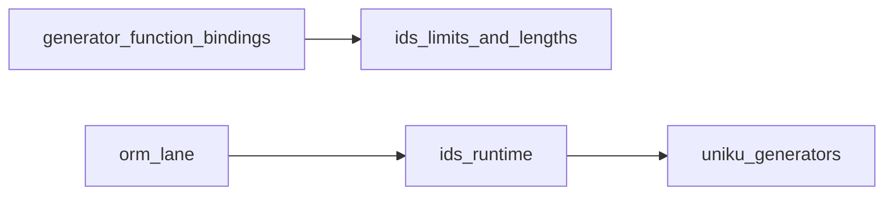

# @internal/ids

ID generators for Prisma 8 contracts: the built-in generator ids, the limits of their arguments, how many characters each writes, and the runtime that generates the values before Prisma 8 sends data to adapters.

A contract does not import this package to declare a generated id. It writes the column type, usually the identifier's type alias, and the generator call: `field.column(type.sql.Ulid()).id().onCreate(gen.ulid())` in TypeScript or `sql.Ulid @id @onCreate(ulid())` in PSL.

## Responsibilities

- Name the built-in generators (`builtinGeneratorIds`: `ulid`, `nanoid`, `uuidv7`, `uuidv4`, `cuid2`, `ksuid`).
- Write the generator argument limits once: `UUID_VERSIONS` (4 and 7), `CUID_VERSION` (2) and `NANOID_SIZE` (2 to 255). The generator function signatures import them.
- `generatedLength(id, params)` gives the number of characters a built-in generator writes, which the SQL family's generator function bindings check a column's length against.
- Generate values at runtime using `uniku` when mutation defaults require them.

## Architecture



## Usage

```ts
import { generateId } from '@internal/ids/runtime';

const value = generateId({ id: 'uuidv4' });
```

## Related docs

- [Data Contract](../../../docs/architecture%20docs/subsystems/1.%20Data%20Contract.md)
- [Query Lanes](../../../docs/architecture%20docs/subsystems/3.%20Query%20Lanes.md)
