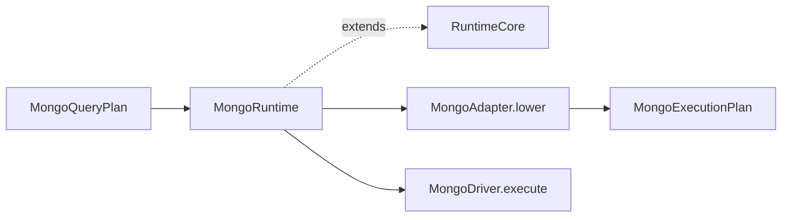

# @internal/mongo-runtime

MongoDB runtime executor for Prisma 8.

## Package Classification

- **Domain**: mongo
- **Layer**: runtime
- **Plane**: runtime

## Overview

The Mongo runtime package implements the Mongo family runtime by extending the abstract `RuntimeCore` base class from `@internal/framework-components/runtime` with Mongo-specific lowering and driver dispatch. It provides the public runtime API for MongoDB, layering Mongo concerns (adapter lowering and wire-command dispatch) on top of the shared middleware lifecycle.

## Usage

The runtime takes a **`MongoExecutionContext`** built from a **`MongoExecutionStack`** (target + adapter + optional driver + extension packs). The context aggregates codec contributions from each stack component into a single registry — users do not construct or thread a `MongoCodecRegistry` themselves. This mirrors the SQL pattern (see `packages/2-sql-family/5-runtime/src/sql-context.ts`).

Typed reads that attach a **`resultShape`** on the query plan are decoded after the driver yields each row: scalars and scalar arrays run through their `codecId` entries; `kind: 'unknown'` subtrees are passed through unchanged; plans without `resultShape` (for example raw commands) leave rows as the driver returned them.

Example:

```ts
import mongoRuntimeAdapter from '@internal/adapter-mongo/runtime';
import mongoRuntimeDriver from '@internal/driver-mongo/runtime';
import {
  createMongoExecutionContext,
  createMongoExecutionStack,
  createMongoRuntime,
} from '@internal/mongo-runtime';
import mongoRuntimeTarget from '@internal/target-mongo/runtime';

const stack = createMongoExecutionStack({
  target: mongoRuntimeTarget,
  adapter: mongoRuntimeAdapter,
  driver: mongoRuntimeDriver,
});
const context = createMongoExecutionContext({ contract, stack });

const driver = stack.driver.create();
await driver.connect({ kind: 'url', url, dbName });

const runtime = createMongoRuntime({
  context,
  adapter: stack.adapter.create(stack),
  driver,
});
```

Custom or third-party codecs (encryption, vendor scalars) are contributed via an extension-pack descriptor whose `codecs` slot returns the codec descriptors; `createMongoExecutionContext` folds them into the same registry. Duplicate codec ids across contributors throw `RUNTIME.DUPLICATE_CODEC` at composition time.

## Responsibilities

- **Stack/context composition**: `createMongoExecutionStack` and `createMongoExecutionContext` mirror SQL's `createSqlExecutionStack` / `createExecutionContext`. Given a driver descriptor, `createMongoExecutionStack` returns a `MongoExecutionStackWithDriver`, whose `driver.create()` passes the target's session settings to the descriptor, as `SqlExecutionStackWithDriver` does. Without one it returns a `MongoExecutionStack`, which `mongoStatic` uses so that it never loads `mongodb`. The context aggregates codec contributions from `[stack.target, stack.adapter, ...stack.extensions]` into a single `MongoCodecRegistry`. The `MongoExecutionContext` type is declared in `@internal/mongo-query-ast`, as SQL's `ExecutionContext` is declared in relational-core, and holds no stack: the query lanes build against it, and the runtime receives the adapter as its own option.
- **Runtime executor**: `createMongoRuntime({ context, adapter, driver, ... })` composes context, adapter and driver into a `MongoRuntime`, as the SQL runtime does. The caller creates the adapter with `stack.adapter.create(stack)`, and the runtime checks middleware against the target named by `context.contract.target`. The runtime has separate `query(plan)` and `execute(plan)` operations accepting `MongoQueryPlan<Row>` from `@internal/mongo-query-ast`. `query()` yields decoded rows, while `execute()` returns statement statistics. Both operations lower the plan with the adapter, and run the wire command on the driver; `query()` **optionally decodes** each row when `plan.resultShape` is present.
- **Operation flow**: Row-producing work uses `query(plan)` and the query middleware lifecycle; statistics-producing work uses `execute(plan)` and the execute middleware lifecycle. Each operation allocates its own `CodecCallContext` and threads it through its codec dispatches.
- **Lowering**: Happens in the adapter (`lower(plan)`), wrapped by the runtime's `lower` override into a `MongoExecutionPlan`.
- **Middleware lifecycle inheritance**: `MongoRuntime` extends `RuntimeCore<MongoQueryPlan, MongoExecutionPlan, MongoMiddleware>` and runs every `query()` and `execute()` as a statement activity: `activityStarted`, `beforeEncode` (before `resolveParams`), `intercept.onQuery` / `intercept.onExecute`, `onRow`, `activityEnded`, then `activityFinalized` right away, because Mongo has no transactions. Mongo does **not** override `runBeforeCompile` (Mongo middleware has no `beforeCompile` hook today).
- **Lifecycle management**: `close()` closes the driver. After it, `query()` and `execute()` reject with `DRIVER.NOT_CONNECTED` "Runtime is closed", the error the SQL runtime gives.

## Architecture

`MongoRuntimeImpl` extends `RuntimeCore<MongoQueryPlan, MongoExecutionPlan, MongoMiddleware>` and overrides:

- `lower(plan)` — calls the adapter's `lower(plan)` and wraps the resulting wire command into a `MongoExecutionPlan`.
- `runDriver(exec)` — dispatches the wire command to the Mongo driver via `driver.execute(exec.command)`.
- `close()` — closes the underlying driver.

`MongoRuntimeImpl` extends `RuntimeCore` but **overrides `query`** so that after `runQueryWithMiddleware` yields a raw driver row, the runtime can **`decodeMongoRow`** when the lowered plan carries `resultShape`, then yield the decoded row. `lower(plan)` copies `resultShape` from the query plan onto `MongoExecutionPlan`. Middleware `onRow` still sees the raw driver row (decode happens after the middleware loop for that row, before the consumer receives the value).

The execution template is: `lower` → `runQueryWithMiddleware` (driver loop + query middleware) → **per-row decode when `exec.resultShape` is set** → yield to consumer.



## Related Subsystems

- **[Runtime & Middleware Framework](../../../../docs/architecture%20docs/subsystems/4.%20Runtime%20&%20Middleware%20Framework.md)** — Runtime execution pipeline
- **[Adapters & Targets](../../../../docs/architecture%20docs/subsystems/5.%20Adapters%20&%20Targets.md)** — Adapter and driver responsibilities
