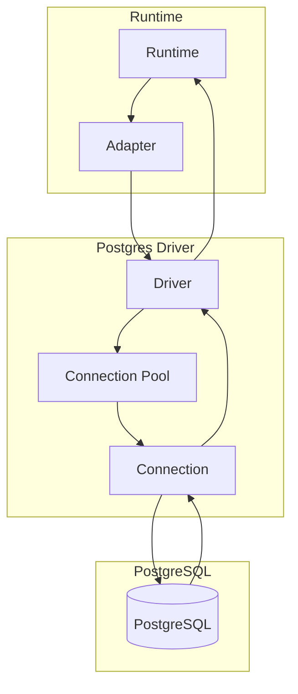

# @internal/driver-postgres

PostgreSQL driver for Prisma 8.

## Package Classification

- **Domain**: targets
- **Layer**: drivers
- **Plane**: multi-plane (migration, runtime)

## Overview

The PostgreSQL driver provides transport and connection management for PostgreSQL databases. It implements the `SqlDriver` interface for executing SQL statements, explaining queries, and managing connections.

In Prisma 8, "driver" refers to the Prisma 8 interface (not the underlying `pg` library). Drivers are transport-agnostic: they own pooling, connection management, and transport protocol (TCP, HTTP, etc.), but contain no dialect-specific logic. All dialect behavior lives in adapters. Instantiation is separate from connection; `create()` returns an unbound driver, `connect(binding)` binds at the boundary ([ADR 159](../../../../docs/architecture%20docs/adrs/ADR%20159%20-%20Driver%20Terminology%20and%20Lifecycle.md)).

This package spans multiple planes:

- **Migration plane** (`src/exports/control.ts`): Control plane entry point for driver descriptors
- **Runtime plane** (`src/exports/runtime.ts`): Runtime entry point for driver implementation

## Purpose

Provide PostgreSQL transport and connection management. Execute SQL statements and manage connections without dialect-specific logic.

## Responsibilities

- **Connection Management**: Acquire and release database connections
- **Statement Execution**: Execute SQL statements with parameters
- **Query Result Parser Policy**: Configure `pg` so runtime query rows expose every column as raw server text, because codecs own decoding; control-plane queries keep `pg` parsing except for array columns
- **Query Explanation**: Execute EXPLAIN queries for query analysis
- **Connection Pooling**: Manage connection pools (when applicable)
- **Transport Protocol**: Handle PostgreSQL protocol (TCP, HTTP, etc.)

**Non-goals:**

- Dialect-specific SQL lowering (adapters)
- Query compilation (sql-query)
- Runtime execution (runtime)

## Architecture



## Components

### Driver (`postgres-driver.ts`)

- Main driver implementation
- Implements `SqlDriver` interface
- Manages connections and executes statements
- Handles PostgreSQL protocol

### Row parser policy

The runtime requires a driver to return every row value as `string | Uint8Array | null`, where the string is the text the server prints for the type ([ADR 155](../../../../docs/architecture%20docs/adrs/ADR%20155%20-%20Driver%20Codec%20Boundary%20and%20Lowering%20Responsibilities.md)). Buffered, cursor, and named cursor `query` paths meet that requirement by passing `serverTextTypes` to `pg`. That policy returns raw server text for every type OID, so `pg` never parses a value. Rows from `query` carry the server's text output for every column, and that text is the wire value (ADR 030) every Postgres codec decodes: `t` for a `bool`, `\x0102` for a `bytea`, `NaN` for a `float8`, `1 day 02:03:04` for an `interval`, `{a,b}` for an array, and the JSON text for a `json` or `jsonb` value. A stored JSON string such as `"standard"` keeps its quotes until codec decoding. Direct driver `query` callers see the same server text strings. A reader that consumes `query` rows without a codec, such as the runtime marker check, must parse the text itself.

`explain` passes no `types` option, so its rows use the default `pg` parsing.

The control driver passes `controlTextTypes` instead. Control-plane queries read catalog rows without codecs, so that policy keeps `pg` parsing for scalar types and returns raw text only for the array OIDs that `pg-types` registers (`PG_TYPES_ARRAY_OIDS`), which the control plane parses itself.

The policies are scoped to each driver query; caller-owned clients and the global `pg` type parsers keep their defaults.

### Liveness check of a pooled connection

A `pg.Pool` notices that an idle connection died only when it emits `error`, and a dead socket emits nothing until the process writes to it. The pool removes an idle connection for other reasons too, such as `idleTimeoutMillis`, but until one applies, a connection that died silently stays eligible for checkout. So after a paused process resumes, or after a NAT or load balancer drops a connection without telling the client, the pool can hand out the dead connection. The pooled driver checks it before it uses it.

- **When it runs.** On every connection the driver takes from a pool (a statement, a held connection, a transaction), unless the connection was last used less than one second ago by both the wall clock and the monotonic clock. If either clock says a second or more, or went backwards, the driver checks. A connection used within the last second, or one the pool has just opened, is used without a check, so a busy application pays nothing. The one exception is the eviction cutoff below: if a check that started after this connection's last use has failed, the connection is evicted without a check, however recently it was used.
- **What it sends.** One statement with a 5 second time limit on that statement alone. When the session settings are due on the connection, the session-settings statement is the check. Otherwise the driver sends an empty statement, which PostgreSQL answers with an empty result. The caller's own statements get no time limit.
- **What "dead" means.** The connection is alive only if the server answered, with a result or with a database error. A timeout, a connection error, or any other failure from the client library counts as dead. A database error on the session-settings statement is thrown to the caller, as it is without the check.
- **Eviction.** The driver destroys a dead connection's socket, so a peer that never answers cannot hold it open, and releases it to the pool with an error, which removes it. It then takes another connection. The time the failed check started becomes the pool's cutoff: a connection the driver saw last used before it is evicted on its next checkout without a check, because the pool hands out its most recently used connection first. A connection used after the cutoff is kept. A connection the driver has no record of, such as one the application used before it created the driver, is checked. After a failed check it is evicted without a check instead, when the pool is a `pg.Pool` or has emitted `connect` while the driver listened: such a pool gives every connection it opens since a record, so one without a record is older than the cutoff. The loop takes at most the pool's `max` plus one connections, or 11 when the pool has no `max`.
- **What `release` listeners see.** An application listening to its pool's `release` event sees a `SqlConnectionError` for each evicted connection: "evicted an idle pooled connection that failed its liveness check", or "last used before another connection from the same pool failed its liveness check".
- **Errors.** If the pool cannot open a new connection, the caller gets the connect error. If the loop reaches its limit, the caller gets the last failed check as a `SqlConnectionError`, or, when every connection it took was evicted for being older than another request's failed check, a `SqlConnectionError` that says so and that no statement was sent.
- **Cost of a misjudged check.** A check can time out on a healthy connection: behind a transaction-mode pooler such as PgBouncer that is out of server connections, the empty statement waits in the pooler's queue like any other; and when the process's event loop is blocked for more than 5 seconds, the time limit fires before the answer is read. The driver then evicts that connection and, on their next checkout, the older idle ones, which costs up to 5 seconds and reconnects, never a wrong result.

It does not cover:

- a connection that died silently and is used again within the second, which is not checked unless a clock moved backwards or an earlier failed check already evicts it. Its statement fails with `SqlConnectionError`, or waits with no limit if the peer never answers. The one second is a known limit, and is what keeps a busy application from paying for a check;
- a connection that dies between the check and the statement, or while a statement runs. That statement fails with `SqlConnectionError`, and the driver never sends it again ([ADR 337](../../../../docs/architecture%20docs/adrs/ADR%20337%20-%20A%20SQL%20driver%20does%20not%20resend%20a%20statement%20after%20its%20connection%20fails.md));
- the application's own `pool.query()` and `pool.connect()`, which do not pass through the driver;
- a connection the application holds with `acquireConnection()`, which is checked when it is taken, not later;
- a single `pg.Client` binding or the serverless entry, which have one connection and nothing to swap to.

There is no option to change the two numbers or to turn the check off.

### Statements the driver sends that the user did not write

The runtime driver sends these on its own account:

- the session-settings statement (`SELECT set_config(...)`), on a connection from a pool or client that does not start with the settings the target declares. On a pool or client the application supplied, the settings stay on that connection afterwards, so the application's own queries on it see them ([ADR 159](../../../../docs/architecture%20docs/adrs/ADR%20159%20-%20Driver%20Terminology%20and%20Lifecycle.md));
- `BEGIN` and `COMMIT` around a cursor stream outside a transaction, which keep the cursor's portal alive;
- the liveness check above: an empty statement, or the session-settings statement when it is due;
- `ROLLBACK` on a single `pg.Client` the application supplied, when the driver gives the client up (a held connection is destroyed) while a transaction the driver began is still open on the server. It discards that transaction's uncommitted writes.

## Related Subsystems

- **[Adapters & Targets](../../../../docs/architecture%20docs/subsystems/5.%20Adapters%20&%20Targets.md)**: Driver specification

## Related ADRs

- [ADR 159 — Driver Terminology and Lifecycle](../../../../docs/architecture%20docs/adrs/ADR%20159%20-%20Driver%20Terminology%20and%20Lifecycle.md)
- [ADR 005 — Thin Core Fat Targets](../../../../docs/architecture%20docs/adrs/ADR%20005%20-%20Thin%20Core%20Fat%20Targets.md)
- [ADR 016 — Adapter SPI for Lowering](../../../../docs/architecture%20docs/adrs/ADR%20016%20-%20Adapter%20SPI%20for%20Lowering.md)
- [ADR 251 — Target-owned Postgres list framing](../../../../docs/architecture%20docs/adrs/ADR%20251%20-%20Target-owned%20Postgres%20list%20framing.md)
- [ADR 337 — A SQL driver does not resend a statement after its connection fails](../../../../docs/architecture%20docs/adrs/ADR%20337%20-%20A%20SQL%20driver%20does%20not%20resend%20a%20statement%20after%20its%20connection%20fails.md)

## Usage

Use the descriptor + connect lifecycle:

```typescript
import postgresDriver from '@internal/driver-postgres/runtime';

const driver = postgresDriver.create({ cursor: { batchSize: 100 } });
await driver.connect({ kind: 'url', url: process.env.DATABASE_URL });
// driver is now bound; use acquireConnection, query, execute, etc.
```

Binding variants:

- `{ kind: 'url', url }`: Driver creates a Pool from the connection string and ends it on `close()`
- `{ kind: 'pgPool', pool, ownedByDriver }`: Use an existing pg Pool
- `{ kind: 'pgClient', client, ownedByDriver }`: Use an existing pg Client (direct connection)

`ownedByDriver` says whether the driver ends the pool or client on `close()`. With `false` (a pool or client the caller supplied) the driver never ends it. A client that has not started connecting is connected on first use, whoever owns it; pg has no public flag for this, so the driver reads pg's `_connected`, `_connecting`, `_ending` and `_queryable` fields, and treats a client that is ending or no longer queryable as lost. A client whose connect failed or whose connection dropped cannot be reused: the driver rejects every later use.

When a direct driver gives up a supplied client (for example after a failed rollback), it marks the client unusable, sends a `ROLLBACK` for any transaction it opened on it, and never ends it. Binding that client again fails: create a new client.

The driver ensures the session settings the stack's target declares on every connection it uses; the PostgreSQL target declares `DateStyle=ISO`, which every date and time codec that reads a date or timestamp needs. It also changes how the application's own raw SQL prints dates on those connections. The target declares only settings a connection pooler accepts at connection start; it does not declare `lc_monetary`, which the `money` codec needs to be `C` and the database must provide. A pool or client made by `createPgPool` or `createPgClient`, as a `url` binding's pool is, starts each session with the settings as startup options, after any `options` the URL or `PGOPTIONS` gives, and reads its connection string, `PGOPTIONS` and certificate files when it opens each connection, as pg does. On any other pool or client, the driver sets the settings with one statement on each connection before first use, and again after a connection from `acquireConnection()` is released.

With `cursor: { disabled: true }` (or buffered cursor fallback), driver-level pool queries return their connection after fetching, before yielding buffered rows for decoding or consumption. Cursor streams retain the connection until completion or iterator cleanup. Queries on caller-owned connections and transactions never release the caller's lease.

## Exports

- `./runtime`: Runtime entry point for driver implementation
  - Default: `postgresRuntimeDriverDescriptor` — use `create()` for unbound driver, then `connect(binding)`
  - `createPgPool(config, sessionSettings)` and `createPgClient(config, sessionSettings)`: a pg pool or client whose sessions start with the session settings
  - Types: `PostgresBinding`, `PostgresDriverCreateOptions`, `QueryResult`
- `./control`: Control plane entry point for driver descriptors
  - Default export: `DriverDescriptor` for use in `prisma.config.ts`
