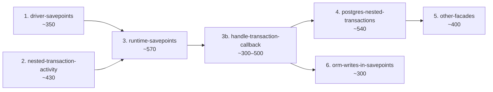

# Nested transactions — Plan

**Spec:** `projects/nested-transactions/spec.md`
**Linear Project:** skipped by the operator.

## At a glance

The whole project is about 2,500–2,700 changed lines, counting production code, tests and docs. That is over the operator's 1,000–1,500 limit for a single delivery. It is split into six slices of about 500 lines or fewer each, plus slice 3b, added after slice 3's PR opened.

Slices 1–3 build the substrate: the drivers, the framework activity and the runtime. Slice 3b replaces the owned transaction with `withTransaction`, so that the ORM and the facades start transactions the same way. Slice 4 gives users `tx.transaction(cb)` on Postgres. Slices 5 and 6 extend that to the other facades and to ORM writes.

Line counts are estimates, measured against the existing code. For example:
- `PostgresTransactionImpl.commit`/`rollback` is about 25 lines.
- The SQL runtime's transaction tests are about 1,300 lines across `transaction-activity.*.test.ts` and `with-transaction.failures.test.ts`.
- The SQLite facade's `transaction.test.ts` is 268 lines.

## Composition

### Parallel group A (start together)

- **Slice `driver-savepoints`** (~350: ~120 production, ~230 tests): `projects/nested-transactions/slices/driver-savepoints/`
  - **Outcome:** every SQL driver can open, release and roll back savepoints, nested to any depth.
  - **Builds on:** none.
  - **Hands to:** a required `SqlTransaction.savepoint(name): Promise<SqlTransaction>` on the Postgres, MySQL and SQLite drivers. On a savepoint, `commit()` sends `RELEASE` and `rollback()` sends `ROLLBACK TO`.
  - **Focus:**
    - `driver-types.ts` and the three driver packages.
    - Driver-level tests: PGlite for Postgres, live MySQL, and SQLite. They cover a savepoint inside a savepoint, and Postgres recovering from the aborted state after `ROLLBACK TO`.
    - The Postgres statements take the client query lock and keep `SharedTransactionState.open` set.
    - Nothing above the driver uses the method yet.

- **Slice `nested-transaction-activity`** (~430: ~70 production, ~300 tests, ~60 docs): `projects/nested-transactions/slices/nested-transaction-activity/`
  - **Outcome:** the framework runs a transaction activity beneath another transaction activity, with the finalization rules of spec decision 6.
  - **Builds on:** none.
  - **Hands to:** `startTransactionActivity` accepting a transaction parent, plus a release settlement:
    - **Released:** a savepoint hands its children and its statement failures to the parent.
    - **Rolled back:** a savepoint finalizes its children right away as `rolled-back` and passes no failures up.
  - **Focus:**
    - `framework-components` `transaction-activity.ts` and `test/transaction-activity.test.ts`: finalize order and outcomes for released, rolled-back and doubly nested savepoints.
    - The finalization section of the Runtime & Middleware subsystem doc, and the ADR 271 amendment.
    - No runtime calls it yet.

### Stack (after group A)

3. **Slice `runtime-savepoints`** (~570: ~200 production, ~350 tests, ~20 docs): `projects/nested-transactions/slices/runtime-savepoints/`
   - **Outcome:** the SQL runtime opens savepoints on an open transaction, enforces the fail-fast guard, and settles them with the error behaviour of spec decisions 3 and 9.
   - **Builds on:** slice 1's driver `savepoint()` and slice 2's nested transaction activity.
   - **Hands to:**
     - `transaction()` on a `RuntimeTransaction`, opening a savepoint.
     - The savepoint-name counter per transaction, and tracking of the innermost open level per connection.
     - `RUNTIME.TRANSACTION_SUSPENDED`.
     - Every level invalidated after a failed `ROLLBACK TO`.
   - **Focus:**
     - `packages/2-sql-family/5-runtime`: `sql-runtime.ts`, `activity-handle.ts`, the transaction state.
     - Runtime tests with stub drivers, as the existing `transaction-activity.*` tests do.
     - The error reference entries.
     - No facade or ORM change.

3b. **Slice `handle-transaction-callback`** (~300–500, estimate to be measured at slice spec time): `projects/nested-transactions/slices/handle-transaction-callback/`
   - **Outcome:** a transaction started from an activity handle on the runtime goes through `withTransaction`, and the owned transaction is removed.
   - **Builds on:** slice 3 (`OuterTransaction`, `transaction()` on a `RuntimeTransaction`).
   - **Hands to:**
     - `ActivityHandle.transaction(fn, options)`, a callback form built on `withTransaction`, in place of the method that returns a `RuntimeTransaction` on a connection the transaction owns.
     - `withTransaction` taking a parent activity, so the transaction activity stays beneath the activity that started it.
     - No `owned-transaction.ts`, `beginOwnedTransactionBeneath` or `ownTransaction`: the rules for giving a connection back exist only in `withTransaction`.
     - `rollback()` after a commit rejects `RUNTIME.TRANSACTION_CLOSED`, since `withTransaction` never calls it and the ORM's `runInTransaction` is gone.
   - **Focus:**
     - `packages/2-sql-family/5-runtime`: `withTransaction`, `activity-handle.ts`, `sql-runtime.ts`, `owned-transaction.ts` (removed), `runtime-transaction.ts` (the `self` reference that `Object.create` needed goes away).
     - `sql-orm-client` `run-graph.ts`: `runInTransaction` replaced by the callback. The ORM's implicit transaction then reports commit failures as `RUNTIME.TRANSACTION_COMMIT_FAILED`, as `db.transaction(cb)` does; confirm with the operator at slice spec time.
     - Supabase `beginRoleTransaction` on the callback form.
     - The runtime tests for the handle's `transaction()` and the owned connection rules, rewritten against `withTransaction`; main's three tests for `rollback()` after a commit.
     - The subsystem doc's `transaction()` bullet and ADR 271.

4. **Slice `postgres-nested-transactions`** (~540: ~180 production, ~330 tests, ~30 docs): `projects/nested-transactions/slices/postgres-nested-transactions/`
   - **Outcome:** Postgres users can call `tx.transaction(cb)`, with every behaviour in the spec.
   - **Builds on:** slice 3's `transaction()` on a `RuntimeTransaction` and guard, and slice 3b's `withTransaction` with a parent activity.
   - **Hands to:** `withSavepoint(txCtx, fn, buildMembers)` exported from the SQL runtime, with the Postgres facade using it.
   - **Focus:**
     - `withSavepoint`, sharing the guarded queryable and settle code with `withTransaction`.
     - `postgres-members.ts` and `PostgresTransactionContext`.
     - `withSavepoint` unit tests.
     - PGlite integration tests: the spec's At a glance example, aborted-state recovery, and every guard and error path from the project DoD.
     - The subsystem doc's `withTransaction` section.

### Parallel group B (after slice 4 and after slice 3b, respectively)

- **Slice `other-facades`** (~400: ~100 production, ~300 tests): `projects/nested-transactions/slices/other-facades/`
  - **Outcome:** `tx.transaction(cb)` works on the MySQL, SQLite and Supabase facades the same way it does on Postgres.
  - **Builds on:** slice 4's `withSavepoint`.
  - **Hands to:** every SQL facade exposing `tx.transaction(cb)`.
  - **Focus:**
    - Wiring and transaction context types in `mysql.ts`, `sqlite.ts` and `supabase.ts`.
    - The At a glance example as a test on live MySQL, on SQLite, and on Supabase over PGlite.
    - The review of the `withSavepoint` shape required by spec decision 10. Any change to the helper lands here.

- **Slice `orm-writes-in-savepoints`** (~300: ~30 production, ~250 tests, ~15 docs): `projects/nested-transactions/slices/orm-writes-in-savepoints/`
  - **Outcome:** a multi-statement ORM write inside a transaction runs in its own savepoint.
  - **Builds on:** slice 3's `transaction()` opening a savepoint on a `RuntimeTransaction`, and slice 3b's callback `transaction(fn, options)` on the handle. It does not need slice 4: its tests open the transaction through the runtime.
  - **Hands to:** project close.
  - **Focus:**
    - `sql-runtime`: `transaction()` on an activity handle opened on a transaction or savepoint, opening a savepoint beneath the handle's activity and rejecting options with a new `RUNTIME.SAVEPOINT_OPTIONS_UNSUPPORTED` (slice 3 left handles as on main).
    - `sql-orm-client`: `run-graph` calling the handle's `transaction(fn)` inside a transaction too, without options there.
    - ORM integration tests on Postgres, MySQL and SQLite.
    - The subsystem doc's paragraph on ORM writes.

## Dependencies (external)

- [ ] The live MySQL database used by the `*.live.test.ts` files: available in CI, already used by `transaction-isolation.live.test.ts`.
- [ ] The query-lock question, under discussion in a separate session. It doesn't block: slice 1 uses the lock as `BEGIN`, `COMMIT` and `ROLLBACK` do. If that discussion removes the lock, the savepoint statements lose it in the same change.

## Sequencing rationale

- **Split to fit the size limit.** The operator capped deliveries at about 500 changed lines per slice once the project went past 1,500 lines. The substrate therefore ships in three slices (1–3) that users don't see until slice 4. That is an accepted exception to "Valuable": each one lands a tested layer with a named outcome, and the spec's transitional-shape constraints allow layers to land before anything uses them.
- **Six slices, more than the usual four.** This follows from the size limit, not from two projects bundled into one. There is one purpose, and every slice serves it.
- **Slices 1 and 2 run in parallel.** Drivers and the framework activity share no code.
- **Slice 3b follows slice 3 directly.** It came out of slice 3's review: the owned transaction kept a second copy of `withTransaction`'s connection rules, and its `Object.create` wrapper constrained the transaction classes. It changes the handle's `transaction()` and the ORM's implicit transaction, so it lands before slices 4 and 6 build on either.
- **Slice 6 starts as soon as slice 3b merges, in parallel with slice 4.** It needs only the runtime's `transaction()` opening a savepoint and the handle's callback `transaction()`, not `withSavepoint` or a facade.
- **Slice 5 waits for slice 4.** It reuses `withSavepoint`, and it is where the helper's shape is reviewed.
