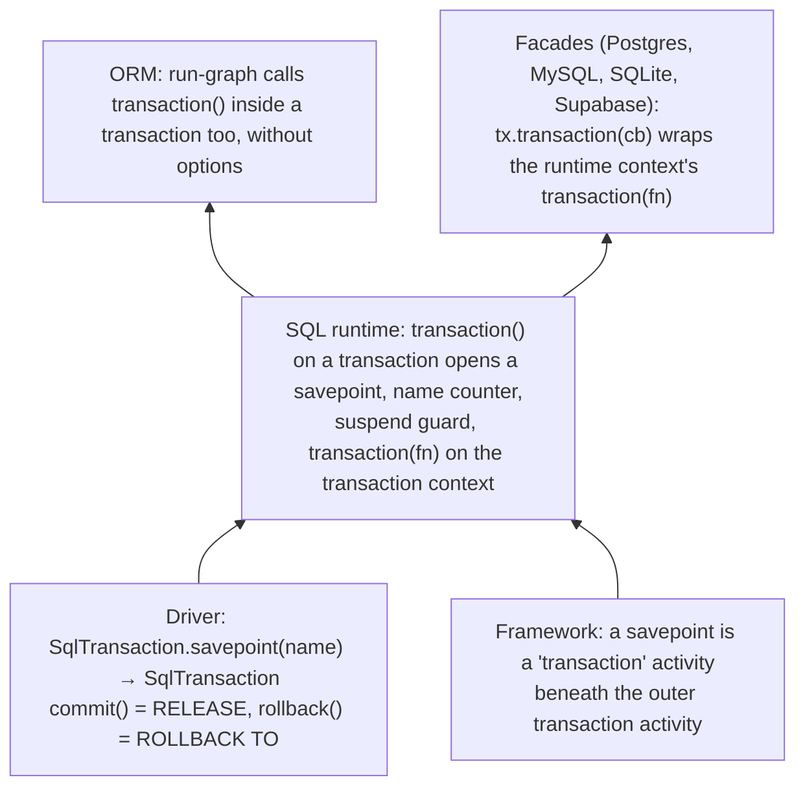

# Nested transactions

## Purpose

Code that runs in its own transaction can be called from inside another transaction without breaking that transaction, and a failure in one part of a transaction can be undone without losing the work around it. A single ORM call stays atomic whether or not it runs inside a user's transaction.

## At a glance

Inside `db.transaction(cb)`, the transaction context gets a `transaction(cb)` member. A nested call always runs in a savepoint: if its callback throws, the work it did is rolled back to the savepoint and the error is rethrown; if it returns, the savepoint is released.

```ts
await db.transaction(async (tx) => {
  await tx.orm.User.create(a)                      // A

  await tx
    .transaction(async (inner) => {                // SAVEPOINT sp_1
      await inner.orm.Post.create(b)               // B
      throw new Error('nope')                      // ROLLBACK TO SAVEPOINT sp_1, rethrow
    })
    .catch(() => {})                               // the outer transaction is still usable

  await tx.orm.Audit.create(c)                     // C
})                                                 // COMMIT: A and C land, B does not
```

The same mechanism makes a multi-statement ORM write (a nested create, a create with related rows, and so on) atomic inside a user transaction. Today such a write is flattened into the user's transaction (`sql-orm-client/src/mutation-graph/run-graph.ts:79`), so a caught failure leaves its earlier statements in place on MySQL and SQLite. After this project, it runs in its own savepoint.

Layers, from the database up:



## Decisions

Each decision was reached in a design discussion with the operator. The research behind them covered Drizzle, Kysely, Knex, TypeORM, Sequelize, MikroORM, Prisma 6, Django, SQLAlchemy, Rails, Ecto and Spring.

1. **A nested `tx.transaction(cb)` always creates a savepoint.** There is no mode that joins the outer transaction.
   - Why: code like `createUser(db)` that opens its own transaction must stay isolated when called from inside another transaction. Joining the outer transaction (the default in Rails, Sequelize and Ecto) silently gives up that isolation, and a swallowed inner rollback is the usual complaint about those libraries.
   - Rejected: a propagation or nest-mode flag (Sequelize `nestMode`, MikroORM and Spring `propagation`). It adds a choice every caller has to understand, for a mode we don't want as the default.
2. **The nested call takes no options.**
   - **No isolation level:** isolation can't change inside a transaction. Libraries that accept it silently ignore it (Knex, TypeORM, MikroORM); Rails and Sequelize reject it. Leaving it out of the type is clearer than either.
   - **No timeout:** the outer transaction's deadline already covers the savepoint, because it runs on the same connection. A timeout that rolls back only the savepoint would need statement cancellation in every driver (`pg_cancel_backend`, `KILL QUERY`). A timeout that ends the outer transaction adds nothing over the outer timeout.
3. **Concurrency on one transaction fails fast.**
   - **A second savepoint while one is open on the same level** (`Promise.all([tx.transaction(a), tx.transaction(b)])`) rejects with `RUNTIME.TRANSACTION_SUSPENDED`, like any other work on a transaction with a savepoint open above it, with a message that names the savepoint. (Amended after slice 3's PR opened, at the operator's request; it was `RUNTIME.TRANSACTION_ALREADY_OPEN`.)
   - **Using the parent context while a child savepoint is open** rejects with a new code, `RUNTIME.TRANSACTION_SUSPENDED`, whose details carry the open savepoint's activity ID. The parent can be used again once the child has settled.
   - **Savepoint names** come from a counter per transaction. `COMMIT` and `ROLLBACK` remove every savepoint of the transaction, so names can repeat across transactions, and only one savepoint is open per level, so names never collide within one.
   - Why: a savepoint applies to whatever runs on the connection at that moment. A sibling's `ROLLBACK TO` would undo the other sibling's statements, and outer work sent while a savepoint is open would be undone with it.
   - Rejected: making siblings wait for each other (Knex). It hides the bug: statements run in a different order from the one the code reads in.
4. **Driver interface: one recursive `SqlTransaction`.**
   - `SqlTransaction` (`packages/2-sql-family/4-lanes/relational-core/src/ast/driver-types.ts`) gains a required `savepoint(name: string): Promise<SqlTransaction>`.
   - On a savepoint, `commit()` sends `RELEASE SAVEPOINT name` and `rollback()` sends `ROLLBACK TO SAVEPOINT name`. Calling `savepoint()` on a savepoint stacks another one.
   - The driver sends the statements, so they go through the same path as `BEGIN`, `COMMIT` and `ROLLBACK`, including the Postgres driver's per-client query lock. The runtime owns the names and the guard.
   - Why: the runtime's settle logic, as in `withTransaction`, is written once against one shape and serves every level.
   - Rejected:
     - A shared base interface with a separate `SqlSavepoint { release() }`: the runtime would have to rebuild the single shape anyway.
     - The runtime sending `SAVEPOINT` as an ordinary statement: it would skip the driver's lock and transaction state, and middleware would see it as a user statement.
5. **Required, with no capability flag.** Postgres, MySQL/MariaDB and SQLite all support `SAVEPOINT`, `RELEASE SAVEPOINT` and `ROLLBACK TO SAVEPOINT` with the same syntax. The SQL databases without savepoints (Spanner, Redshift, Snowflake, BigQuery) aren't targets. If one becomes a target, making the method optional is non-breaking for consumers.
6. **Middleware sees each savepoint as its own `'transaction'` activity**, started beneath the outer transaction activity. This is an approved change to `packages/1-framework`, limited to `transaction-activity.ts` and its tests.
   - **A savepoint that rolls back** finalizes its children right away as `rolled-back`. Its statement failures are not passed up, because `ROLLBACK TO` has recovered the transaction, so a later `COMMIT` really commits.
   - **A savepoint that is released** hands its children to the parent, which finalizes them with the outer outcome. Its statement failures are passed up, so the existing rule applies unchanged: a `COMMIT` that resolves after a failed statement is `unknown`. The only way to reach this path with a failed statement is for user code to catch the statement's error inside the nested callback and return normally, on MySQL or SQLite. On Postgres, `RELEASE` fails in an aborted transaction and the path becomes a rollback.
   - **No new field on `TransactionActivity`.** A middleware tells a savepoint apart with `activity.kind === 'transaction' && ctx.inTransaction()`.
   - Why: without this, writes undone by a savepoint would be finalized `committed`, and one recovered failure would make every statement in the outer transaction `unknown`.
   - Rejected: savepoints invisible to middleware. That needs no framework change but gives the two inaccurate outcomes above.
7. **ORM multi-statement writes run in a savepoint inside a transaction.** `run-graph` calls `transaction()` on its scope wherever it runs: outside a transaction it passes `implicitTransactionOptions` and gets a transaction, inside one it passes no options and gets a savepoint. It tells the two apart from its activity (`ctx.inTransaction()`). This applies wherever a transaction is open on the connection, whichever API opened it.
8. **The runtime-level member is `transaction()` on every scope that can open one.** A connection's `transaction(options)` begins a transaction; a transaction's or savepoint's `transaction()` opens a savepoint; an activity handle's `transaction()` does whichever its scope does.
   - On a transaction or savepoint, `transaction()` takes no parameters (decision 2). An activity handle's `transaction(options)` keeps its options parameter, because a handle on the runtime takes them; inside a transaction it rejects them with `RUNTIME.SAVEPOINT_OPTIONS_UNSUPPORTED` and sends nothing, so a caller never gets an isolation level or timeout other than the one it asked for. The handle change lands in slice 6.
   - The MySQL facade's `implicitTransactionOptions: { isolationLevel: 'ReadCommitted' }` (`mysql.ts:326`) is why the ORM leaves options out inside a transaction (decision 7).
   - These runtime types are internal, not public API. The user-facing call is `tx.transaction(cb)` as well.
   - Amended after slice 3's PR opened, at the operator's request: the first version named the member `savepoint()`, separate from `transaction(options)`, so that the ORM chose between two methods instead of passing or omitting options.
9. **Settle failures reuse `RUNTIME.TRANSACTION_COMMIT_FAILED` and `RUNTIME.TRANSACTION_ROLLBACK_FAILED`.**
   - **Callback throws:** `ROLLBACK TO`, then the callback's error is rethrown, and the outer transaction stays usable.
   - **`RELEASE` fails:** try `ROLLBACK TO`. If it succeeds, the outer transaction stays usable and the nested call throws `TRANSACTION_COMMIT_FAILED`.
   - **`ROLLBACK TO` fails:** every level up to the outer transaction is invalidated, so its next statement fails with `RUNTIME.TRANSACTION_CLOSED`, and the outer settle destroys the connection, as `withTransaction` does after a failed rollback today.
   - **A middleware `activityStarted` hook refuses the savepoint:** no `SAVEPOINT` is sent, the nested call rejects, and the outer transaction stays usable.
10. **The runtime's transaction context has `transaction(fn)`, and each facade wraps it.**
    - The context that `withTransaction` passes to its callback has `transaction(fn)`. It holds all the savepoint logic: opening, the guard, settling and the error paths. `fn` receives a nested context of the same kind.
    - Each facade (Postgres, MySQL, SQLite, Supabase) adds `transaction: (fn) => txCtx.transaction((nested) => fn(buildMembers(nested)))` to the members it builds, so the nested callback gets the facade's members.
    - The first shape was an exported `withSavepoint(txCtx, fn, buildMembers)`, which the operator chose over moving nesting into `withTransaction` itself, to be reviewed after the first facade. That function had to find the transaction behind `txCtx` through a hidden member. The operator reviewed it during slice 4 and chose the method on the context.

## Non-goals

- A mode that joins the outer transaction, or any propagation flag.
- Options on the nested call: isolation level, timeout, or anything else.
- Rolling back only the savepoint when the outer timeout or abort fires, and statement cancellation in drivers.
- A user-facing, named savepoint API in the style of Kysely's `trx.savepoint('a')`.
- Making sibling savepoints wait for each other.
- Databases without savepoints, a capability flag for them, and databases without `RELEASE SAVEPOINT` (SQL Server, Oracle).
- Mongo: its runtime has no transactions.
- Whether the Postgres driver's per-client query lock is needed. That is a separate discussion; this project uses the lock the same way `BEGIN`, `COMMIT` and `ROLLBACK` do.

## Place in the larger world

- **ADR 271** (the runtime middleware observes a tree of activities) already expects nested transactions "as a transaction activity under a transaction activity", with finalization waiting for the outermost. Decision 6 keeps that for released savepoints and finalizes rolled-back savepoints right away, because their outcome no longer depends on the outer transaction. The ADR, and its statement that "a handle opened under a transaction has no `transaction`, so transactions do not nest", are amended.
- **ADR 266** (cache middleware): invalidation still happens when the outermost transaction ends for released savepoints, and not at all for rolled-back ones. The cache needs no change; it ignores transaction activities (`cache-middleware.ts:108`).
- **Runtime & Middleware Framework subsystem doc** (`docs/architecture docs/subsystems/4. Runtime & Middleware Framework.md`): the finalization rules, the transaction runner, and the activity-handle `transaction()` paragraph that says transactions do not nest.
- **Error reference** (`docs/reference/error-reference.md`): a new `RUNTIME.TRANSACTION_SUSPENDED` entry.
- **Prior art:** prisma/prisma#15212, "Support 'nested' transactions in interactive transactions", is open on Prisma 6.

### Adapter impact

| Target | Change |
|---|---|
| Postgres driver (`packages/3-targets/postgres/3-driver`) | `savepoint(name)` on the transaction. Its three statements take the client query lock. `SharedTransactionState.open` stays `true` while savepoints are open, so the cursor portal-protection wrap behaves as today. |
| MySQL/MariaDB driver (`packages/3-targets/mysql/1-mysql/3-driver`) | `savepoint(name)` |
| SQLite driver (`packages/3-targets/sqlite/3-driver`) | `savepoint(name)` |
| Postgres, MySQL, SQLite facades; Supabase extension | `tx.transaction(cb)` member and its type on each transaction context. Supabase's role is set for the session and isn't undone by `ROLLBACK TO`, so it needs nothing extra. |
| Mongo | none |

### Contract impact

None. No contract entity, emitter output or `contract.json` shape changes.

## Cross-cutting requirements

- `tx.transaction(cb)` behaves the same on every SQL target: same semantics, same error codes, same nesting depth.
- Savepoint statements never reach middleware as user `statement` activities.
- Every level of nested context is guarded like today's `tx`: once it settles, or once any enclosing level is aborted or invalidated, work on it fails with `RUNTIME.TRANSACTION_CLOSED`.
- Today's top-level transaction behaviour is unchanged: `withTransaction`, its options, its timeout and abort handling, and its error codes.

## Transitional-shape constraints

- Each merged slice leaves `tx.transaction(cb)` either absent or complete for a given facade, never present and partly working. One exception, chosen by the operator: between slices 4 and 5, `tx` on MySQL, SQLite and Supabase has the runtime's `transaction(fn)`, whose nested callback receives the runtime context without the facade's members.
- The framework activity change can land before any runtime uses it; nothing calls it with a transaction parent until the runtime does.

## Project Definition of Done

Inherits the team DoD floor in [`drive/calibration/dod.md`](../../drive/calibration/dod.md). In addition:

- [ ] On each of PGlite, MySQL (live) and SQLite, an integration test shows the At a glance example: A and C committed, B not.
- [ ] A PGlite integration test shows recovery from the aborted state. A statement fails inside a nested transaction, the nested call throws, and the outer transaction then commits work done after it.
- [ ] Tests show each guard and error path: sibling savepoint and parent used while a child is open (`TRANSACTION_SUSPENDED`), `RELEASE` failure with recovery, `ROLLBACK TO` failure invalidating every level, and middleware refusing a savepoint start.
- [ ] Framework tests show finalize outcomes and order for released, rolled-back and doubly nested savepoints.
- [ ] An ORM integration test shows that a multi-statement write that fails inside a user transaction, with its error caught, leaves none of its rows on MySQL and SQLite, and lets the outer transaction commit on Postgres.
- [ ] ADR 271 is amended, or a new ADR records decisions 1–10, and the subsystem doc and error reference describe the shipped behaviour.

## Open Questions

None. Every question raised was settled in the design discussion.

## References

- Linear: skipped by the operator.
- ADRs: ADR 271 (activity tree), ADR 266 (cache middleware), ADR 260 (superseded by 271).
- Prior art: prisma/prisma#15212.
